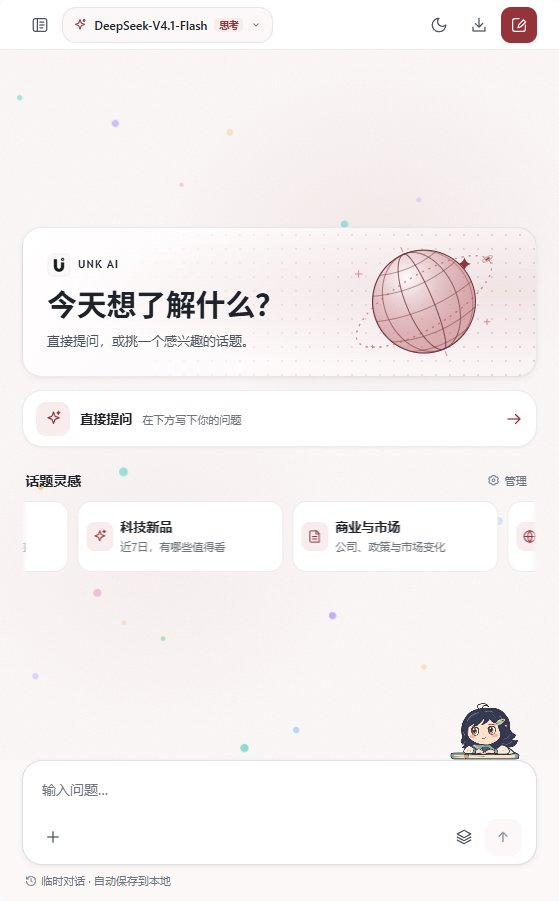
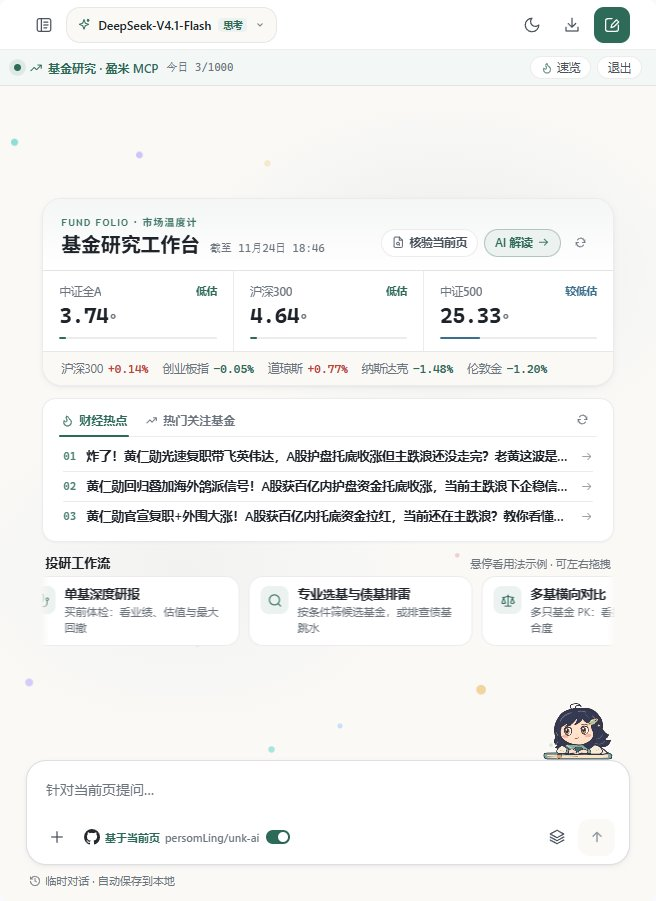

<div align="center">


# UNK AI

**Paper & Ink 温润纸感 Chrome 侧栏 AI 助手**  
边看网页边提问、多页对比、B 站视频笔记、基金研究工作台与本地化对话管理

[](https://github.com/persomLing/unk-ai/releases)
[](#开始使用)
[](#模型与数据)
[](#模型与数据)

[界面预览](#界面预览) · [核心能力](#核心能力) · [开始使用](#开始使用) · [模型与数据](#模型与数据) · [操作手册](docs/USER-GUIDE.md) · [更新记录](CHANGELOG.md)

</div>

---

UNK AI 是一个基于 Chrome 侧栏的本地优先 AI 助手，用于边看网页边提问、整理资料与沉淀长对话。支持接入自选的 OpenAI 兼容模型服务，会话与图片可自动同步保存到你的本地文件夹。

当前源码版本：**0.20.1**。已发布版本安装包与说明见 [GitHub Releases](https://github.com/persomLing/unk-ai/releases)。

## 界面预览

<table>
  <tr>
    <td align="center" width="50%">
      
      <br />
      <sub><b>纸墨日常欢迎页（酒红桃主题）</b><br />独立单字 Logo、话题灵感轮播与阅读搭子小笺</sub>
    </td>
    <td align="center" width="50%">
      
      <br />
      <sub><b>基金研究工作台 · 盈米 MCP（森苔绿主题）</b><br />市场温度计、财经热点速览、投研工作流与当前页核验</sub>
    </td>
  </tr>
</table>

## 核心能力

### 阅读、对比与视频笔记
- **网页阅读与多页对比**：结合当前网页、PDF 或 GitHub 源码提问，按资料缺口补读并查看来源；支持通过「＋ → 多页对比」或 `/compare` 勾选 2–4 个标签页联合提取并横向对比。
- **B 站视频笔记**：把 B 站当前视频 / 当前 P 的字幕写成一篇独立讲解。字幕有充足容量时直接成稿，分批预读时优先保留关键条件和对应原句；代码示例标明来源，关键时间码可回看原视频，支持「截帧」视觉审阅配图。
- **联网与页面操作**：按需搜索、核对来源（收尾协议异常时原地恢复重试，不重复检索）；在授权范围内辅助点击、输入和导航。

### 基金研究工作台（盈米 MCP）
- **只读投研工作台**：在设置中连接盈米 MCP，通过「＋ → 基金研究模式」或 `/fund` 打开工作台，查看当日市场温度、财经热点与热门关注基金。
- **结构化投研 SOP**：内置单基深度研报、专业选基与债基排雷、多基横向对比、持仓组合诊断回测、投顾策略追踪、家庭财务配置规划与费率交易日历，并支持一键核验当前浏览网页中的基金。数据工具为纯只读，模型服务需支持流式工具调用。

### 快捷交互与资料整理
- **快捷输入与右键直达**：在输入框键入 `/` 可选快捷指令；在网页选中文字后，可从右键菜单解释、中英互译或提炼要点。
- **图片、文档与生图**：支持上传与粘贴资料；图片可滚轮缩放、拖动查看、单击关闭预览，长文本可预览和编辑；支持聊天生图与参考图引用生图。
- **引用追问与 Skill 指南**：选中回答添加引用注释，或在可收起的独立窗口继续讨论；可导入单文件 `SKILL.md`，检查兼容性后用于本次提问。

### 视觉体验与本地会话管理
- **Paper & Ink 界面外观**：温润纸感视觉与独立单字 Logo，提供 6 套低疲劳护眼主题色与 6 种画布纹理；支持调整正文字号、字体、间距与阅读搭子小笺（含轻语互动）。
- **会话管理与回合导航**：分组、搜索历史，为每段对话记住模型，长对话提供右侧回合进度条与带序号/时间的预览卡片；支持导出 Markdown、图片或 PDF。
- **容量提示与自动整理**：查看下一次提问预估和最近请求的 Token 分类与环形容量圈，按输入预算自动整理较早记录。

## 开始使用

### 方式一：下载安装包（推荐）

需要支持侧栏的 Chrome。前往 [GitHub Releases](https://github.com/persomLing/unk-ai/releases/latest) 下载最新安装包（或使用本地打包生成的 `unk-ai-v0.20.1.zip`）：

1. 解压安装包，确认目录根部直接包含 `manifest.json`（包内附更新说明与离线操作手册）。
2. 在浏览器地址栏打开 `chrome://extensions`，开启右上角 **开发者模式**。
3. 点击 **加载已解压的扩展程序**，选择解压后的目录即可。

> 已安装 0.19.1 或更新版本时，可在「设置 → 版本更新」检查 GitHub 正式版本；更新时也可解压新包覆盖原目录后在扩展管理页重新加载。

### 方式二：从源码构建

需要 Node.js 22.12+：

```bash
npm ci
npm run build
```

构建完成后，按上述步骤加载 `dist` 目录。

### 第一次使用

1. 点击工具栏图标或按 **Alt + U** 打开侧栏，从历史区底部进入 **设置**。
2. 选择本地数据文件夹，填写 OpenAI 兼容模型服务地址与 API Key，添加模型；测试连接后点击 **保存设置**。
3. 普通知识或独立附件问题先关闭 **基于当前页**，阅读网页时开启；B 站视频先选好分 P，再点击「＋ → 视频笔记」，无需再按发送。

需要分享时使用顶栏下载菜单；需要围绕某段回答继续讨论时，选中正文使用引用或单独追问。

## 模型与数据

- **模型能力要求**：图片理解需要视觉模型，联网问答与基金研究需要模型服务支持流式工具调用。Token 数值为容量估算，不能直接用来计算账单。
- **视频字幕与画面识别**：视频笔记优先读取平台字幕，当前支持 B 站普通视频。B 站提示无字幕轨或字幕为空时，可确认「从画面识别字幕」——它独立采样原视频、不跳转播放器，需要支持图片输入的模型；结果不是完整字幕或语音转写。
- **聊天生图与视频配图**：在设置中选择默认生图模型后，点击「＋ → 生成图片」输入描述，或发送 `生图：一只蓝色小猫` 即可调用生图服务。点击已有配图的「引用生图」可带一张参考图继续生成（需要服务支持 `/images/edits`）。视频笔记的「截帧」独立解码原视频分片，视觉模型审阅通过的截图插在对应段落，观看可继续且配图保留实际比例。未选择默认生图模型时，明确的生图指令会在发送前提示配置，视频配图仅可选择关闭或截帧；文字问答、图片理解与画面字幕识别不需要生图模型。
- **数据流向与本地备份**：发送时，本轮使用的问题、历史、页面资料、附件、字幕或 Skill 内容会交给你配置的模型服务。会话可写入所选本地目录；备份时请一起保留 `conversations/` 和 `images/`，配置、API Key 与技能库保存在当前浏览器中。

## 开发与操作文档

| 命令 | 说明 |
| --- | --- |
| `npm run dev` | 监听源码并持续构建扩展 |
| `npm run check` | 运行全部项目测试与生产构建 |
| `npm run docs:build` | 根据操作手册生成带内嵌配图的离线 HTML |
| `npm run release` | 提交版本代码后，执行检查、打包、创建 tag 并推送 GitHub Release |

每个版本都会递增版本号，更新 [更新记录](CHANGELOG.md)，并发布对应的 `vX.Y.Z` tag、更新说明和版本包（发布命令需要 Node.js、PowerShell 7 与有推送权限的 GitHub Git 登录）。

常用操作、标注截图与问题速查见 [操作手册](docs/USER-GUIDE.md)，也可下载 [离线 HTML 阅读版](docs/USER-GUIDE.html) 独立打开阅读。
