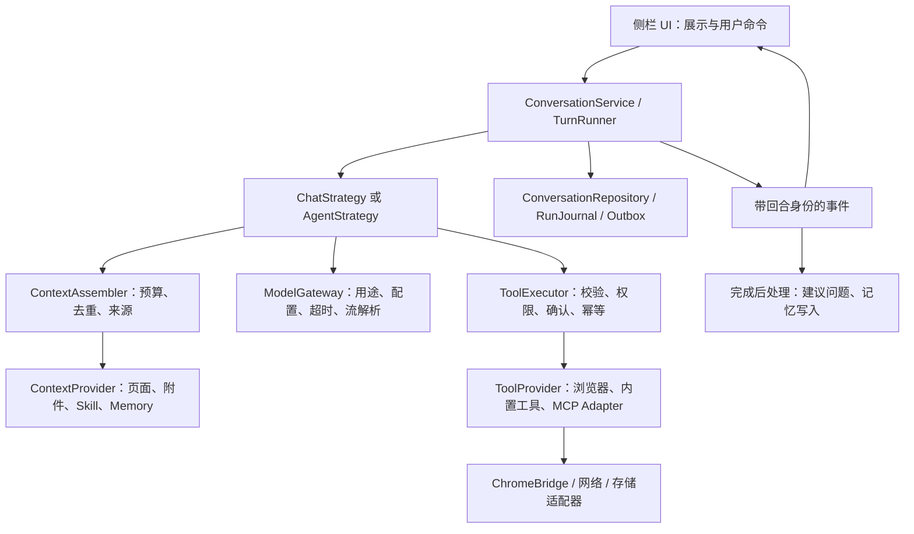

# UNK AI 可扩展架构与问答稳定性设计

日期：2026-11-02。适用：当前原生 JavaScript + Vite + Chrome MV3 项目。

**结论：保留插槽方向，建立“稳定的回合内核 + 有边界的能力扩展”。** P0 核心防护和 P1 普通问答内核已落地；发送、队列、重试及模型请求已经抽到应用服务，入口仍持有共享状态和 UI/浏览器/存储适配。

第 1 节保留改造前审计，第 2 节记录 P0；第 3 节之后为整体目标，P1 的实际 API、范围和验证以 [P1 交付说明](2026-11-02-p1-runtime.md) 与 [模块地图](MODULE-MAP.md) 为准。普通问答已接入 TurnRunner；Agent 动作循环迁移、ToolExecutor、MCP、Skill 和长期记忆仍待后续阶段。

## 1. 改造前源码审计：为什么容易牵动基础能力

| 观察 | 源码依据 | 影响与判断 |
| --- | --- | --- |
| 侧栏入口约 3200 行，集中持有提交、生成、压缩、队列、会话和保存状态 | `src/sidepanel/sidepanel.js`：`state`、`sendMessage`、`generateReply`、`regenerate` | 同一生命周期散落在多个函数，新功能容易遗漏其中一个分支 |
| 生产只装配 reading、visual、agent 三个插槽 | `composition/composition-root.js` | attachments/context 是辅助模块，已有名称不代表已接入 |
| 原注册表允许静默覆盖，组合对象却保留原实例 | `composition/slots.js` 与组合层 | 可导致两个调用方使用不同实现；是确认的架构缺陷，尚不能直接认定为用户所有重复回答的原因 |
| 纯附件提交在后期才创建回合，却未绑定错误收尾引用 | `sendMessage` 的 fallback 追加和 catch 分支 | 已复现：保存失败、模型请求为 0，但回复仍显示生成中，附件还回到草稿，容易重复重发 |
| 原队列只固定页面，没有固定会话 | `processQueue` 与 `queueItem` | 已复现：A 会话等待页面开关的队列，在 B 会话中被执行 |
| Agent 回调原来只查当前会话 | `activeAgentTurnMessage`、`endAgentTurn` | 已复现：暂停或终结期间切换会话，原任务的最终回复丢失；应以任务归属更新消息 |
| 授权增删各自读改写整个对象 | `src/utils/agent-permissions.js` | 已复现：并发增加丢授权，并发撤销/清理可能使旧授权复活 |
| 模型请求分散在客户端、视觉决策、摘要和 Agent 中 | `llm-client.js`、`auto-visual-slot.js`、入口 `summarizeTextWithModel` | 配置快照、超时、预算和请求用途缺少统一约束 |
| Agent 工厂创建 DOM 和浏览器监听，没有 dispose | `features/agent/agent-slot.js` | 当前不能安全热替换；旧监听和新实例可能并存 |

审计前项目测试 **620 项通过**。新增故障复现说明：已有测试是有效基础，但缺少组合场景。不能把“全绿”理解为供应商、真实站点和浏览器生命周期均已验证。

应保留的已有机制：页面 `tabId/URL/documentId` 校验、每轮来源元数据、取消和 request owner、Agent 后台执行许可与动作幂等、结果不明不重放、会话 outbox 与目录绑定。这些是新架构的基础，不应在重构时丢掉。

## 2. P0 已落地范围

| 防护 | 当前行为 | 验证入口 |
| --- | --- | --- |
| 插槽契约与封存 | 初始注册、register、replace 都验证真实方法；重复注册报错；replace 只能在装配期间、seal 前；生产装配 seal 后不允许改写公开方法或替换实例 | `slots.test.js`、`composition-root.test.js` |
| 附件回合完整收尾 | 只发附件的回合也绑定本轮 user/assistant；保存失败变成明确错误，不同时保留空转回复和重复草稿 | `submission-lifecycle.test.js` |
| 队列会话归属 | 记录 conversationId；首会话创建期间按提交 owner 绑定；切换会话后保留原队列并显示等待原因，回到原会话再执行 | `submission-lifecycle.test.js`、`queue-page-scope.test.js` |
| Agent 回调与保存归属 | 独立回调模块绑定 taskId、conversationId、messageId；切换会话仍更新原回答；重复完成不覆盖终态；延迟保存固定会话，临时会话晋升与新建进入同一保存队列 | `agent-callback-ownership.test.js`、`conversation-save.test.js` |
| 授权并发写入 | 同扩展 origin 的 Web Lock 覆盖完整读改写；调用者超时不会提前释放尚未完成的写锁 | `agent-permissions.test.js` |
| 开发入口与约束 | 根 `AGENTS.md` 写明实际边界、修改原则和回归要求；`npm test` / `npm run check` 提供统一检查入口 | `AGENTS.md`、`package.json` |

这里的封存是可信模块的代码约束，不是第三方代码沙箱。P1 已补充同步/异步工厂失败、初始化超时及释放隔离；静态模块导入错误、死循环和越权代码不属于该隔离机制的保障范围。无 Web Locks 的回退只保证同一模块实例串行，不承诺多个文档间互斥。

本次抽出的 `features/agent/agent-turn-callbacks.js` 与 `features/storage/conversation-save.js` 是回合归属的第一步，还不是完整 TurnRunner。旧 Agent checkpoint 缺少 conversationId，恢复只能依据实际匹配的会话消息建立关联；跨关闭/重开的全面恢复仍在 P2 补齐。`saveAgentSettings` 的配置整对象并发 patch 尚未统一到权限写入仲裁，留待后续存储整理。

## 3. 目标结构：一个回合内核，四类扩展口



| 层 | 拥有的职责 | 禁止越界 |
| --- | --- | --- |
| UI | 输入、队列展示、确认面板、流式渲染 | 不构造模型请求，不决定回合是否完成 |
| 应用内核 | 命令去重、会话归属、状态迁移、取消、唯一最终提交 | 不依赖 DOM，不按具体 MCP 服务写业务分支 |
| 执行策略 | 普通问答或多步 Agent 的推进规则 | 不创建第二个主回复，不直接保存全局当前会话 |
| 能力层 | 返回上下文块、工具定义、工具结果或完成后任务 | 不修改 `conversation.messages`、全局生成状态和发送按钮 |
| 基础适配器 | 模型连接、Chrome 桥接、磁盘/IndexedDB、网络 | 不依赖侧栏 UI，不反向调用发送流程 |

四类扩展口分别是 **ContextProvider、ToolProvider、ExecutionStrategy、PostTurnEffect**。不要把 Agent、MCP、Skill、Memory 全部设计成具有任意钩子的同一种插件。

普通聊天默认选 ChatStrategy；用户明确选择页面操作才进入 AgentStrategy。增加 Memory 或 Skill 不得暗中把聊天升级成浏览器操作。

## 4. 回合内核：只允许一个主回答出口

### 4.1 身份与归属

| 标识 | 含义 | 生命周期 |
| --- | --- | --- |
| commandId | 一次提交事件，阻止同一命令重复消费 | 排队前生成，重入沿用 |
| conversationId | 归属会话 | 提交时固定；首次会话准备期间先绑定提交 owner |
| turnId | 一个用户问题及其回答位置 | 重试沿用问题归属 |
| runId | 一次执行尝试 | 用户重试创建新值，旧 run 立即失效 |
| toolCallId | 一次具体工具调用 | 同一调用重送沿用；新决策生成新值 |
| eventId / seq | 回合内事件身份及单调顺序 | 用于丢弃重复或乱序事件 |

每个 run 固定：模式、模型配置、页面目标、附件快照、启用能力和预算。不能等异步操作回来后再读取“现在选中的模型/页面/会话”替换本轮依据。

当前 1200ms 发送指纹只防快速双击，不是持久化幂等协议。重复文字不代表重复命令；用户主动再次提问必须允许。

### 4.2 状态机

```text
queued → preparing → running → committing → completed
                         ↕
                 waiting_approval / paused

queued / preparing / running / waiting_approval / paused / committing（原子提交前）
  → cancelling → cancelled
  → failed
```

`reading/compressing/waiting-model/reasoning/tool-running` 是阶段信息，不应再增加互相矛盾的全局布尔值。committing 准备不可变最终快照；在带 runId/version 条件的原子提交点核验许可、写入终态及持久任务。提交前失败或取消进入 failed/cancelled；提交成功后进入 completed，迟到的停止或错误不能改写终态。同步到文件夹的成功/待同步状态与模型回答状态分别记录，outbox 之后的同步失败不重新打开已完成回合。

内核对事件执行四步：核验 conversationId/turnId/runId → 检查执行许可 → 检查 seq/终态 → 提交消息更新。渲染和保存只消费被接受的事件。

### 4.3 结束、重试与取消

- 主回复只能由 `TurnRunner.commitResult(runId, result)` 创建/完成一次。Chat 返回最终文本；Agent 返回有依据的结果；工具只返回工具结果。
- 辅助建议、摘要、记忆写入不能再次调用主回复出口。只有 reasoning、没有可见正文时，必须明确标记空回答或中断，不能显示成功。
- 失败、超时、停止都必须使可见回合进入终态并释放界面占用。迟到 I/O 可以收尾，但不得重新启动模型、追加回复或清空新一轮锁。
- 重试保留原问题及来源范围，生成新 runId；不重放已执行的页面动作。普通聊天重试不进入 Agent；Agent 重新开始必须重新观察和授权检查。
- 取消传播给读取、模型和可取消工具；已经提交的外部写操作不能假装撤销，记录真实完成结果或 `outcome_unknown`。
- 保证应用内单次最终提交，不声称网络请求和外部系统具有绝对 exactly-once。结果不明的写工具不得自动重试。

## 5. 扩展契约与装配规则

以下是下一阶段的协议草案，用于明确字段，不代表项目已经切换 TypeScript。

```ts
type RunContext = Readonly<{
  conversationId: string; turnId: string; runId: string;
  signal: AbortSignal; deadlineAt: number;
  mode: 'chat' | 'agent'; model: PublicModelCapabilities;
  target?: PageTarget; budget: RunBudget;
}>;

type ContextBlock = {
  id: string; providerId: string; content: string;
  source: { kind: string; url?: string; capturedAt?: string };
  trust: 'user' | 'configured-skill' | 'external-data';
  priority: number; truncated: boolean;
};

interface ContextProvider {
  id: string; apiVersion: 1;
  collect(input: TurnInput, run: RunContext): Promise<ContextBlock[]>;
}

interface ToolProvider {
  id: string; apiVersion: 1;
  listTools(context: DiscoveryContext): Promise<ToolDescriptor[]>;
  execute(call: ValidatedToolCall, run: RunContext): Promise<ToolResult>;
}

interface ExecutionStrategy {
  id: string; apiVersion: 1;
  run(input: TurnInput, context: RunContext, ports: StrategyPorts): Promise<RunResult>;
}

interface PostTurnEffect {
  id: string; apiVersion: 1;
  run(snapshot: Readonly<CommittedTurn>, context: EffectContext): Promise<EffectResult>;
}
```

RunContext 只暴露脱敏的模型标识、能力和预算；API Key、完整连接配置与凭据由 ModelGateway 私有持有。StrategyPorts 只提供受限模型调用、工具执行和进度事件，策略返回 RunResult，由内核提交终态。EffectContext 使用独立的配额与取消信号，只能调用对应辅助服务，不能获得 commitResult 或可写消息仓库。

必需性、阶段、超时和配额由主程序的 CapabilityPolicy 声明；插件不得自行宣称“必需”“已获授权”或提升权限。运行时校验参数/返回值，不能只依赖 JSDoc 或类型声明。

注册规则：唯一命名空间、兼容的 apiVersion、明确 dependsOn、依赖无环、确定的装配顺序。装配结束封存；本阶段不支持热替换。未来确需卸载时，先实现 `initialize/dispose`、监听清理和在途任务终止，再开放卸载。

可选插件初始化、发现或执行失败时，应隔离该能力并记录原因；基础聊天仍可用。必需内核契约失败时明确报告启动错误，不能以半初始化状态继续接请求。P1 已通过 CapabilityHost 与 ContextAssembler 实现工厂/上下文失败隔离；通用工具发现仍在后续阶段。

## 6. 各类 AI 能力如何接入

| 能力 | 扩展位置 | 如何不影响基础问答 |
| --- | --- | --- |
| Agent | ExecutionStrategy，通过 ToolExecutor 推进循环 | 单一回合、有限步数和时间；完成结果交给内核；沿用后台动作许可 |
| 内置工具 | ToolProvider | schema、权限、执行结果、重试语义都随工具声明，不改发送流程 |
| MCP | ToolProvider 下的 transport adapter | 发现、连接、鉴权、取消和断线限制在适配器；远端工具进入统一执行器 |
| Skill | 受控配置 + ContextProvider | 只提供任务说明、提示片段、可请求的工具集合和参数默认值，不直接执行脚本 |
| Memory | ContextProvider + PostTurnEffect | 检索可降级；写入在成功提交后排队，失败不阻断当前回答 |

### 6.1 ToolExecutor 与 MCP

调用路径固定为：发现并注册 → 参数校验 → 权限与用户确认 → 记录意图 → 执行 → 校验/裁剪结果 → 记录结果 → 返回策略。内部工具身份使用 provider/server/tool 命名空间，避免与 `finish_task`、`read_page` 等内置名冲突；发往模型前映射成该供应商允许的函数名，并保存双向映射，不能假定服务允许斜杠或任意长度。

ToolDescriptor 至少包含：输入 schema、输出限制、read/write 分类、权限范围、是否需要确认、timeoutMs、是否幂等、是否支持取消。远端 MCP 自报的工具注解只能作为参考，本地策略决定实际权限。MCP 结果、网页和文件中的文字都是数据，不能自行修改权限、注册其他工具或触发写操作。

DiscoveryContext 携带取消信号与截止时间。每个 run 固定本轮可用工具、服务身份和 schema 版本；发现列表更新只影响下一轮。服务定义在确认后变化时，拒绝沿用旧确认执行，重新校验并按需重新确认。

现有浏览器工具仍由后台 `agent-service.js` 校验任务 epoch、目标、站点授权和动作安全；工具注册不能绕过这层。将浏览器动作和任意 MCP 操作全部塞进 `agent-schema.js` 的分支会继续扩大耦合，应逐个迁移到工具描述与执行器。

扩展可设计远端 HTTP MCP 适配器；本机 stdio 服务需要单独的本地桥接/Native Messaging host，不能直接从 MV3 启动本机进程。远端能力断开时停止其在途调用或标记结果不明；不要自动重试写操作，也不要让服务发现卡住聊天启动。

### 6.2 Skill

建议 SkillManifest 包含 `id/version/description/instructions/allowedTools/contextBudget`。启用哪些 Skill 由用户配置和当前任务策略决定；工具许可取 **Skill 请求范围 ∩ 用户授权 ∩ 内核策略**，Skill 文本不具有授权效力。

Skill 内容带版本和来源进入上下文预算，避免一次装入所有 Skill。可选 Skill 加载失败使用基础聊天并展示简短提示；用户明确要求某 Skill 而不可用时应说明缺口。初期只支持声明式 Skill；执行脚本是另一种受控工具能力。

### 6.3 Memory

区分会话历史、任务临时状态和长期记忆。历史压缩摘要不是长期记忆库；当前项目的 `pageContext` 单份正文也不是历史网页归档。

建议 MemoryRecord 保存 `id/scope/content/sourceTurnId/sourceRunId/createdAt/expiresAt/schemaVersion`。scope 至少区分会话、项目/站点和用户，读取时按授权范围过滤；不把 API Key、表单草稿、工具凭据或整页正文自动写成长期记忆。

检索有独立条数、字符和时间上限；去重后与页面、附件统一预算。检索失败可省略记忆。记忆新增、覆盖、删除由用户策略控制；成功回合后产生候选/写入任务，按 `(memoryPolicyVersion, sourceRunId, candidateId, operation)` 幂等提交，允许同回合产生多个候选。重试成功时，先标记旧 run 的未确认候选失效；已确认记忆只能依据 stableMemoryId 提议修订，不能无声覆盖。错误或停止的回答不自动沉淀成事实。

提供记忆查看、编辑、删除、导出和作用域设置；删掉记录时同步移除检索索引。先用本地结构化记录实现规则检索，再依据实际需要加入向量索引，无需先引入数据库服务。

## 7. 请求、预算、失败与存储

### 7.1 ModelGateway

统一封装现有 `llm-client.js`，按 `purpose` 区分 `answer/agent-decision/visual-decision/compression/suggestions`。每次请求带 runId、配置快照、超时、取消信号、输入与输出预算；日志只记用途、阶段、耗时、状态和估算用量，不记 API Key 或完整私密正文。

SSE 解码器只处理传输协议，不创建消息或读 UI 状态。供应商能力降级只能发生在明确的请求拒绝且未接受响应时；不要在已产生正文后自动重发整个请求。Agent 多步模型决策允许多次请求，但仍只有一个主回答提交。

ContextAssembler 统一给系统约束、当前问题、必要工具定义、历史、页面、附件、Skill 和 Memory 分配预算。为回答预留输出空间；保留来源和截断标记。可选上下文不能挤掉当前问题，必需数据无法容纳时报告错误。现有 token 估算应如实显示为估算。

### 7.2 故障处理表

| 故障 | 应用行为 |
| --- | --- |
| 用户要求读取的当前页失败/身份变化 | 本轮明确失败，不使用旧页面替代 |
| 自动视觉建议、可选 Memory/Skill 超时 | 跳过该能力并给出必要的缺口提示，不阻断普通问答 |
| 主模型空回答、断流、超时 | 保存已有文本，显示失败/中断，释放占用，允许用户重试 |
| 辅助建议问题失败 | 主回答保持成功；不生成第二条助手消息 |
| 写工具超时且执行结果不明 | 记录未知结果，重新观察/查询状态或请求用户处理，禁止自动重放 |
| 文件夹写盘失败 | 保存到 outbox，显示待同步；不因此重新调用模型 |
| 可选插件初始化失败 | 该能力不可用，基础聊天可启动；此行为在 P1 实现 |

### 7.3 保存与浏览器生命周期

ConversationRepository 以 conversationId 接收更新，RunJournal 记录运行身份和关键状态；UI 当前打开哪个会话与保存目标无关。保留现有 outbox、写入版本确认和原目录绑定，不让旧保存完成覆盖新状态。

Agent checkpoint 后续必须携带 conversationId/turnId/runId/taskId/epoch。恢复时先定位原消息，再与后台许可对账；无法定位则显示可恢复记录，不能把任务接到当前会话。首次实现不自动恢复具有副作用的动作。

MV3 Service Worker 会被回收，侧栏关闭也会终止当前侧栏循环。持久化状态不等于常驻执行。下一阶段继续采用侧栏驱动、后台裁决的模式；只有产品明确需要无人值守长任务时，再评估独立常驻执行服务。

## 8. 建议目录与迁移方式

以下为目标目录，**尚未全量创建**。新目录随真实迁移创建，不提前堆空壳。

```text
src/
  app/                    # TurnRunner、ConversationService、策略与上下文编排
  domain/                 # 回合状态机、事件与数据模型；不依赖 DOM/Chrome
  contracts/              # Context/Tool/Model/Storage 接口与运行时校验
  capabilities/
    reading/ attachments/ visual/
    browser-agent/ mcp/ skills/ memory/
  adapters/
    model/ chrome/ storage/ network/
  sidepanel/              # 展示、交互、presenter
    composition/          # 唯一装配入口；选择具体实现
  background/             # 消息桥、权限、浏览器动作仲裁
  content/                # DOM 提取和执行前校验
```

依赖方向：UI → app → domain/contracts；capabilities/adapters 实现 contracts；composition 负责连接。domain/contracts 不反向依赖 UI、feature 或 Chrome。

暂不引入 React、全局事件总线、通用 DAG 引擎或外部 Agent 框架。项目当前问题是归属和生命周期边界；先通过显式接口解决。需要增强类型时，先给新契约添加 JSDoc 和检查，再按模块评估 TypeScript。

## 9. 分阶段交付与准入标准

| 阶段 | 交付 | 验收及下一步条件 |
| --- | --- | --- |
| P0：本次核心防护 | 插槽封存、附件/队列修复、Agent 回调与保存归属、授权并发保护、开发规则、回归测试 | 原有测试与新增回归通过，构建成功；不宣称已完成全量解耦 |
| P1：稳定回合内核（已落地） | 普通发送/队列/重试委托 ConversationService；主回复经 TurnRunner/Repository/ModelGateway；可选工厂和上下文隔离 | fake model/storage/clock 下验证终态、取消和重复事件；禁用全部可选能力仍能聊天；范围见 P1 交付说明 |
| P2：工具与 Agent | ToolRegistry/Executor；将已有 browser Agent 作为首个策略与工具集迁移；checkpoint 补齐归属 | 既有浏览器权限、租约、幂等、接管测试全部保留；写操作结果不明不重放 |
| P3：MCP、Skill、Memory | 先单个只读 MCP，再声明式 Skill，再可关闭的记忆检索和写入 | 每个能力单独开关与回退；失败注入不影响基础聊天；写工具经权限验收后开放 |

每一步用旧接口委托新实现，先迁移普通无页面聊天，再迁移页面/附件、重试/队列，最后 Agent。每轮拆分保持用户可见行为，禁止同时重写 UI、存储格式和 Agent 协议。迁移开关只用于回退，不允许旧新两条主问答链路同时消费一次提交。

新增能力的常规改动应限于能力目录、组合根声明、契约与对应测试。确实需要改基础流程时，先给出破坏的不变量和故障复现，再修改并回归；不是遇到核心文件就反复向用户申请权限。

## 10. 回归矩阵与可观测性

| 场景 | 必须验证的结果 |
| --- | --- |
| 双击发送、Enter/click 同时触发 | 同 commandId 只消费一次；有意的下一次提交仍可用 |
| 附件/选区无正文、配置失败、保存失败 | 有明确错误或保留草稿；不能出现无人拥有的 streaming 气泡 |
| 队列等待时切换会话/页面 | 仍属于原会话和原页面，绝不串源 |
| 停止后立刻发送、重试后旧流返回 | 旧回调不改新消息、不解锁新执行、不再触发工具 |
| 流片段拆边界、重复终态、只有思考、半途断流 | 解析与回合状态一致，终态最多提交一次 |
| 可选插件不响应、抛异常、返回超大数据 | 按配额/超时降级，基础聊天可继续 |
| Agent 暂停/完成期间切会话 | 原回合收到结果并保存，不在新会话生成回复 |
| 工具重复投递、许可过期、后台重启 | 不重复动作，恢复前重新检查，不重放未知结果 |
| 记忆检索/写入失败、Skill 版本变化 | 主回答可完成；去重和版本来源可追踪 |
| 授权并发清理、新增和撤销 | 不丢更新，不恢复已撤销的授权 |

测试分三层：纯状态/契约测试；注入 fake model、Chrome、storage 的行为测试；真实扩展端到端冒烟。当前部分测试从入口截取函数在 VM 运行，容易受重命名影响；P1 抽离模块时改为直接导入测试，减少只检查源码文本的断言。

每次变更运行 `npm run check`。真实扩展发布前至少手测：纯聊天、附件、页面开关与队列、停止/重试、Agent 接管/恢复、切会话、文件夹待同步。Node 测试和构建不替代这些检查。

诊断事件统一记录 `conversationId/turnId/runId/purpose/stage/status/duration/errorCode`。提供本地可导出的脱敏运行记录，区分“准备失败、模型没返回、显示没更新、保存没完成”；不要为了排查而默认记录完整提示词和页面内容。

P1 的验收标准是：故意抛错或挂起的可选 ContextProvider 不阻断普通聊天；同一生成入口重复调用不清空正文、不重复提交；停止旧 run 后迟到回调不能改变新 run。P2 再验收“加入受控工具无需修改普通发送/生成核心”。以可执行标准约束稳定性，不承诺任何新功能都绝不会出错。

## 11. P0 验证结果（历史基线）

执行 `npm run check`：**650 项测试通过，0 失败；Vite 构建成功**。完整记录见 [检查日志](../output/architecture-check-20261102.log)。

新增覆盖包括附件保存失败、首次创建会话期间排队、切回原会话继续队列、插槽实例一致性、跨模块授权读改写、Agent 跨会话最终回复、同 ID 重载后的旧定时器覆盖、临时会话晋升竞态及原会话读取超时。

P0 当时构建提示部分产物超过 500 kB，侧栏主包约 682 kB（压缩前）；当时未进行真实扩展与实际模型供应商的端到端验收。P1 最新测试、构建和真实 MV3 可控模型冒烟范围见 [P1 交付说明](2026-11-02-p1-runtime.md)，包体积优化仍待后续处理。
