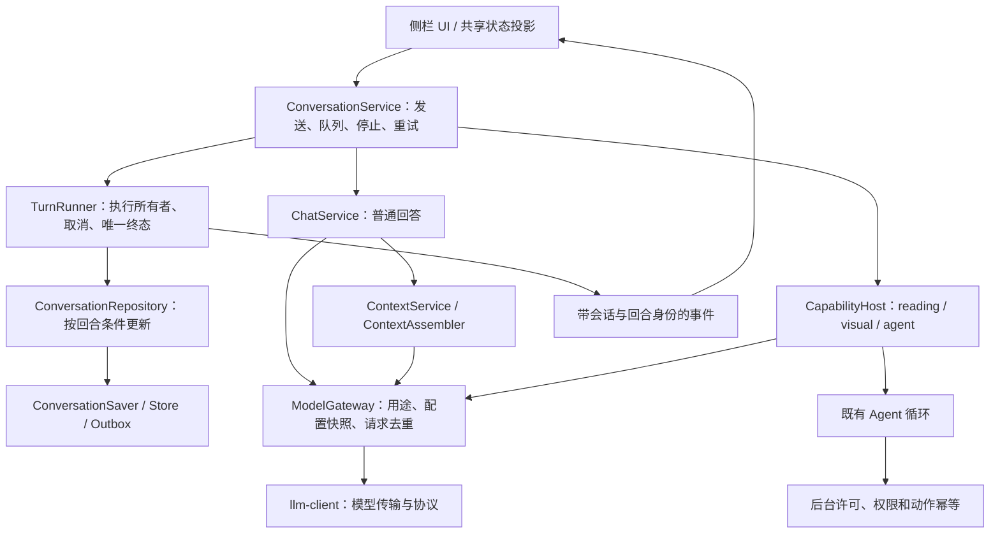

# P1 交付：普通问答运行内核与扩展隔离

日期：2026-11-02。适用于当前原生 JavaScript、Vite、Chrome Manifest V3 项目。

## 1. 交付结论

P1 已接入真实生产链路。普通发送、队列、停止和重试通过应用服务执行；主回复统一管理归属、取消、流事件和最终提交；五类业务模型请求共用 ModelGateway。可选能力工厂或补充上下文失败，可以降级而不拖垮基础聊天。

这次解决的是扩展边界和生命周期，不是增加 MCP、Skill 或长期记忆产品功能。现有受控浏览器 Agent 保留观察、决策、确认、动作、再观察的闭环；工具执行器与完整恢复协议仍在 P2。

## 2. 当前架构



图中仅普通回答的终态由 TurnRunner 提交。Agent 仍通过原任务回调维护消息，并由后台仲裁页面动作；不能把这张图理解为 Agent 已全面迁入统一执行器。

## 3. 本次落地

| 组件 | 已实现行为 | 开发收益 |
| --- | --- | --- |
| ConversationService | 提取发送、准备、队列、停止、重试；保留固定会话/页面、附件及原位重试规则 | 功能扩展不再复制侧栏发送逻辑 |
| TurnRunner | 单个活动普通回合、command 去重、总截止时间、事件顺序、一次终态；释放后拒绝新执行 | 旧回调不能解锁或覆盖新回合 |
| ConversationRepository | 按 conversationId/turnId/runId/assistantId 更新；替换重试、跨会话保存与重载校正 | 保存与消息更新不依赖“当前显示的会话” |
| ChatService | 主回复全程幂等；正文、思考、来源、空回复判定；成功后独立建议问题 | 重复生成入口不会清空已输出正文或再发一次建议请求 |
| ModelGateway | 私有冻结连接配置；五种用途；独立超时、取消、请求去重和脱敏事件 | 辅助请求不能取得主回答流回调 |
| ContextService | 分块压缩、预算、取消、有界失败；保存只报告请求已调度 | 压缩不可用仍能按容量限制回答，父回合取消不被吞掉 |
| ContextAssembler | provider 初始化、来源校验、去重、排序、预算、必要/可选失败策略 | 后续补充资料可沿明确接口接入 |
| CapabilityHost | 同步/异步工厂隔离、初始化期限、稳定代理、清理回调和释放 | 一个可选工厂失败不会阻断其余能力和普通聊天 |
| 实际入口与 UI | 委托应用命令、订阅有效事件；最新回合绘制；双击发送不误停；不可用 Agent 状态；关键启动读取有界、主题失败回退 | 不再保留第二套普通生成实现 |

Agent 和自动视觉已经使用实际 ModelGateway。Agent 当前任务在侧栏内暂停/继续时沿用原配置；旧 checkpoint 在新侧栏首次明确继续时，才冻结当时配置。凭据不写入 checkpoint。Agent 的 DOM、Chrome 及临时确认监听在释放或工厂部分失败时回收。

## 4. 主回复与失败规则

一次提交只选择普通回答或页面操作。普通回答固定回合引用，所有流事件通过运行身份与序号校验。重复调用整个生成入口复用原执行，初始化正文和结束后建议也只运行一次。

真实 Chrome 冒烟还复现了界面层误停：发送按钮变成原位置的停止按钮后，双击第二下以 `detail: 2` 落到停止，模型尚未请求就留下空的已停止回答。本次拦截这次重复手势，独立单击或键盘停止保持有效。这是“发送后没有回答”的一个已确认原因，不代表其他供应商或页面故障都由它引起。

主模型空正文、仅思考、断流和超时不当作成功；部分正文保留，不能自动重放整个请求。停止会解除等待并阻止下一步请求，但不撤销已经执行的浏览器动作或排入存储队列的写入。

可选 provider 抛错、超时或返回不合格资料时记录问题并继续；明确必需 provider 失败时结束本轮，模型请求为零。补充文本以用户资料进入剩余上下文预算，保留来源和截断说明，不能覆盖系统约束或挤掉当前问题。

最终消息提交和文件夹同步仍是两个状态。终态提交完成后，保存调度异常会单独报告；不重开回答，也不假称文件已保存。建议问题失败不改变回答成功状态。

## 5. 后续功能怎样接入

### 补充上下文

在能力目录实现 provider，由 `application-root.js` 的 `contextProviders` 显式注册。生产默认列表为空；本次没有放入空的 Memory 或 Skill 实现。

```js
{
  id: 'local-reference',
  required: false,
  timeoutMs: 2000,
  maxChars: 8000,
  maxBlocks: 8,
  collect: async (input, run) => [{
    id: 'reference-1',
    content: '已核实的参考资料',
    source: { kind: 'local-reference', title: '参考记录 1' },
  }],
}
```

这里只说明现有描述符格式；实际能力必须处理 `run.signal`、截止时间和自己的数据权限。可选工厂通过 `create(lifetime)` 注册清理；外部内容始终是数据，不能修改必需性或授权。

### 模型请求

统一使用 `gateway.createRun({ runId, profile, signal, deadlineAt })`，再调用 `modelRun.request({ requestId, purpose, messages, ... })`。purpose 仅为 `answer`、`agent-decision`、`visual-decision`、`compression`、`suggestions`。

同一 modelRun 中，相同 requestId 必须是同一用途与有效载荷；重复调用沿用首次信号和回调。新步骤、修正决策、显式重试使用新标识。Gateway 不自动重试业务请求，原有供应商明确拒绝时的兼容分支保留在底层传输。

### 工具、MCP、Skill 和记忆

P2 先建立 ToolRegistry/ToolExecutor，声明参数、读写性质、权限、超时、结果上限和安全重试语义，迁移现有浏览器工具并补全 checkpoint 归属。P3 再接只读 MCP、声明式 Skill、可关闭的记忆检索和写入。

不能把 MCP 随意塞进现有浏览器动作枚举；不能让 Skill 执行任意脚本；记忆不能当作动作已经完成的凭据。

## 6. 兼容与尚未迁移

- 入口仍持有共享 state、UI 事件和部分浏览器/存储适配；应用层还复用 feature 下的纯辅助规则，并未完成所有目录分层。
- 原页面和附件准备流程继续使用，尚未全部转换成 ContextProvider。来源仍是每轮小元数据加会话当前完整正文，不是历史网页全文档案。
- 新消息增加可选的 turnId、runId、runRevision、terminalRunId；旧记录不重置、不批量删除，沿原读写兼容路径使用。去重与运行索引限于当前侧栏生命周期，不提供跨崩溃的分布式 exactly-once。
- Gateway 的超时与用途预算不等于累计 token/费用配额；诊断事件 API 已有，持久 RunJournal 和可导出运行日志仍未实现。
- 工厂隔离不是第三方代码沙箱，不能容忍主线程死循环、任意全局写入或静态 import 错误；没有运行时热替换产品接口。
- Agent 循环仍依赖侧栏存活；侧栏关闭后不支持无人值守持续执行。

## 7. 验证记录

测试直接组合真实应用模块，仅替换网络、Chrome、存储和时钟。覆盖普通提交、队列/重试、必需/可选失败、停止后重发、跨会话、乱序/重复事件、唯一终态、迟到流、释放后命令、压缩等待和保存归属。旧生命周期测试已从截取入口函数改成直接导入服务；保留少量 UI 适配测试。

最终 `npm run check`：**782 项测试通过，0 失败；Vite 构建成功**。完整记录见 [P1 检查日志](../output/p1-check-20261102.log)。构建仍提示侧栏主包超过 500 kB，当前约 724 kB（gzip 约 238 kB）；本次没有承诺完成按需加载或包体积优化。

已在隔离 Chromium profile 中加载实际 `dist` MV3 扩展，以真实 Chrome API 和本地可控模型服务进行冒烟。双击发送验证为一次主模型请求、一个用户消息和一个完整回答，建议问题是独立辅助请求；独立停止中断旧请求并保留已有片段，随后新问题正常完成，页面无 JavaScript 错误。修复前后截图及详细记录位于 `output/playwright/p1-architecture-smoke/`。

另在真实扩展中注入 Agent 监听注册后抛错：已获取的监听得到清理，页面操作按钮禁用并显示不可用原因，普通聊天仍完成一次主回答与独立建议请求，页面无 JavaScript 错误。完整过程和截图见 [浏览器验收报告](../output/playwright/p1-architecture-smoke/browser-report.md)；隔离浏览器与本地模型服务已关闭。

这覆盖实际扩展启动、界面交互和可控模型传输，不等于全部真实模型供应商、文件夹权限、页面动作与 MV3 后台回收场景都已实测。

模块定位见 [MODULE-MAP](MODULE-MAP.md)，完整目标见 [架构设计](2026-11-02-ai-architecture.md)，开发约束见 [AGENTS](../AGENTS.md)。
