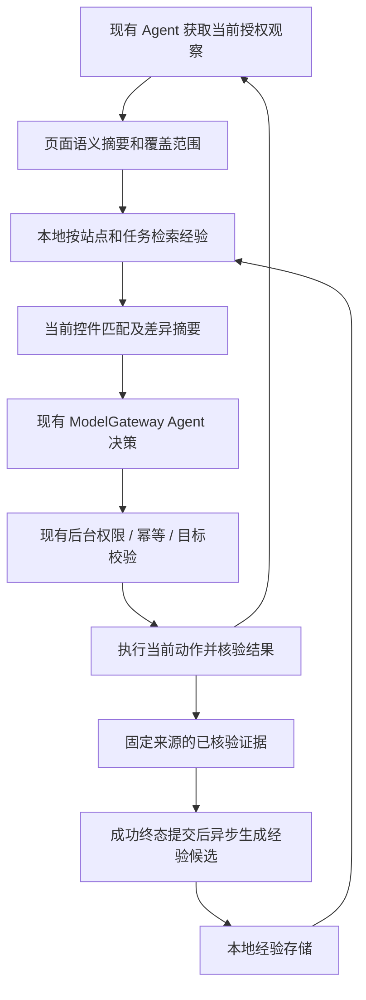

# 浏览器操作经验记忆方案与现状审查

日期：2026-11-06。基线：UNK AI 0.18.1。本文是设计与审查结果，未实现记忆功能，也未修改浏览器执行代码。

后续进展：用户要求优先修复后，R1–R5 已进入独立修复交付，当前行为与验证范围见[浏览器操作边界修复](2026-11-06-agent-boundary-fixes.md)。本文的缺陷定位和复现输出保留审查时基线，记忆部分仍为方案。

建议先修复执行/观察边界，再增加本地「页面语义档案 + 已核验操作经验 + 参数化流程」。记忆帮助模型更快理解当前页面，执行继续经过现有 Agent、后台权限检查和当前快照校验。第一版不需要引入向量数据库、独立后端或替换整套浏览器 Agent。

## 1. 用户会得到什么

以图片生成页面为例，首次任务完成后可以形成以下经验：

- 页面有模型下拉框、动画开关、参考图上传区、提示词输入框和生成按钮。
- 「参考图」上传后出现匹配预览，说明该页面接收了文件；不能据此声称服务器生成成功。
- 一个成功流程可能是：选择模型 → 核对动画选项 → 上传本次参考图 → 填写本次提示词 → 确认生成 → 核对生成结果。
- 下次来时，先读取当前控件，发现模型选项增加、生成按钮改名或输入框移动，只重新理解受影响部分。
- 提示词、上传文件和具体业务数据是本次任务参数，不自动变成以后重放的固定值。

界面建议提供「记住本站操作经验」开关、经验列表、来源与上次核验时间、编辑/删除/导出。任务中可显示：「找到相似流程；当前 5 个相关控件中 4 个匹配，1 个需重新确认」。覆盖不足时显示「当前仅观察到部分控件」，不能宣称整个页面没有变化。

第一版学习插件已执行且核验过的任务。用户亲手操作的学习另设显式「演示模式」：开始演示后才记录，结束后预览经验。当前手动输入会触发 Agent 接管，不能把自动执行模式里的接管监听改成常驻行为录制。

## 2. 目前项目已经具备的基础

已阅读 README、MODULE-MAP、现有架构设计及 Agent/权限/观察/核验相关代码和测试。

| 当前能力 | 可复用内容 | 不能直接当作长期记忆的原因 |
| --- | --- | --- |
| `src/content/agent-scanner.js` | 控件类型、名称、位置区域、选中/展开状态、滚动容器、节点引用、动作前校验 | `eN` 属于快照；`stableKey` 是当前文档里的 WeakMap 节点身份，刷新或替换节点就变化 |
| `src/background/agent-service.js` 与 `src/utils/agent-runtime.js` | 任务执行许可、动作串行、幂等记录、固定页面、主/子文档检查 | 是执行边界，不是经验检索库；仍有本次审查发现的竞态 |
| `features/agent/action-verification.js` | 从新观察核对控件效果，区分输入匹配和业务结果 | 保守依赖当前目标；不能把可见变化一律当作业务完成 |
| `src/utils/agent-evidence.js` | 当前任务前后观察比较、正文与来源、忽略部分无关变化 | 是同任务反馈，不是跨访问页面版本比较 |
| `features/agent/task-progress.js` | 子目标、核验记录、无进展恢复和有界停止 | 计划是任务状态，不能直接当成每一步都已完成的证明 |
| `agent-slot.js` 的 `saveAudit` | 最近 10 个任务的摘要、最多 40 条步骤与耗时 | 缺少长期语义索引、参数化流程、版本及控件证据契约；日志不能反推完整事实 |
| `features/page-reading/network-reading-cache.js` | 来源绑定、过期、语义签名、迟到隔离的设计方式 | 仅普通阅读、同会话同文档的短期内存缓存，不是 Agent 长期经验 |

实际执行仍为：侧栏 `agent-slot.js` 观察/决策 → `ModelGateway` → 后台服务/运行时 → content scanner。Agent 循环没有迁入 TurnRunner。`ContextAssembler` 仅已接入普通问答，生产默认 provider 列表为空。不能只注册一个普通聊天 provider 就宣称 Agent 已经会用记忆。

项目虽依赖 `aria-snapshot`，正文提取已避开其读取输入值的旧路径。不要为记忆直接恢复全量 AX/表单值采集。

## 3. 市场方案：哪些可以借鉴，哪些可以直接用

下表按 2026-11-06 访问的官方仓库和文档核验，未安装这些框架，也未做性能对比。

| 项目 | 与需求的关系 | 本项目选择 |
| --- | --- | --- |
| [Agent Workflow Memory / AWM](https://github.com/zorazrw/agent-workflow-memory) | 从示范/经历归纳可复用子流程，支持离线和在线归纳；[研究论文](https://arxiv.org/abs/2409.07429) | 最接近「经验总结」，借鉴流程抽象和证据结构。研究实现面向 Python、WebArena/Mind2Web，不是 MV3 即插即用库 |
| [Stagehand](https://github.com/browserbase/stagehand) | 观察、操作、提取与动作缓存；页面变化后重新推理 | 借鉴缓存失效和重新定位。[v4 缓存](https://docs.stagehand.dev/v4/best-practices/caching)由 Browserbase 托管，本地浏览器的 cache 选项无效；[v3](https://docs.stagehand.dev/v3/best-practices/caching)另有本地 cacheDir，不能混用版本结论 |
| [Browser Use](https://github.com/browser-use/browser-use) | 保存历史、检测变量、用新参数重放成功路径 | 借鉴流程参数化。目标变化可能中断重放，前面步骤已经执行；不是整段事务。Python 运行时不适合直接放进现有扩展 |
| [Skyvern](https://github.com/Skyvern-AI/skyvern) | 视觉/DOM 自动化和组合工作流 | 可借鉴视觉恢复及流程分块；需要服务或云 API，当前阶段引入成本高 |
| [rrweb](https://github.com/rrweb-io/rrweb) | DOM 初始快照与增量事件，[增量设计](https://github.com/rrweb-io/rrweb/blob/master/docs/observer.md) | 将来做用户演示回看可评估；replay 是还原录制画面，不是在真实站点重新执行操作，不自动理解控件用途 |
| [Mem0](https://github.com/mem0ai/mem0) | 通用事实、偏好、会话/Agent 记忆提取和检索 | 不负责 DOM 定位、页面变化、权限与动作核验。大量跨任务检索有需求时再评估 |
| [jsondiffpatch](https://github.com/benjamine/jsondiffpatch) | 浏览器 ESM 的对象/数组 diff，支持移动检测 | 可用于差异展示；必须先定义语义身份，数组对象需配置 objectHash。第一版比较少量规范化字段，自写也够用 |

Browser Use Cloud 的[旧 Skills](https://docs.browser-use.com/cloud/legacy/skills)已退役，新建/refine/手工录制返回 410；当前文档转向 [rerunnable scripts](https://docs.browser-use.com/cloud/agent/scripts)。不要按旧教程设计新的依赖。

许可证核验范围：Stagehand、Browser Use、rrweb、jsondiffpatch 为 MIT；AWM、Mem0 为 Apache-2.0；Skyvern 为 AGPL-3.0。核验了仓库 LICENSE、GitHub license API 或包声明，未审计全部依赖；云服务条款另计。这里只建议方法借鉴，不计划复制上述框架的执行代码。

结论：目前没有在本次核实范围内发现「直接接入我们现有 MV3 执行链，同时做好控件语义记忆、页面差异、权限和安全复用」的完整库。采用本地小模块最符合现有边界。

## 4. 记忆数据分三层

### 4.1 页面语义档案

保存页面类型、主要区域、控件语义描述和观察覆盖。控件描述由 role/tag/type、label/name、所属表单/区域/标题、可见选项、链接用途等组成。

分别保存「观察到的标签」「用途解释」「证据等级」。例如标签写着“生成”只能证明按钮的名称，不能证明点击一定会生成作品。模型归纳的用途先是候选；真实动作及其结果证据才能提高可信程度。

长期定位线索不使用旧 `eN`、坐标或 `stableKey`。DOM id、name、选择器也只是候选线索，要检查是否动态生成、是否唯一、当前语义是否一致。

### 4.2 操作经验

保存已核验的动作类型、控件语义、前置条件、可观察结果及其来源。例如「在动画区域，切换该 checkbox 后 checked 从 false 变为 true」。不要把它扩写成「动画文件已经生成」。

每项经验关联原 task、run/执行代次、conversation、turn、action 与证据。失败、取消、仅模型声称完成、结果不明的动作不生成成功经验。第一版不自动沉淀失败任务；以后可以保存明确标记的负面案例，用于避免无效方法，但不能宣称动作未发生。

### 4.3 参数化流程

流程只引用声明式动作和语义目标：

```json
{
  "schemaVersion": 1,
  "kind": "workflow",
  "id": "workflow-opaque-id",
  "revision": 1,
  "scope": { "origin": "https://example.test", "workspaceKey": "local-scope" },
  "pageFamily": { "routeTemplate": "/create", "semanticVersion": 1 },
  "status": "candidate",
  "parameters": { "model": "option", "prompt": "text", "reference": "imageRef" },
  "steps": [
    {
      "target": { "role": "combobox", "name": "模型", "region": "生成设置" },
      "action": "select_option",
      "argumentRef": "model",
      "precondition": { "uniqueVisibleTarget": true, "enabled": true },
      "postcondition": { "field": "selectedValue", "parameterRef": "model" }
    }
  ],
  "source": { "taskId": "source-task", "runId": "source-run", "actionIds": ["source-action"] },
  "lastVerifiedAt": "2026-11-06T00:00:00Z",
  "evidenceKind": "observed-control-state"
}
```

这是待实现的数据示意，不是现有接口。不包含脚本、原始输入值、上传像素、Cookie、Token 或 API Key。截图不是首期默认存储内容。完整 URL 在运行时仍必须精确校验；持久化来源中的敏感查询参数需要过滤，不能为了经验匹配长期保存带令牌的 URL。

## 5. 页面变化怎么比较

必须区分两个身份：

- **检索身份**：origin + 受控路由模板 + 页面类型 + 用户指定工作区/账户作用域，可跨访问找到经验。未知租户/账户不能自动泛化到同域名的所有页面；首期保守限制作用域，允许用户指定。
- **执行身份**：当前 taskId、run/epoch、tabId、完整 URL、主/子 documentId、snapshotId、elementId。每次执行重新绑定，绝不从历史记忆恢复执行许可。

首次实现采用小型、确定性的差异比较：

1. 从已授权的当前观察构造规范化语义摘要，记录采集范围、frame/区域和各类截断。
2. 按站点/页面类型取候选档案，再按任务关键词与相关区域筛选。
3. 优先匹配当前唯一且语义一致的控件；同名重复、角色变化、用途变化、iframe 来源变化时标为歧义或失效。首期不靠一个相似度分数放行操作。
4. 把变化分为：布局移动、控件语义/选项变化、当前状态变化、任务风险变化、未覆盖。布局移动可保留用途解释；状态始终用当前值；风险或语义变化必须重新判断。
5. 只把相关经验、当前匹配关系与差异摘要送入现有决策请求。页面没被完整扫描、在屏幕外、折叠或虚拟列表未渲染的控件标为「未观察到」，不能据此标记已删除。

忽略时钟、随机 DOM id、动画等噪声；价格、金额、收件人、checked/selected/disabled 等可能影响任务的字段不能当噪声忽略。完全相同的 DOM 也不能证明后台状态或业务权限没变。

先做两次规范化摘要比较即可。后续如果扫描成本确实高，再用 MutationObserver 标脏并更新受影响区域；回调只作本地标记，不逐条发送模型。不假设 DOM mutation 能覆盖尺寸、滚动、CSS 可见性、frame 导航及所有 Shadow DOM 变化；重要动作前依旧核验当前目标。监听必须按任务/文档生命周期清理。

## 6. 接入本项目的位置与契约



以下是拟新增模块，当前不存在：

| 建议文件 | 职责 |
| --- | --- |
| `src/sidepanel/features/browser-memory/page-profile.js` | 语义摘要、字段过滤、覆盖描述、稳定候选指纹 |
| `src/sidepanel/features/browser-memory/page-diff.js` | 同类页面比较、歧义/未知/失效与匹配证据；纯函数 |
| `src/sidepanel/features/browser-memory/experience-service.js` | lookup、recordVerified、invalidate、dispose；控制预算、固定归属和迟到隔离 |
| `src/sidepanel/features/browser-memory/experience-context.js` | 有来源、不可信、有限大小的 Agent 经验上下文；不直接返回可执行许可 |
| `src/sidepanel/features/browser-memory/experience-view.js` | 查看、编辑、删除、来源与本站策略 |
| `src/utils/browser-memory-store.js` | 独立 IndexedDB、版本迁移、revision、幂等和索引 |

由 `composition-root.js` 显式注入 Agent 所需 service。首期可以是有生命周期的辅助服务，不必制造空的 Memory 插槽。若独立能力初始化/停用确实需要 CapabilityHost，再为真实方法在 slots 中声明契约并封存注册。

`agent-slot.js` 的最小接缝有两个：拿到新观察后查相关经验，在 `decideAction` 构造消息时加入预算内资料；固定动作结果核验后收集证据，在成功终态确实提交后交给可选持久化。经验模块不导入 sidepanel、不绑定发送/停止/重试、不持有主回复出口。

第一版使用规则生成结构化经验，不新增每一步的总结模型请求。以后需要模型概括时，新增明确的辅助用途，例如 `agent-memory-summary`，通过 ModelGateway 固定 profile、独立截止和 requestId；当前用途白名单还没有它。现有 `finishTask` 会取消并释放原 modelRun，不能在结束后继续借用这个 run。候选总结需独立的有界 effect 生命周期、固定原来源，并在关闭/删除/失效后拒绝迟到写入；不能额外生成第二条主回答。

当前 `concludeTurn/endTurn` 是有界 best-effort 调用，接入时必须明确拿到唯一终态提交的确认，不能把「调用过回调」当成「已提交成功」。这属于 Agent 回调适配的窄改动，应先补归属/重复完成回归。不要顺便改 ConversationService、ChatService、TurnRunner 或流式解析。

以后若普通聊天也需要解释已学会的页面操作，可通过 `application-root.js` 的 `contextProviders` 注册同一只读服务；这一步与 Agent 经验接入分别验收。

建议初始预算（待基准校准）：检索最多 200 ms、最多 5 条/合计 3000 字符，并计入现有模型总预算；不能挤掉任务和当前控件。单任务候选最多 20 条，写入等待最多 1 秒且不阻止回复显示。默认首次用户启用本站策略后学习，30 天未核验的经验须重新验证。存储总量先设 20 MiB 配额，自动候选可按策略淘汰，用户编辑/固定的经验不静默删除；配额满时停止学习并说明原因。

## 7. 持久化、隐私和取消要求

- 独立 IndexedDB 保存 `schemaVersion/revision/scope/source/evidence/status/lastVerifiedAt`。与会话 outbox 分离，不直接另写会话文件。首期浏览器本地保存和用户主动 JSON 导出即可；不默认同步到数据文件夹。
- 原子提交经验与检索索引。幂等键包含 policyVersion、sourceRunId、candidateId、operation；同一任务的重复完成只提交一次。编辑使用 revision 检查，删除有墓碑/代次，迟到候选不能把已删除经验复活。
- 旧版本增量迁移，较新/损坏版本明确报错，不静默清库。重试任务的未确认旧候选失效，已有人工确认记录只能提出修订。
- 检索与当前站点策略、作用域、取消信号绑定；每次 await 后重新检查所有者。可选检索/写入故障有界降级；用户明确要求的经验能力不可用、权限拒绝、取消不伪装成功。
- 停止会撤销本次执行与学习入口，已经提交的存储写入不宣称被撤销。删除/关闭策略通过代次阻止后续发布；已写记录按显式删除规则管理。
- 标签、页面内容、历史经验和导入 JSON 都是不可信资料。不得允许它们改系统指令、降低确认等级或加入可执行 JS。导入走字段白名单、大小/版本校验，来源重新核验。
- 不把日志拼成训练材料；诊断继续只记数量、耗时、匿名来源、命中/失效原因，不记录输入值或经验正文。

## 8. 本次审查发现

以下等级用于安排修复：P1 优先处理执行边界，P2 处理观察正确性和可用性。均未在本次修改生产代码。

### R1 · P1：停止时页面执行许可的撤销可能被存储等待拖住

`src/background/agent-service.js:106` 先等待 `runtime.interrupt`，之后 `:110–118` 才注入 scanner 的 `cancelTask`。`src/utils/agent-runtime.js` 中 interrupt 会等待 session 持久化。

复现条件：一个页面动作已经发给浏览器但尚未实际执行；停止时让 session.set 挂起，再让该动作到达 scanner。后台本地 lease 已撤销，但页面 guard 还有效，仍可能执行一次点击。这不是要求撤销已经完成的动作，而是已经请求停止后，页面端撤销被无关存储等待延后。

最小修复方向：将运行时本地失效、页面 guard 撤销与状态持久化拆开；页面撤销不要排在持久化后。继续保留 action 的幂等记录/串行锁与「已发出、结果不明」语义，不能因停止就安全重放。

### R2 · P1：最终动作派发前的授权复核不完整

- `agent-service.js:717–720` 导航前最后只检查 URL 和 lease；等待最后一次 tab 读取期间关闭控制，仍可调用 tabs.update。
- `agent-service.js:525` 早期读取 iframe 授权，但 `:600–619` 最后只重新检查主页面控制；期间撤销子站授权，仍可对该 iframe 点击。

最小修复方向：派发前统一复核 enabled、主站、目标 frame/目的站授权及执行许可；授权关闭/撤销还应使相关任务代次/页面 guard 失效。不能仅缓存最初读到的 grants，也不能用模型侧提示代替。停止和授权变更处理要避免又被持久化等待阻塞。

### R3 · P2：观察期间撤销授权后，仍可发布旧授权下的观察

`agent-service.js:314–329` 捕获设置/授权后注入扫描；`:427–428` 发布前检查 lease，没有重新验证当前授权。复现中在扫描前撤销授权，依然返回控件和快照。当前运行链没有通过 storage.onChanged 自动撤销对应 lease 来补上这个缺口。

最小修复方向：扫描前和发布前核验有效权限/文档；收到撤销事件及时中断相关读取、清理快照。后置校验不能撤回已经发生的读取，但能阻止把它作为有效资料继续使用或传给模型。

### R4 · P2：80 个控件的预算裁剪没有完整披露，并可能排空 iframe 候选

`agent-scanner.js:533–546` 按扫描工作量计算 scanTruncated，随后又按 MAX_ELEMENTS 裁剪；后台合并也有总量上限，但 `agent-service.js:424` 仅汇总子扫描的截断标记。

定向复现：90 个可见按钮 → 返回 80、candidateCount=90、scanTruncated=false；主框架 80 个按钮 + 已授权 iframe 1 个按钮 → frames=2、返回 80、iframe 控件 0、仍不报告截断。

影响：模型可能把「预算未返回」理解成「页面没有」，反复读取、滚动或错误归纳页面。记忆 diff 更不能把这些缺失控件标为删除。

最小修复方向：区分扫描截断/候选裁剪/框架配额，披露 omittedCount 与 coverage；给 frame/区域分配可解释配额，支持有界定向重新观察。先保证覆盖信息正确，再按任务相关性排序，避免简单把 80 调大而增加所有模型请求成本。

### R5 · P2：开放 Shadow DOM 中的按钮可能被误判为遮挡

scanner 能扫描开放 Shadow DOM，但 `agent-scanner.js:1109–1114` 点击命中只看 document.elementFromPoint 和普通 contains。浏览器在这里可能返回 shadow host，contains 不穿越 ShadowRoot，导致已观察到的按钮返回 ERR_ELEMENT_OCCLUDED。

最小修复方向：对开放 shadow root 逐层做 elementFromPoint/composed ancestry 校验，保留真正遮挡拒绝；关闭的 shadow root 明确不支持，不能以跳过命中检查补救。需要真实 Web Component 页面验证嵌套 shadow、遮罩和节点替换。

审查证据：[运行时复现脚本](../output/browser-memory-review-2026-11-06/audit-runtime-repro.mjs)、[运行结果](../output/browser-memory-review-2026-11-06/audit-runtime-repro.log)、[扫描复现脚本](../output/browser-memory-review-2026-11-06/audit-scanner-repro.mjs)、[运行结果](../output/browser-memory-review-2026-11-06/audit-scanner-repro.log)。这些在本地 output 中，不属于 npm test 的正式测试集合；正式修复时应改写为 tests 下的行为回归。

其他限制不应混作缺陷：stableKey 遇到节点重建会失效，是目前保守核验边界，跨访问记忆要新增语义匹配；同 URL 的虚拟列表分页、侧栏关闭后的无人值守与旧 checkpoint 跨侧栏恢复仍有已知范围限制。`AGENT_PAGE_EVIDENCE` 旧入口没有生产调用，可考虑清理或收窄，不能据它断言当前主读取链全部不安全。

## 9. 效率优化顺序

| 优先级 | 改动 | 收益来源与限制 |
| --- | --- | --- |
| 先做 | 修复 R1–R5，尤其授权/停止及观察覆盖 | 减少无效动作、假失败和错误经验；不是以放宽校验换速度 |
| 首期 | 经验检索后加入小型相关控件/流程提示 | 降低重新探索、读整页和反复规划的需求；命中差时可能增加 token，需 A/B |
| 首期 | 当前状态已满足时跳过变更，复用现有 verify_state | 例如开关已开启，不再点击一次把它关掉。判断必须基于当前观察 |
| 首期 | 按任务区域分配控件上下文，披露未覆盖 | 让表单/弹窗/子框架的目标进入候选，减少无目标滚动；不能偷偷删除安全相关信息 |
| 二期 | 语义 diff + 局部标脏 + 有界等待目标状态 | 减少重复全量扫描和盲等；仍需处理 SPA 导航、可见性、布局与文档变化 |
| 后期 | 把熟悉、低风险流程编译成逐步规则 | 可减少每步模型决策，但仍每步重新定位、授权、核验；失配退回现有 Agent，不能整段盲重放 |

现有优化要保留：正文读取后的受控快照复用、写任务正文合计 3000 字符/区域摘要另限 3000、局部截图、无进展预算、完成时直接显示 finish_task.summary。不要重新加入每一步截图、全页正文或额外模型总结来抵消收益。

首期流程只是决策参考，不承诺每步零模型。服务器缓存命中率、单次 LLM 时延与站点异步响应都可能成为瓶颈。下一步先利用已有诊断区分 observe/model/action/verification/storage 用时，再决定是否做扫描增量化。构建仍有大 chunk 警告，属于启动体积问题，不能据此解释多步任务执行慢。

两个可以按实测排序的具体优化点：`agent-slot.js:1818` 每个动作后固定等待 280 ms，可改为有上限的相关状态等待，避免一直等待整页动画停止；`agent-runtime.js:33–44` 每次持久化序列化整个任务集合，动作前后各写一次，终结任务集合没有总量上限。后者可评估按任务保存及有界保留，但必须先设计拒绝迟到命令的 tombstone/代次协议，不能简单删除记录或省略动作执行前的意图保存。

## 10. 分阶段交付与验收

1. **A：执行边界和基线。** 把 R1–R5 转成正式失败回归再最小修复；固定 3 类页面（表单、文档/管理列表、图片生成页）及任务，记录冷启动和重复任务的步骤/耗时/输入估算。
2. **B：本地经验 MVP。** 只学习 Agent 成功任务；结构化控件经验、候选流程、本站策略、来源与管理 UI、规则检索及预算。模型每次仍看当前控件，操作不直放行。语义 diff 首先帮助识别失效和解释变化。
3. **C：复用效率。** 改进控件重建后的唯一语义匹配、区域覆盖和变化检测；证据充分的低风险步骤才尝试省去模型决策，仍逐步执行核验。高风险操作照常逐次确认。
4. **D：演示与规模化。** 再评估用户显式演示、局部录制/回看、可选模型流程归纳及向量检索。当前没有证据需要先引入这些依赖。

必须新增的验收场景：

- 同布局刷新、动态 ID、控件换节点、按钮移动/改名/语义反转、重复同名、选项变化、状态已满足。
- 折叠、屏幕外、80+ 控件、虚拟列表、同 URL 不同分页、主/子 frame 配额、部分扫描，不能误判删除或完整匹配。
- SPA 路由、完整 URL/documentId 变化、切标签、跨会话、同站不同工作区/账户；检索命中不能改变执行目标。
- 停止后重发、撤权、挂起存储/浏览器消息、迟到扫描/模型/候选、重复完成、删除后迟到写入；不多执行、不多回复、不复活已删除经验。
- 错误/取消/结果不明不生成成功经验；可见状态变化和业务完成分开；上传接收不等于服务端成功。
- 存储损坏/配额/旧版本/并发 revision，检索和候选归纳失败不拖住主回复；敏感字段/截图/提示注入不得进入执行权限。
- 注入经验后仍跑 slots、composition-root、Agent 生命周期/回调/权限/服务/扫描/核验测试；若增加 Gateway 用途补对应模型回归。整体交付前 npm run check。

性能采用同页面、同任务、同模型/参数比较冷任务与有经验任务，记录模型调用数、输入 token 估算、扫描次数、各阶段 p50/p95、任务完成率、人工接管和错误操作。建议首期选择至少 3 类页面 × 5 个任务，每种条件重复 3 次；将页面变动场景单独统计。是否放大样本由波动决定。可把模型次数或输入估算降低 20% 作为试点目标，但不是已达到的结果；安全回归不得以速度改善抵消。

## 11. 本次实际验证范围

- `npm run check`：1665 项测试全部通过，构建通过。日志：[npm-check.log](../output/browser-memory-review-2026-11-06/npm-check.log)。构建存在既有的大 chunk 警告。
- 补充定向复现直接运行真实 backend/scanner 模块，浏览器 API、DOM 和异步时序使用 Node 替身；证明现有逻辑对这些条件的处理，不代表在真实 Chrome 已复现所有竞态。
- 本次没有修改生产逻辑、没有安装记忆库、没有跑真实站点自动操作，也没有性能提升实测。已有测试通过不代表 R1–R5 不存在，这些是现有覆盖之外的场景。
- 库比较来自官方仓库/文档核实；没有使用供应商速度宣传推算本项目收益。

建议首批实施范围是 A + B：先使观察和执行证据可靠，再让这些证据逐步成为可管理、可失效的经验。
