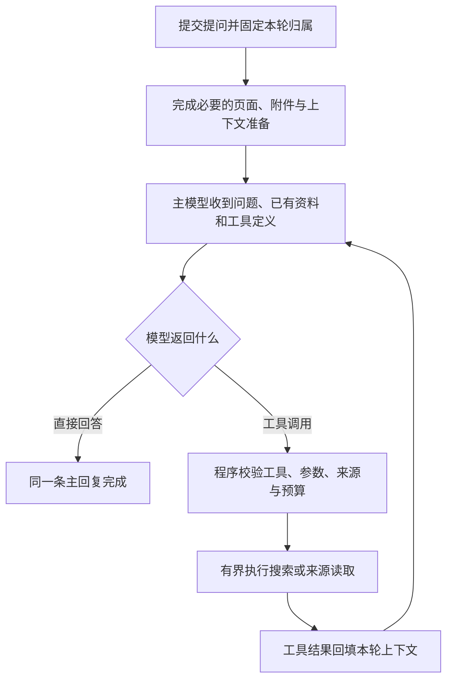

# 普通问答的模型驱动检索 · 2026-11-09

普通联网问答已从“程序先判断、搜索并抓取资料，再让主模型回答”，改为“主模型先分析，按需请求搜索或读取来源，再继续回答”。这项变更减少独立分类请求和不必要的正文抓取；实际速度仍受模型、中转服务、搜索服务、资料量和思考设置影响，不能承诺把用户观察到的近一分钟降到元宝那次的 8 秒。

之前的延迟证据、用户提供的对照与竞品公开资料见[回答延迟调研](2026-11-09-response-latency-research.md)。该报告记录的是改造前状态；其中的旧请求链路、测试数字和“未修改生产代码”不代表本次交付。

## 用户可观察到的行为

开启联网检索时，普通问答第一次主模型请求就附带可用工具。模型可以直接回答，也可以先输出思考或简短说明，再调用工具。是否搜索、搜索什么、哪些来源需要正文以及何时结束检索由主模型判断。程序不再为普通问答单独发起 `research-decision` 请求，也不再先运行旧的整套 `createWebResearcher` 流程。

同一逻辑回合仍可能包含多次 HTTP 请求。工具结果作为 `role: tool` 消息与原 `tool_call_id` 配对返回；支持原生思考字段的服务会收到上一工具轮的 `reasoning_content`。这不等于复用了模型服务内部状态，也不代表一次 API 请求可以完成所有工作。

“基于当前页”仍控制当前页面阅读。开启时，本轮必要的页面正文读取、已有的补读和视觉准备仍先按原流程执行；读取失败不能静默换成旧正文。关闭页面开关不会关闭全网检索。本次没有将当前标签页读取、截图或页面动作加入普通模型的工具集合。

关闭设置中的联网检索后，普通回答继续使用无工具的流式请求。模型配置仅允许搜索而禁用正文抓取时，只开放搜索工具。思考强度仍使用本轮冻结的模型配置，本次没有自动替换为低思考强度或另一个模型。

## 已开放的工具

| 工具 | 参数与范围 | 返回内容 |
| --- | --- | --- |
| `web_search` | 不超过 200 字符的模型查询；只读公开网络 | 最多 6 条有界来源，带本轮 `sourceId`、完整 URL、采集时间和摘要/正文标记；不自动抓取所有来源 |
| `read_webpage` | 本轮搜索已经返回的 `sourceId`；不接受模型任意填写 URL | 复用已取得且未截断的正文，否则读取对应来源；来源地址变化时报错，不改绑原 ID |

搜索查询保持模型选定的时间与主题范围。当前时间已在普通问题上下文中提供；新公开搜索适配器不再机械地给所有查询追加当前年份，历史问题可保留用户要求的年份。模型负责根据资料日期和问题范围判断时效，采集时间不等于发布日期。

来源注册只接受公开 HTTP/HTTPS 地址，拒绝凭据 URL、已知本地/私有地址以及非网页协议。搜索摘要与实际正文分别标记。来源在回填前标为外部不可信资料，不能提升为系统指令；未取得的资料不能声称已读取。正文每源最多 8000 字符，每次工具结果序列化后不超过 12000 字符，本轮最多登记 12 个来源。截断情况保留在工具结果与最终来源元数据中。

工具不操作 DOM，不使用当前标签页身份，不获得浏览器 Agent 的动作许可。已有 Agent 的站点授权、目标核验、动作串行化和结果不明规则继续独立执行。这两个工具不是通用 MCP 执行器，也没有加入 Skill、长期记忆或侧栏关闭后的无人值守运行。

来源注册和工具往返上下文只存在于本轮内存；主回复保留展示所需的来源小元数据，不新增历史网页全文库。重试重新建立工具会话，不能沿用上次运行的 `sourceId` 作为已读证据。

## 执行预算与失败语义

| 约束 | 当前值与含义 |
| --- | --- |
| 工具轮数 | 最多 4 轮工具请求，之后可以再请求一次不带工具的收尾回答 |
| 工具调用数 | 本轮最多 6 次不同操作，相同查询或来源按执行器参数指纹复用，不重复扣次数 |
| 搜索次数 | 最多 3 次不同查询，达到后从可用工具中移除搜索，仍可在剩余额度内读取来源 |
| 模型单批大小 | 最多接受 12 个工具调用条目；超过时视为异常批次，不执行任何工具 |
| 并发 | 同一批经过完整校验的调用每次最多并行执行 2 个；结果按原调用顺序回填 |
| 工具时间预算 | 各批工具执行累计等待最多 45 秒，不计模型思考和回答时间；不会因后续轮次或公开回退重置 |
| 单次工具等待 | 最多 12 秒，同时受工具总截止与原回合截止限制 |
| 主模型等待 | 每次最多 120 秒，同时受原回合总截止限制 |
| 原回合总截止 | 默认 240 秒，包含已有准备流程；不是新的平均耗时或性能承诺 |

45 秒按实际等待工具的墙钟时间累计，同批并行请求的时间不重复相加。模型先思考较久不会提前消耗这项工具预算；主模型等待仍受每次 120 秒和原回合 240 秒上限约束。达到轮数或调用预算后收起工具，让模型依据已有资料说明结论与缺口；正在执行的必要工具失败、超时或被取消时保留可见失败/停止状态。空正文、只有思考、截断的工具参数或不正常结束的模型响应不会伪装成成功。

每次模型请求更新剩余搜索、工具和轮数预算。合法批次申请超额时，先完整校验参数、来源与标识，再按原顺序执行额度内的调用；其余调用返回 `kind: budget`、`ok: false`、`executed: false`、`code: ERR_RESEARCH_TOOL_LIMIT` 的配对结果，不产生新来源。任何预算拒绝都会让下一轮使用 `tools: []`、`toolChoice: none`，继续同一回答收尾，并说明缺口。已成功完成的前一批耗尽时间预算时，尚未派发的调用也按此拒绝；已经执行中的工具超时仍失败，不改成成功总结。

例如，两次不同搜索已经取得 11 个来源，模型再同时申请两次搜索时，只执行剩余的一次，并明确返回另一项未执行，然后完成回答。相同查询或来源复用不会额外扣次数，但重复工具轮仍消耗 4 轮上限。收尾保持原流式前缀、思考和工具调用/结果配对；模型在强制收尾时继续请求工具，或收尾只返回空正文，仍明确报错。

来源数量仅统计实际返回的来源，不等于搜索次数或完整正文数量。消息来源按钮只有在全部来源为 `readStatus: body` 时显示“已读取”；摘要、混合或未知旧记录使用中性数量。展开列表逐项标明搜索摘要、已读正文、未知状态及截断，不能把只拿到摘要的 11 个来源称为读过 11 篇正文。

每批工具在任何调用执行前校验名称、参数结构、调用 ID 和当前来源权限。相同调用 ID 不能复用为不同参数；相同查询或来源的重复执行会复用本轮操作结果，不重复请求。所有等待绑定原回合的信号和连接，等待返回后及下一次副作用前重新核验归属。

停止会及时结束本地等待，阻止下一次模型请求或工具调用；迟到结果不能写入新回合。已发给远端的只读请求可能仍在远端处理，取消等待不表示远端从未收到请求。工具循环只返回数据和流式更新，最终成功/失败/停止仍由原 TurnRunner 唯一提交。重试继续替换原回合回答，不重复追加用户问题；建议问题仍在成功后独立生成。

## 模型服务和公开搜索兼容

主模型继续使用已配置的 Chat Completions 兼容服务。普通联网回答现在要求该服务正确支持流式 `tool_calls`、工具结果消息以及工具选择参数。若服务明确拒绝工具参数，会显示错误，不自动去掉工具后把需要资料的问题改成纯记忆回答。既有、尚未输出内容前的思考参数兼容回退仍保留，但回退请求继续携带工具定义。

搜索和抓取仍优先使用本轮模型配置中的服务地址、凭据和搜索/抓取路径。网关仅为这两类请求保留经过限制的 HTTP 状态码，以便区分“没有该端点”和真实调用失败。

只有端点返回 `404`、`405`、`501` 表明能力缺失时，才调用公开适配器；认证失败、权限拒绝、限流、服务器错误、网络错误、取消或超时不会触发公开回退。公开适配器每次只搜索一次或读取一个来源，省去旧流程的自动分类、多轮选源和逐篇正文准备。

公开请求省略浏览器凭据，不跟随重定向，响应流最多读取 128 KiB，支持文本/HTML 与常见声明字符集。重定向、无法读取的正文类型或来源地址变化会明确失败。这个保守范围意味着部分必须跳转的站点无法通过公开回退读取；不能因此声称所有公开站点已兼容。搜索摘要仍可用于说明其实际支持的有限事实。

## 实现落点与核心接口的最小改动

| 文件 | 本次职责 |
| --- | --- |
| [`research-answer-loop.js`](../src/sidepanel/features/web-research/research-answer-loop.js) | 主模型驱动的工具循环、轮数/调用/时间预算、批次校验与并发、工具上下文预算和结果回填 |
| [`research-tools.js`](../src/sidepanel/features/web-research/research-tools.js) | 本轮只读工具会话、工具 schema、参数/sourceId 校验、去重、来源正文复用和有界结果 |
| [`public-research-transport.js`](../src/sidepanel/features/web-research/public-research-transport.js) | 单次公开搜索和单页读取，复用已有 HTML 搜索结果解析，不执行返回的脚本 |
| [`application-root.js`](../src/sidepanel/composition/application-root.js) | 默认装配工具会话、公开回退及原有诊断观察 |
| [`chat-service.js`](../src/app/chat-service.js) | 将原前置联网分支替换为工具循环，沿用已有主回复回调、归属与后处理 |
| [`model-gateway.js`](../src/app/model-gateway.js) | 允许主回答声明工具并选择对应传输；仍冻结本轮配置、按完整请求载荷去重并隔离辅助用途 |
| [`llm-client.js`](../src/utils/llm-client.js) | 在原流式解析基础上组装原生工具分片，区分完整工具轮和最终文本回答，保留下一轮所需思考字段 |

旧 ChatService 接口只支持“检索完成后生成一次最终文本”，不能把模型工具调用结果继续送回主模型，因此需要替换其联网分支。旧 `streamChatCompletion` 返回字符串且没有工具分片结果，网关只允许 Agent 声明工具，无法表达普通回答中的完整工具轮；新增 `streamChatToolCompletion` 返回结构化结果，旧字符串 API 和 Agent 决策 API 继续保留。

实现没有另建发送、队列、停止、重试或消息提交路径，也没有迁移 Agent 决策循环。仍遵循共享状态由侧栏入口持有、普通执行由应用服务及 TurnRunner 管理的生产边界。

## 验证与尚未验证的范围

先构造行为回归再修改核心适配：流式工具参数分片/交错、重复事件、截断、空回复、服务拒绝工具、思考字段续接、停止和部分输出保留；应用组合覆盖直接回答、搜索后读取、正文复用、并发限制、预算耗尽、重复提交、停止后重发、迟到回调、失败重试和唯一终态。

来源与公开适配另覆盖私有地址、重定向、未知 `sourceId`、同 URL 正文升级、序列化大小、响应流预算、字符集、缺失端点回退、权限/限流不回退，以及挂起请求的取消/截止。定向测试位于 `tests/research-answer-loop.test.js`、`tests/research-tools.test.js`、`tests/public-research-transport.test.js`、`tests/chat-tool-transport.test.js`、`tests/model-gateway.test.js`、`tests/chat-service.test.js` 和 `tests/application-root.test.js`；完整交付按项目约定运行 `npm run check`。

预算收尾优化先构造可暴露旧实现中断的行为回归，再修改 feature 循环；真实应用组合验证 11 来源后的剩余额度、拒绝配对、同一助手唯一终态和保存，以及收尾阶段停止后的迟到结果。新增 `tests/source-evidence-view.test.js` 验证摘要/正文/未知旧记录的实际渲染。此次预算优化尚未在用户的原中转服务及实际 MV3 侧栏中重跑，先前接口实测不等于已经验证本次修改。

**预算收尾优化验证（2026-11-09）：`npm run check` 通过，1802 项项目测试通过，0 失败/取消/跳过，扩展构建成功。** 本次不改变模型、搜索及时间上限，也没有修改普通发送、重试、TurnRunner 或流式解析核心。

**最终验证记录（2026-11-09）：`npm run check` 通过，1773 项项目测试通过，0 失败/取消/跳过，扩展构建成功。** 日志保留于 `output/model-driven-research/check.log`。本次还用真实 ModelGateway 和流式解析器配合可控 HTTP 响应，验证工具参数分片、搜索、原生思考字段回送与唯一主回复保存；首轮模型思考不消耗工具等待预算，多轮思考计时排除工具等待，正文裁剪同步来源截断标记，可选 provider 为工具定义预留上下文空间。

初次交付时尚未实测用户中转。后续经用户授权，已对本机 WorkBuddy2API 的 `cn:deepseek-v4.1-flash` 完成四项真实接口测试：原 YAML 追问连续两次成功，原生搜索/读取/回答循环成功，未复现缺少完成标记。参数、计时及限制见[中转接口实测记录](2026-11-09-workbuddy-live-probe.md)。仍无竞品同条件计时、所有站点或完整 MV3 生命周期的覆盖结论。
