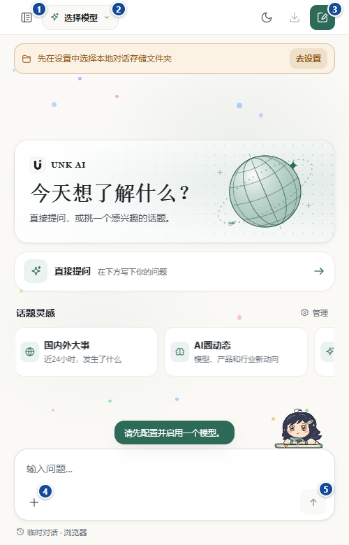
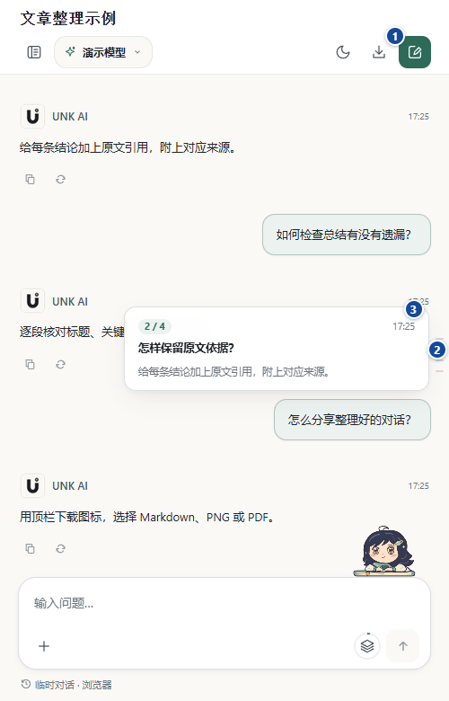

# UNK AI 操作手册

**适用版本：0.20.1｜更新日期：2026 年 11 月 25 日**

## 1. 安装、更新和配置

1. 下载并解压扩展 ZIP。在 Chrome 打开 `chrome://extensions`，启用「开发者模式」，点击「加载已解压的扩展程序」，选择直接包含 `manifest.json` 的目录。[下载扩展](https://github.com/persomLing/unk-ai/releases/latest)
2. 点击工具栏的 UNK AI 图标，或按 **Alt + U** 打开侧栏。点左上角历史图标，打开底部「设置」。
3. 在「本地数据」选择文件夹。在「连接服务」填写模型服务地址和 API Key，点击「获取模型」，再到「模型库」添加模型。点「测试连接」，成功后点「保存设置」。
4. 回到侧栏，在顶栏选好模型。在输入框发送一个问题，确认能收到回答。

**更新**时进入「设置 → 版本更新 → 检查更新」。如有新版，点击「更新并重启」，按提示选中 Chrome 当前加载的扩展目录。也可下载 ZIP，解压覆盖原扩展目录，再到扩展管理页重新加载。

*图 1　① 历史与设置　② 选择模型　③ 新对话　④ 添加菜单　⑤ 发送。*

## 2. 聊天和快捷操作

- **发消息**　Enter 发送，Shift + Enter 换行。欢迎页「话题灵感」可将问题填入草稿。
- **停止或排队**　生成时点停止按钮可中断。输入下一条后可排队，点队列旁的撤回按钮可继续编辑。
- **重试或改问**　回答下方可重新生成。悬停在自己的问题上，选择「回退并重新编辑」可恢复原问题和附件，并从该轮重新开始。
- **引用或单独追问**　选中回答文字，点「引用到当前对话」并确认后发送，或点「单独追问这段内容」在小窗继续。
- **使用 Skill**　从「＋ → 技能 → 管理」导入单个 `SKILL.md`。通过兼容检查后，从「＋」菜单选中技能再发送。

在输入框键入 **/**，用 ↑↓ 选择指令，Enter 确认。常用指令有 `/new`（新对话）、`/sum`（总结当前页）、`/compare`（多页对比）、`/video`（视频笔记）、`/img`（生成图片）和 `/fund`（切换基金研究）。

## 3. 网页、视频和附件

| 想做什么 | 怎么操作 |
| --- | --- |
| 阅读网页、在线 PDF 或 GitHub 项目 | 打开目标页，开启「基于当前页」后提问。回答后展开来源，核对读取范围。 |
| 对比多个网页 | 「＋ → 多页对比」，勾选 2–4 个标签并提取资料，补上对比要求再发送。 |
| 解释、翻译或提炼选区 | 在网页选中文字，右键打开 UNK AI 子菜单并选择操作。 |
| 写 B 站视频笔记 | 先切到要整理的分 P，开启「基于当前页」，点「＋ → 视频笔记」，直接开始。点笔记时间码可回看。 |
| 给视频笔记配图 | 启动前点「视频笔记」旁的「配图」按钮切换方式。截帧会选用视频画面，生图需配置生图模型。 |
| 分析图片或文档 | 「＋ → 上传图片 / 上传文档」，也可直接粘贴截图。读图要选支持图片输入的模型。单独分析附件时可关闭「基于当前页」。 |
| 生成图片 | 在「设置 → 模型库」选择默认生图模型，再用「＋ → 生成图片」填写描述并发送。点已有图片下方的「引用生图」可使用参考图。 |

B 站无可用字幕时，如出现「从画面识别字幕」，可用视觉模型采样识别。点击聊天图片可打开预览，滚轮缩放、拖动查看，单击或按 Esc 关闭。

## 4. 基金研究

1. 打开「设置 → 基金研究」，填入盈米 MCP API Key，点「测试连接」。连接成功后会自动保存，也可单独点「保存配置」。密钥获取入口见设置页的「接入管理 → API 密钥」提示。
2. 回到侧栏，点「＋ → 基金研究模式」或选择 `/fund`。模型服务需支持**流式工具调用**。
3. 直接提问，或在「投研工作流」卡片、「＋」菜单、`/` 指令面板选模板。按提示补充基金代码、筛选条件或持仓，再发送。

*图 2　① 填盈米 MCP API Key　② 保存配置　③ 测试连接，成功后自动保存。*

*图 3　① 配置密钥　② 退出基金模式　③ 核验当前页　④ 选投研模板。*

- **看市场**　工作台显示市场温度。配置后，对话中也可点顶栏「速览」查看。选择 `/temp` 会直接发送市场复盘请求。
- **查基金**　用 `/check` 看单只基金，`/pk` 横向比较，`/screen` 筛选，`/portfolio` 做持仓诊断回测。打开目标网页后，点「核验当前页」或选 `/pagefund` 可直接发起核验。
- **查数据来源**　展开回答末尾的「盈米 MCP 数据调用」。基金研究提供只读数据查询。点顶栏「退出」回到普通聊天。

## 5. 联网检索和页面操作

- **搜索和核对**　进入「设置 → 联网检索」开启搜索和网页抓取，可点「检测接口」。提问时写明时间范围和想核对的来源。回答后区分「搜索摘要」和已读取的网页正文。
- **补读当前页**　页面表格或接口数据有遗漏时，保持「基于当前页」开启，写明要补查的字段。若提示站点权限，核对后再授权。
- **点击、填写或导航**　进入「设置 → 浏览器控制」，开启「允许浏览器控制」。回到目标页，开启「基于当前页」，选「＋ → 页面操作」，写清任务后按提示授权和确认。出现「结果不明」时，先回网页核对实际结果再操作。

## 6. 历史、导出和外观

- **找对话**　点左上角历史图标，可搜索、分组或多选。长按对话拖入分组，长按分组标题可排序。每段对话会记住各自的模型。
- **定位某一轮**　悬停右侧刻度可预览轮次、时间和问答，点击刻度跳到原文。点发送旁的容量图标可查看下一次提问或最近请求的估算。
- **保存和恢复**　查看输入框下方的保存状态。同目录备份时，一起复制 `conversations/` 和 `images/`。误删后可用历史区的撤销入口恢复。
- **导出和分享**　回答下方可复制单条内容。导出整段对话时点顶栏下载图标，选 Markdown 或图片 / PDF。
- **调外观**　顶栏切换明暗。「设置 → 界面外观」调整主题色、纹理、字体、字号、间距和阅读搭子。「设置 → 话题灵感」管理欢迎页卡片。

*图 4　① 导出当前对话　② 悬停或点击轮次刻度　③ 查看轮次和提问时间。*

## 7. 常见问题

- **发送不了**　检查已添加模型并保存设置，再确认顶栏选中了该模型。基金模式还需测试盈米 MCP 连接。
- **页面入口没出现**　切回目标网页。Chrome 内部页面等受限页面无法读取。读页结果不完整时，检查来源后补问具体章节。
- **对话未同步**　在「设置 → 本地数据」检查原文件夹授权，恢复权限后重试保存。
- **要排查报错**　当前对话的记录从顶栏下载菜单选「诊断日志」。当天全部诊断从「设置 → 本地数据」导出。

本轮使用的问题、页面资料和附件会发给你配置的模型服务。基金数据查询会向配置的盈米 MCP 服务发送查询所需参数。
