# UNK AI 操作手册

**适用版本：0.20.1｜更新日期：2026 年 11 月 26 日**

UNK AI 是一个 Chrome 侧栏插件。你可以直接聊天、结合当前网页提问、上传图片和文档、整理 B 站视频字幕，也可以选用 Skill 指南或在授权后让它操作网页。回答使用你在设置中配置的模型服务。

可按下表找到对应章节。界面截图均使用演示数据，蓝色编号对应图下的操作说明。

### 第一次使用

1. 按第 1 节安装扩展，点击工具栏图标或按 **Alt + U** 打开侧栏。
2. 从左上角历史区进入底部“设置”，选择本地数据文件夹，填写模型服务地址、密钥并添加模型。
3. 点击“测试连接”，确认可用后点击“保存设置”；回到侧栏查看顶栏模型名称。
4. 先关闭“基于当前页”，发送“用三个步骤解释你可以怎样帮我整理一篇文章”，确认普通对话可用。
5. 打开一篇文章，开启“基于当前页”，发送“总结这篇文章，并区分作者结论和文中证据”。页面阅读按本轮需要自动补充资料。
6. 选中回答中的一句话，点击“引用到当前对话”，补充说明并确认；在输入框发送后继续讨论。需要另开一个主题时，选择“单独追问这段内容”。
7. 查看保存状态；需要分享时，用顶栏下载图标导出图片 / PDF 或 Markdown。

不确定模式时，先用普通聊天。需要阅读眼前网页再开启页面开关；需要实际点击、输入和导航时，再进入“页面操作”并授权。

### 按场景查找

| 你现在想做什么 | 阅读位置 |
| --- | --- |
| 安装、更新、换模型或配置联网 | 第 1–2 节；联网单独见第 13 节。 |
| 调整主题、管理话题灵感或找到 GitHub 仓库 | 第 3 节“认识新版界面”。 |
| 停止、排队、重试，或改回先前的问题 | 第 4 节“停止与排队”“重新生成与回退编辑”。 |
| 围绕某一句话追问，保留主聊天进度 | 第 4 节“引用注释”“单独追问”。 |
| 总结网页、PDF、代码仓库，核对表格或接口数据 | 第 5–6 节。 |
| 使用盈米基金研究，查看市场、比较基金或做组合诊断 | 第 7 节「基金研究工作台」。 |
| 整理 B 站当前视频或分 P，按时间码回看 | 第 5 节“B 站视频笔记”。 |
| 导入总结、翻译或写作指南，用于本次提问 | 第 4 节“导入和使用 Skill”。 |
| 让插件帮忙筛选、填写或上传参考图 | 第 8 节，先了解授权和结果不明的处理。 |
| 上传截图、放大图片、分析文档或备份附件 | 第 9 节。 |
| 查看输入容量、输出预留，管理历史和待同步记录 | 第 10–11 节。 |
| 分享回答、导出文字、定位失败原因 | 第 12–13 节；常用入口与快捷键见第 14 节。 |

### 界面速览

- 欢迎页随当前网页显示快捷入口。点击话题卡片可将提示内容填入草稿。
- 「界面外观」集中提供主题色、字体、正文字号、间距、局部纹理和「下一步探索」开关。
- 历史分组支持长按标题排序。窄屏用抽屉，宽屏可与主对话并排。
- 单独追问小窗用于文字问答。点击「替换当前对话」可在主窗口使用完整功能。
- 视频截帧通过视觉审阅后才会插入对应笔记段落。

## 1. 安装与更新

### 首次安装

1. 下载已发布的扩展 ZIP，解压到固定文件夹。[GitHub Releases](https://github.com/persomLing/unk-ai/releases/latest)
2. 在 Chrome 地址栏输入 `chrome://extensions`。
3. 打开右上角的“开发者模式”。
4. 点击“加载已解压的扩展程序”，选择**直接包含 `manifest.json` 的文件夹**。
5. 在浏览器扩展菜单中找到 UNK AI，建议固定到工具栏。
6. 打开一个普通网页，点击插件图标打开侧栏。

安装压缩包时，解压后的根目录就是扩展目录；从项目源码构建时，加载的是 `dist` 文件夹。不要把 ZIP 文件本身当作扩展目录。

默认快捷键为 **Alt + U**。如果与其他程序冲突，可到 `chrome://extensions/shortcuts` 查看或修改。

### 更新现有插件

1. 先停止正在生成的回答或网页操作，确认需要保留的会话已经保存。
2. 将新包解压到原来的扩展目录，替换旧程序文件。
3. 回到 `chrome://extensions`，点击 UNK AI 卡片上的重新加载按钮。
4. 在扩展卡片或详情中核对安装版本，再重新打开侧栏。已有网页上的控件仍在使用旧状态时，刷新网页。

使用项目源码时，先完成构建，再重新加载 Chrome 正在使用的 `dist` 目录。界面仍没变化时，到扩展详情核对实际加载路径；只更新另一个同名文件夹不会更新正在运行的插件。

保留原扩展安装和对话数据文件夹。为了更新而卸载插件可能清除浏览器内的配置、临时记录、分组和待同步内容。

### 使用「版本更新」入口

从 0.19.1 起，可以在设置中检查并安装 GitHub 正式版本。首次从 0.19.0 升级按上方步骤操作。

1. 从历史区底部打开「设置」，在设置导航选择「版本更新」。查看当前版本，点击「检查更新」。
2. 发现新版本后，先完成正在处理的对话并保存设置。保持 Chrome 扩展管理页的开发者模式开启，点击「更新并重启」，选择当前加载且直接包含 `manifest.json` 的扩展文件夹。
3. 同意浏览器的文件夹读写请求后，扩展会下载对应 GitHub 正式 tag 的 ZIP，校验文件再安装。安装完成后扩展会重新加载，重新打开侧栏即可使用新版。
4. 浏览器拒绝写入或新版涉及更多扩展权限时，可用「下载 ZIP」，按上方步骤替换程序文件。

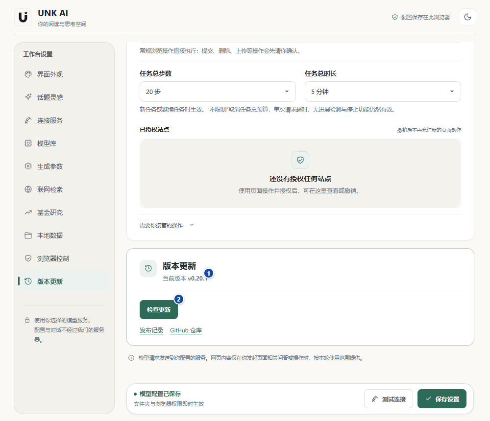

*图 1　① 当前安装版本　② 检查更新。*

## 2. 首次配置模型与本地保存

设置入口在**左上角历史侧栏 → 底部“设置”**。

1. 进入“本地数据”，点击“选择文件夹”，选择专门保存对话的目录并授权。
2. 进入“连接服务”，填写服务地址和 API Key。服务地址通常填到 `/v1`，也支持完整的 `/chat/completions` 地址；不需要密钥的本地服务可以留空。
3. 点击“获取模型”。在“模型库”的下拉框中选中需要的模型，再点击“添加模型”。
4. 点击已经添加的模型，检查它的“生成参数”。不确定的数值先留空，沿用模型或服务默认值。
5. 点击“测试连接”，根据反馈修正服务地址、密钥或模型。
6. 点击“保存设置”，看到保存成功后回到侧栏。

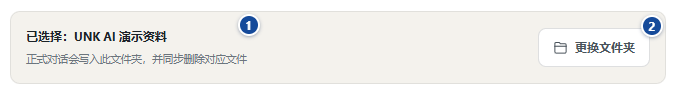

*图 2　① 查看当前保存目录　② 首次点击「选择文件夹」，选过目录后此处显示「更换文件夹」。*

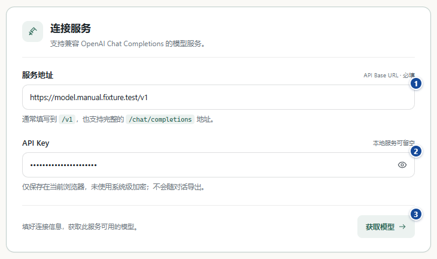

*图 3　① 填模型服务地址　② 填 API Key　③ 获取模型列表。图中使用演示地址。*

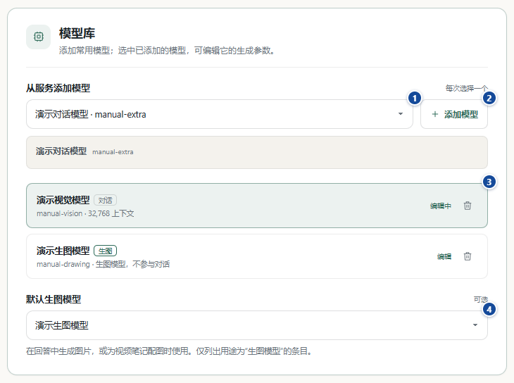

*图 4　① 从服务列表选择模型　② 添加模型　③ 点击已添加的模型编辑参数　④ 可选的默认生图模型。*

**测试连接不等于保存设置。** 对话模型测试发送一条简短模型请求，不读取网页；生图模型测试只检查服务接口可达，不实际生成图片。修改模型配置后仍需点击“保存设置”。文件夹授权、浏览器控制开关和站点授权则即时生效。

| 设置项 | 如何使用 |
| --- | --- |
| 上下文长度 | 模型一次请求能承载的总内容量。按服务商提供的真实规格设置，不要为了消除提示随意填大。 |
| 最大输出 | 模型单次生成的输出预算；部分服务会把思考也计入。普通回答、页面操作决策和推荐问题都跟随本轮模型配置，设置过小可能导致正文或动作没有生成。 |
| 回答随机性 | 越低通常越稳定，越高通常越有变化；不确定时沿用默认值。 |
| 思考模式 / 思考强度 | 仅在模型及服务实际支持时启用。它控制模型推理，与自动补充页面结构是两件事。 |
| 视觉输入 | 需要读图片时使用支持视觉的模型。手动开启此项不会让纯文本模型获得识图能力。 |

页面操作决策和“下一步探索”不再额外固定为 1200 和 420 tokens。模型未配置最大输出时，请求省略该参数，交给服务默认策略；这不代表模型支持无限输出。思考强度是另一项设置，停止、请求超时和上下文容量检查仍然生效。

模型库的“从服务添加模型”下拉框用于**添加**模型；编辑现有模型参数时，点击模型库中已经添加的模型。普通问答和页面操作共用侧栏顶栏的模型选择入口。

### 日常切换与修改模型

1. 只切换本次使用的模型时，在侧栏顶栏选择已经添加的模型。
2. 需要调整上下文长度、最大输出、视觉或思考参数时，回到设置，点击模型库中对应的模型卡片修改。
3. 测试修改后的连接并保存，再回到侧栏发一条简短问题验证实际输出。
4. 使用图片或联网时，再分别验证图片理解和带来源的问题；普通文本测试不会覆盖这些能力。

服务地址、密钥与模型名称必须相互匹配。能获取模型列表只说明列表接口可用，不能证明回答、视觉和联网工具调用都可用。先用服务商明确支持的配置跑通，再调整生成参数，便于定位失败原因。

### 配置生图并在聊天中使用

聊天生图和视频笔记的“生图”配图模式需配置兼容的生图服务；“截帧”配图使用原视频画面，不需要生图模型。

1. 获取并添加生图模型，在「生成参数」将「模型用途」设为「生图模型」，再到「模型库 → 默认生图模型」选中它。点击「保存设置」。生图与对话共用服务地址和密钥。
2. 在侧栏点击“＋ → 生成图片”，在标签下输入画面描述后发送；点击标签上的“×”可退出生图并保留文字。也可直接发送“生图：一只蓝色小猫”或“生成图片：一只蓝色小猫”。明确指令不先请求文字模型。只有“生成图片”没有描述时，会提示补充内容，不会擅自使用上一轮的描述。
3. 想在已有图片基础上修改，点击回答配图旁的“引用生图”，或进入生图模式后上传一张参考图，再填写修改要求。支持 PNG、JPEG、WebP，单张最多 8 MiB；需要服务支持 `/images/edits`。不支持时会报错，不改成文生图。提示词和所引用的图片作为本轮提问保存，可撤回和重试；之后的普通问答按原有上下文预算保留提示词和图片引用说明，不会自动重复发送历史图片像素。
4. 提示词最多 4000 字，可在其中写明 `16:9`、`1:1` 等构图要求，实际输出比例由服务决定。聊天生图、视频配图及其加载框铺满正文可用宽度，成图按实际比例显示，不拉伸或裁切；原上传图和预览不受影响。

**未选择默认生图模型时**，“生图：……”等明确指令会提示配置并保留草稿，不发给文字模型或生图服务。自然语言问答仍可得到文字回复，但不会启动生图或配图规划。询问配置、编辑提示词和上传图片让视觉模型分析不受影响。

明确生图和普通回答一样支持排队及停止。插件最多等待 20 分钟，等待计入本轮总耗时。回答完成后的可选配图也有 20 分钟等待预算，可用「取消配图」结束本地等待。可选配图用时单独计算。服务商提前返回错误时会显示失败原因。

## 3. 认识新版界面

### 欢迎页与话题灵感

*图 5　① 管理话题　② 左右浏览话题卡片，点击填入草稿。*

页面可读时，欢迎页提供「总结当前页」。没有可读页面时，可以「直接提问」。欢迎页上的地球仪可以左右拖动。

点击话题卡片会把提示内容填入草稿，可编辑后再发送。按住卡片横向拖动，或用触控板横滑，可浏览后面的条目。悬停及键盘聚焦时暂停轮播。用 Tab 移动焦点，按 Enter 选取。系统设置「减少动态效果」后，仍可手动浏览。

点击欢迎页「话题灵感」旁的「管理」，也可从「设置 → 话题灵感」进入。点击现有条目可编辑，或用「添加话题」创建自己的提示。填写标题、可选副标题和提示内容后，点击「保存话题」。四个预置话题分别是国内外大事、AI圈动态、科技新品和商业与市场。提示中的 `{{北京时间}}` 会在点选时替换为当时的北京时间。

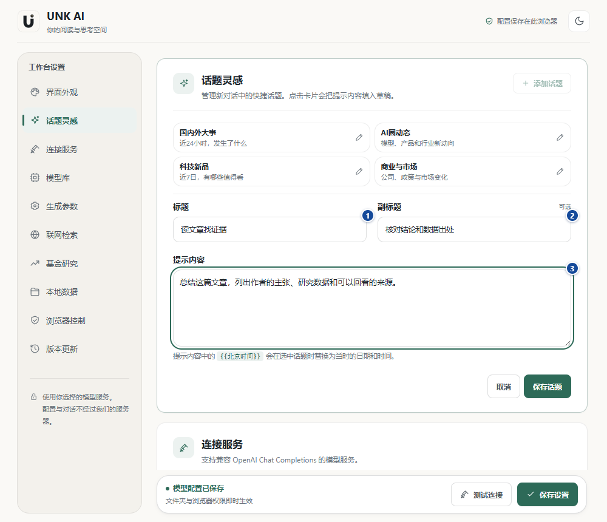

*图 6　① 标题　② 可选副标题　③ 会填入草稿的提示内容。*

### 主题、字体、字号和间距

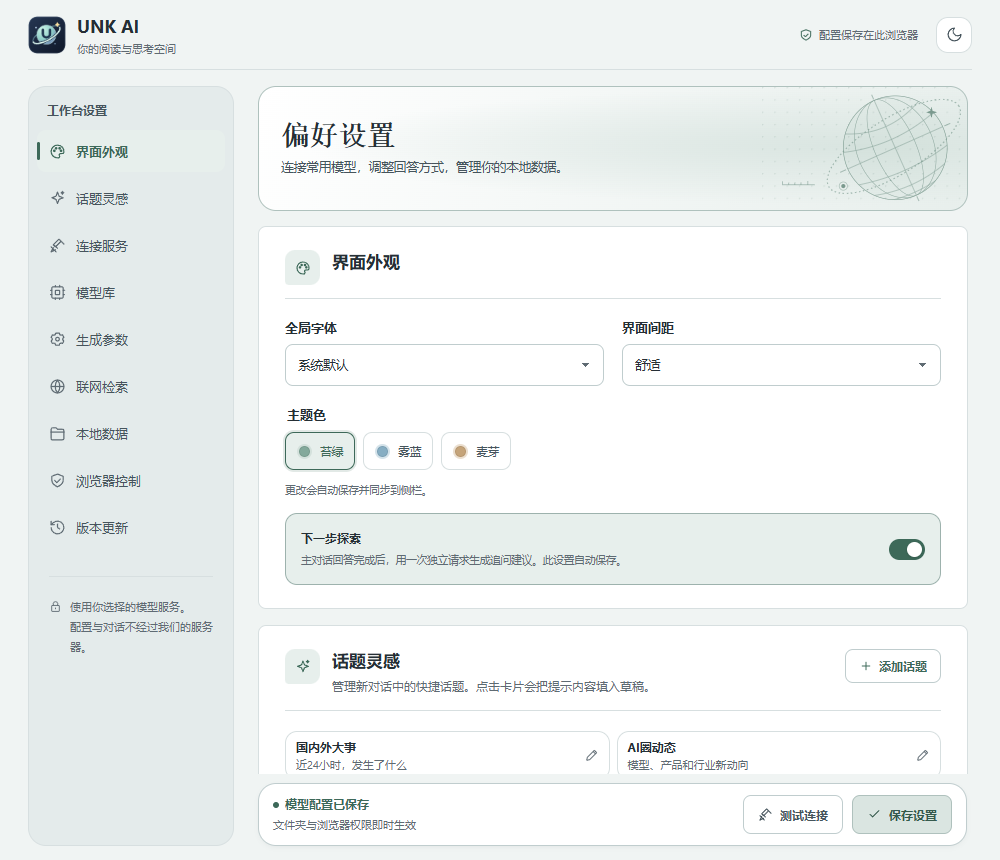

*图 7　① 全局字体　② 界面间距　③ 主题色　④ 下一步探索。*

从历史区底部打开设置，在「界面外观」可选择全局字体、正文字号、紧凑／舒适／宽松间距，以及 **苔绿、豆绿护眼、暖纸护眼、雾蓝、暮霭丁香、酒红桃杏** 六套明暗自适应主题色。局部纹理支持 **无、细颗粒、点阵手账、方格图纸、亚麻织纹、横线信笺** 六种效果，以柔和低透明度延展至对话画布、历史抽屉与设置背景，不影响正文阅读。外观自动保存并同步到侧栏；顶栏的月亮或太阳图标切换明暗。输入框输入 `/` 可呼出快捷指令面板（`/compare`、`/sum`、`/video`、`/img`、`/new`、`/fund`），方向键选择、Enter 触发。

「正文字号」提供 12、13、14、16、18 和 20 像素，默认 13 像素。调整后，聊天提问、回答、单独追问和文本预览立即使用新字号。

### 顶栏与输入区

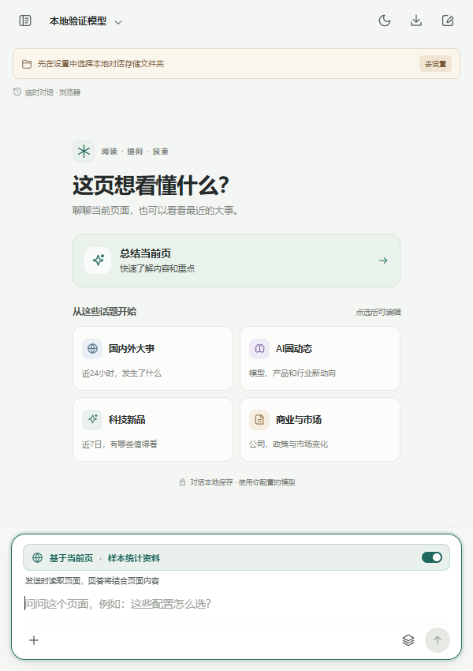

*图 8　① 历史　② 模型　③ 导出　④ 基于当前页　⑤ 添加菜单　⑥ 会话容量　⑦ 发送。*

| 位置 / 入口 | 作用 |
| --- | --- |
| 顶栏左侧历史图标 | 展开历史区，访问历史对话、分组和底部设置；收起使用历史区右上角“×”。 |
| 历史区底部 GitHub | 打开项目仓库，也可从「设置 → 版本更新」访问。 |
| 顶栏会话标题 | 滚动长对话时保持可见；过长时悬停查看全文，新对话不显示额外标题行。 |
| 顶栏模型名称 | 切换当前对话的模型。支持思考的模型还会显示思考强度选项。 |
| 顶栏主题图标 | 切换明暗主题。 |
| 顶栏下载图标 | 选择图片 / PDF、整段 Markdown，或本对话今天的诊断日志。 |
| 顶栏新对话图标 | 新建一段对话。 |
| 输入框底部页面开关 | 显示本轮准备使用的网页，提供“基于当前页”开关。 |
| 输入框底部“＋” | 上传图片、文档，选择生成图片、多页对比、基金研究、技能、页面操作或视频笔记。 |
| 输入区下方保存状态 | 查看临时、已保存、待同步或失败状态，以及可用的手动保存入口。 |
| “＋ → 页面操作” | 进入网页操作模式，需要单独授权。 |
| “＋ → 视频笔记” | 整理 B 站当前视频 / 当前 P 的字幕，点击即执行。 |
| “＋ → 技能 → 管理” | 导入、查看和删除 SKILL.md；已导入技能可直接从菜单选用。 |
| 叠层图标 | 查看下一次提问预估、最近请求的 Token 分类、输出预留和整理摘要。 |
| 消息区右侧轮次刻度 | 悬停或聚焦预览轮次、提问时间及问答，点击跳转到原文。 |
| 右下角箭头 / 停止图标 | 发送问题，或停止正在进行的任务。 |

当前对话标题固定在工具栏上方，滚动长对话时仍可见；标题过长时单行省略，悬停查看全文。Chrome 原生侧栏头由浏览器绘制，不能随会话动态改名，当前标题显示在它正下方。新对话不增加标题行，保留默认的“UNK AI - 阅读与对话”。

每段对话记住自己的模型和思考强度，切回时自动恢复。新对话选中下拉列表里的第一个对话模型，并使用该模型的默认思考强度。原模型已移除时，顶栏显示「选择模型」。发送提问时会提示先选择模型，并保留输入框内容、附件和引用。

小笺固定在输入框右上方的外沿。翻阅对话时，正文从她身后滚过；插画的透明处可以照常选字、点击链接。她会看向指针，打字时探头，轻点她会脸红并躲到书后。选中回答正文时她会扶书签，提交新消息时会翻页。在「设置 → 界面外观 → 输入框搭子 · 小笺」可选择动态、静态或关闭。系统开启减少动态效果时只显示静态插画。

窄侧栏同样保留一行底部操作。点击“＋”展开菜单，方向键切换、Enter 选择、Esc 收起。关闭“基于当前页”时，页面操作和视频笔记一起隐藏；浏览器内部页等不可读页面也不显示这两个入口。新提问默认自动阅读，接口资料由模型按需判断。

滚动条只在内容超出区域时出现。鼠标移入聊天、历史、思考、表格、浮窗或设置页的可滚动区域后显示滑块，移出后隐藏；滚轮始终可用。键盘聚焦可滚动区域或使用触屏时保留提示。各处颜色统一并随明暗主题调整，显隐不会挤动正文。

| 浏览长内容的场景 | 操作与显示 |
| --- | --- |
| 刚打开页面，鼠标不在长内容区域 | 默认保持清爽；没有溢出内容时无需滚动条。 |
| 鼠标移入聊天、历史或设置中的长列表 | 显示该区域的滚动条，可滚轮滚动或拖动滑块。 |
| 宽表格、长代码 | 在对应区域内横向或纵向滚动，其他区域保持当前位置。 |
| 放大预览中的图片 | 直接显示图片；滚轮缩放，左键或单指拖动查看，单击关闭；不显示原生滚动条。 |
| 用键盘或触屏浏览 | 保留必要的滚动提示；不同区域的滚动条粗细可以不同，颜色规则一致。 |

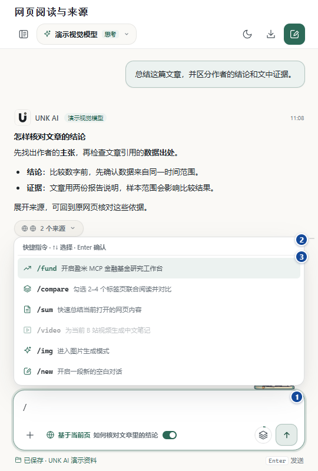

*图 9　① 在输入框键入 `/`　② 用方向键选择，按 Enter 确认　③ 当前选中的指令。*

### 阅读一条长回答

*图 10　① 导出当前对话　② 悬停或点击轮次刻度　③ 查看轮次和提问时间。*

轮次预览中的提问时间以本地时区显示。当天只显示时间，同一年较早的提问显示月日与时间，跨年时还显示年份。

正文支持 Markdown、代码块、公式和表格。点击已完成代码块右上角的复制按钮，只复制该块代码，保留缩进和换行。模型返回实际思考内容时，可展开或收起思考区；收起只改变显示，不停止回答。向上滚动阅读旧内容后，可以使用回到最新内容的入口继续查看输出；右侧轮次导航用于定位已有问答。

标题、来源列表、思考区和正文各有自己的显示状态。来源图标显示为地球时，通常只是网站图标缺失；是否读到正文要看来源中的文字状态。

首次发送时，欢迎页淡出，提问和回复提示依次出现。读页、搜索、思考和生成共用一条状态栏。切换阶段时更新图标和文字，同阶段的计时直接刷新。模型提供思考内容时，可以在同一处展开查看。回复结束后显示总耗时，本条回复的复制和重试按钮可以用 Tab 聚焦。来源和推荐问题随内容到达显示。复制成功后，按钮会短暂显示勾选标记。侧栏遵循系统的「减少动态效果」设置。

## 4. 普通聊天、停止、重试和编辑

### 大段粘贴与长提问

在主聊天或独立追问的输入框粘贴较长的纯文本时，会出现一张“粘贴的文本”卡片，显示首行摘要和字符数。达到 1000 字符或 15 行即使用卡片；短文本仍直接进入输入框，图片粘贴仍按图片附件处理。

1. 点击卡片查看完整原文；关闭弹窗后可以继续输入问题。
2. 点击卡片的“编辑”将该段文字放回输入框并选中，再修改内容。点击“×”只移除这一段。
3. 多次粘贴可形成多张卡片，最多 6 段，粘贴文本合计最多 20 万字符。超过限制会提示拆分，不会只保留一部分。
4. 发送时，卡片文字按原粘贴位置合并为完整提问，保留代码、空格和段落；卡片不是额外的文档附件。需要分隔两段内容时，照常用 Shift + Enter 输入换行。

发送后，超过五行显示高度的长提问会折叠并显示“查看全文”。点击预览或用 Tab 聚焦后按 Enter / 空格，在“完整消息”弹窗阅读、滚动或选择复制原文。点击关闭按钮、遮罩或按 Esc 退出；选取气泡中的文字不会误开弹窗，原有复制和回退编辑按钮仍可使用。

折叠只改变显示，保存、排队及模型请求仍使用完整提问；模型实际可使用的上下文仍受所选模型容量和既有预算约束。未发送的卡片属于当前输入草稿，不会因为点开预览而保存；关闭侧栏前请先发送或另行保留。回退或撤回排队会把全文恢复到输入框，便于重新编辑。

### 先选这次要做的任务

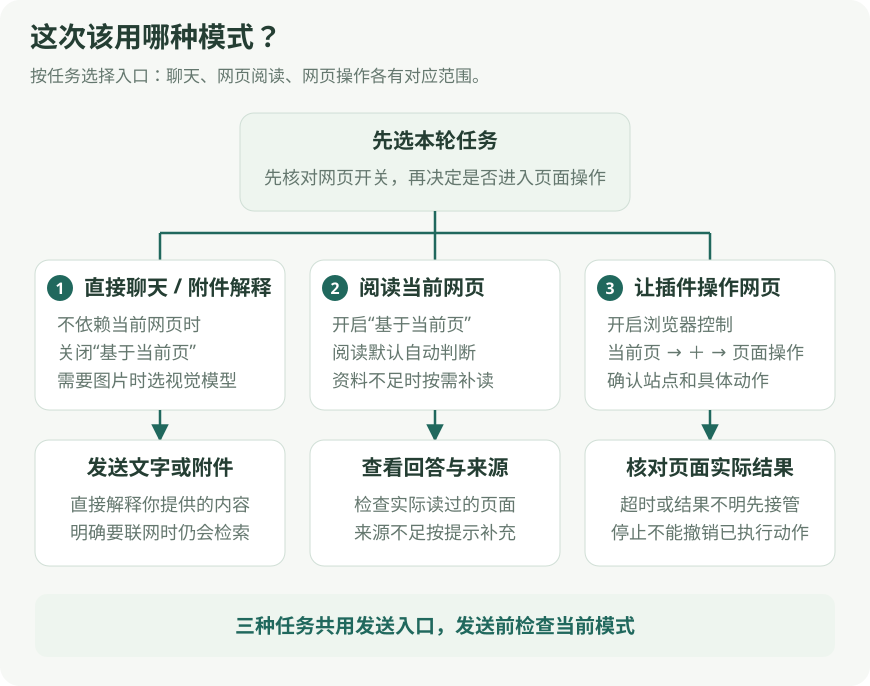

*图 11　按任务选择普通聊天、页面问答或页面操作。*

1. 与眼前网页无关的知识、写作或附件问题，关闭“基于当前页”直接提问。
2. 需要读当前页面时，开启“基于当前页”后提问，自动按资料缺口补读。
3. 需要实际点击、输入或导航时，开启页面开关，选择“＋ → 页面操作”，再按提示授权。
4. 整理 B 站视频时，先选好分 P，开启页面开关并点击“＋ → 视频笔记”；输入框中的原草稿留给之后发送。

自动接口读取用于普通页面问答中的本站资料补充，不能替代页面操作授权。

### 直接提问

如果问题与眼前网页无关，先关闭“基于当前页”，再输入问题并发送。

> 示例：用一个生活中的例子解释向量检索，最后列出三个常见误解。

**Enter 发送，Shift + Enter 换行。** 中文输入法正在选字时，Enter 优先用于确认输入。

欢迎页的新闻、AI、科技、商业等话题卡片会先填入草稿，确认内容后再发送。这些独立话题不会自动带上当前网页；需要结合网页时，再主动开启页面开关或选择页面问题。

完成必要的页面和附件准备后，主模型先分析问题，可以直接回答，也可以调用搜索或来源读取工具后继续回答，不再单独请求模型判断是否联网。没有可显示内容时，界面会按实际阶段显示“正在搜索并读取公开网页”或“正在等待模型输出”，并分别计时。等待模型输出达到 15 秒时，会补充“尚未收到正文或思考内容”；只有服务返回实际思考内容才显示思考。主回答仍使用你选定的模型及思考配置。

| 当前提示 | 可以怎样处理 |
| --- | --- |
| 深度思考 | 服务已返回实际思考内容，模型可以继续回答或按需请求工具；需要结束时点击停止。 |
| 正在搜索并读取公开网页 | 本轮在搜索和读取资料，可等待来源出现，或点击停止结束本轮。 |
| 正在等待模型输出 | 请求尚未返回可显示的正文或思考；计时不能证明服务商正在思考或排队。持续无输出时可停止，检查服务后重试。 |

主聊天和单独追问在回答标题旁显示「已用时」，从本轮开始执行计到完成、失败或停止，届时固定为「总耗时」。读页、上下文准备、联网、模型等待、思考和正文输出都计入；排队、回答后的配图和推荐问题不计入。阶段提示中的「本阶段」只计当前工作。回复结束后，如有思考内容，同一状态栏会显示思考用时并保留展开入口。重试会单独计时。

单纯解释本轮截图、日志、选区或已经读到的页面内容时，模型可以直接回答；需要近期事实或核实时，由模型决定查询和必要的来源读取。工具结果回到同一轮分析，不另建第二条主回复。回复仍很慢或报错时，可在等待期间从顶栏导出诊断日志，记录大致时间和卡住的提示。

### 使用“下一步探索”继续讨论

回答完成后的“下一步探索”会结合本轮问题、具体结论和来源核实状态给出 1–3 个具体追问。例如，消息尚未官宣时，推荐可以围绕官方来源核对，而不会把传闻作为已确认事实；解释了某个技术取舍后，可以继续比较它在本场景中的适用条件。

「下一步探索」默认开启。在「设置 → 界面外观」切换后会自动保存。主对话完成且有合适建议时才会显示。

**点击推荐问题会直接发起追问。** 如果想先改写，先把问题复制或手动写入输入框，修改后自行发送。欢迎页话题卡片则先填入草稿，两种入口的行为不同。

推荐会过滤整段陈述、泛指短语和回答摘录；没有合适问题或生成失败时可以不显示，不影响已经完成的主回答。历史中此前保存的无效推荐只隐藏，正文和会话数据保留。

### 停止与排队

- 生成中点击停止按钮，可结束本轮等待并阻止本轮后续请求。已经收到的内容会保留，状态标为停止。
- 普通回答已完成页面资料准备后，切换网页或关闭“基于当前页”不会中断本轮思考和回答；本轮继续使用已读资料，开关影响后续页面读取。页面仍在读取时关闭开关，会停止读取；页面操作模式下关闭开关仍会停止任务。
- 普通回答进行中，可以继续输入下一问并加入队列；以界面的“加入队列”状态为准。
- 输入框上方的排队栏显示待发送总数和下一条预览。“撤回”恢复显示的这条消息、原附件和生图标签；输入框已有草稿时先处理草稿，不会覆盖。
- 页面相关队列项保留入队时的原会话和原网页。切换会话或关闭页面开关后，可能显示等待原因；可返回原会话继续，或撤回后修改。
- 停止当前回答不会清空队列，收尾后仍可能自动发送下一项。若不希望后续问题继续执行，还需撤回队列中的问题。
- 停止不能撤销已经执行的网页动作，也不能让服务商已经接收的请求变成从未发生。

### 重新生成与回退编辑

回答下方的“重新生成回答”图标或错误状态下的“重试”，用于重新生成对应回合。**对较早回合重新生成，会替换该回合回答并舍弃其后的对话分支**；需要保留的内容先复制或导出。

当前重新生成还会清空待发送队列，且发生在页面重试校验之前。请先撤回并保存需要保留的排队草稿，再点击重试。

页面提问重试时，如果已关闭页面开关，或原标签、完整网址、文档已变化，插件会先核对会话中仍保留的本轮已读资料。来源和读取时间一致、正文及所需选区图片完整时，可以直接复用，并提示“本次重试使用本轮已读的原页面资料”；不会读取后来切换的网页，也不会自动打开页面开关。

如果开关开启且仍是原页面，重试会重新读取正文，读取强度和接口选项沿用原回合设置，接口授权仍需重新核验；重新读取失败会明确报错，不退回旧正文。没有可核对资料时，请回到原页面并开启页面读取后重试，或回退提问重新发送。会话只保留当前页面正文，并不是每轮的历史全文库；原页面已刷新、关闭或资料被后来读取替换时，可能需要回退后重新提问。

*图 12　① 回退并重新编辑　② 复制提问文字。*

需要改提问及其附件时，使用“回退并重新编辑”：

1. 先停止或等待当前生成、提交、附件准备、网页任务及历史整理结束。
2. 悬停原提问气泡，移到右下方的回退图标并点击；旁边的复制图标用于复制提问文字。
3. 检查输入框中的原文字、图片、文档和选区；可继续修改，或通过附件“×”移除文件。
4. 核对页面开关、页面操作模式和目标页面，再重新发送。

回退会移除该提问及后续消息分支，原附件以独立副本恢复。截图仍保留原页面身份，旧网页正文不会作为整份旧页面快照自动恢复。

视频笔记回退后会恢复原视频、分 P 和“截帧 / 生图”选择，输入框下方显示“视频笔记 · P…”。重新发送继续使用原视频字幕，也可修改笔记要求；没有可用字幕记录时重新读取原视频，失败会明确报错。清空输入、选择其他入口或切换对话后，不会把视频笔记模式带到新问题。

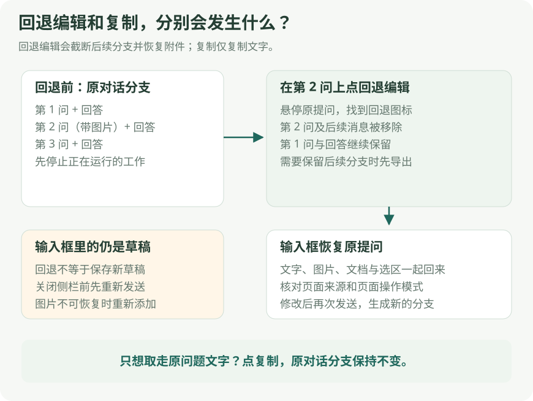

*图 13　回退把原提问和附件放回草稿，复制只复制文字并保留对话分支。*

回退后的文字和附件仍是当前侧栏中的草稿，恢复到输入框不等于草稿已经保存。关闭侧栏前请重新发送或另行保留需要的内容。回退保存超时或失败时保留草稿，并显示具体错误；它不会因迟到保存把图片写进另一段新对话。

### 导入和使用 Skill

点击输入框底部 **＋ → 技能 → 管理** 打开技能库，选择“导入 SKILL.md”；空库也可直接点击菜单中的“导入 Skill”。支持单个 `.md` 文件，适合翻译、写作、总结、分析和整理本轮已有资料的文字指南。可以先试用仓库中的 `examples/skills/reading-notes/SKILL.md`。

1. 导入后查看名称和说明；依赖检查、完整原文可按需展开。导入本身不会发送模型请求。
2. 显示“未发现已知依赖”的技能可点击“用于本次提问”，也可从“＋”菜单直接选用，输入框会出现 Skill 附件。标为“需适配”的菜单项会打开对应详情。
3. 输入具体问题，按需开启“基于当前页”或上传资料，再发送。选择 Skill 不会自动读取页面、开启联网或进入页面操作。
4. 发送前可用附件的“×”移除 Skill；发送后可展开提问中的 Skill 查看本轮原文。

| 依赖或格式 | 第一版处理 |
| --- | --- |
| 单个文件内的文本步骤与输出格式 | 可用于普通问答；仍受模型能力和本轮资料范围约束。 |
| Shell、Python、Node、CLI、安装依赖、本机路径 | 标出原因，仅可查看。浏览器 Skill 没有这些执行环境。 |
| `scripts/`、`references/`、其他相对文件或必须读取的外部链接 | 标出未导入资源；不会自动加载文件或下载链接。 |
| `allowed-tools`、MCP、平台接口、主动联网工具、页面点击或表单操作 | 需要单独适配；不能仅凭导入文件获得这些能力。原有普通联网设置仍独立生效。 |
| 未识别的元数据、缺少名称/说明等 | 显示“需要检查”，调整文件后再导入。 |

静态检查只能识别已知依赖，“未发现已知依赖”不等于保证完整兼容。当前支持常见的 YAML 文本字段和简单 `metadata`，不支持任意 YAML 结构或任意工具执行。正文中的规则不能覆盖宿主权限和用户本轮的具体要求。

每次最多选择一个 Skill，占用一个附件位置。单文件最多 64 KiB、正文最多 12000 字符；技能库最多 20 项、合计 1 MiB。所选指南必须完整放入本轮模型预算，容量不足会明确报错，不会悄悄裁掉后半段步骤。

技能库保存在当前浏览器，重新打开侧栏仍可使用；同名导入会报错，不自动覆盖。已发送、排队和回退的提问各自保留完整技能副本，重试使用原版本，下一问不自动沿用。从技能库删除只移除库条目，草稿和历史中的副本仍保留；未发送草稿不会因选择 Skill 而持久保存。实际使用时，指南内容会随问题发送到你配置的模型服务。

### 选中回答引用与单独追问

选中**同一条助手回答中的正文**后，会出现“引用到当前对话”和“单独追问这段内容”。不要跨多条消息选择，也不要选择思考区、按钮或输入框文字。引用带上原提问、所在小节和相邻正文，帮助模型理解这段内容；不会携带整段原对话、内部思考或自动读取当前浏览器网页。

| 入口 | 适合用途 | 对话会去哪里 |
| --- | --- | --- |
| 引用到当前对话 | 对同一回答逐条批注，集中追问或纠正 | 先成为当前输入框的引用草稿，随问题发送。 |
| 单独追问这段内容 | 深入研究一个分支，同时保留主聊天阅读位置 | 打开独立窗口，首次发送后成为单独的历史对话。 |

#### 引用注释：选中、确认，再发送

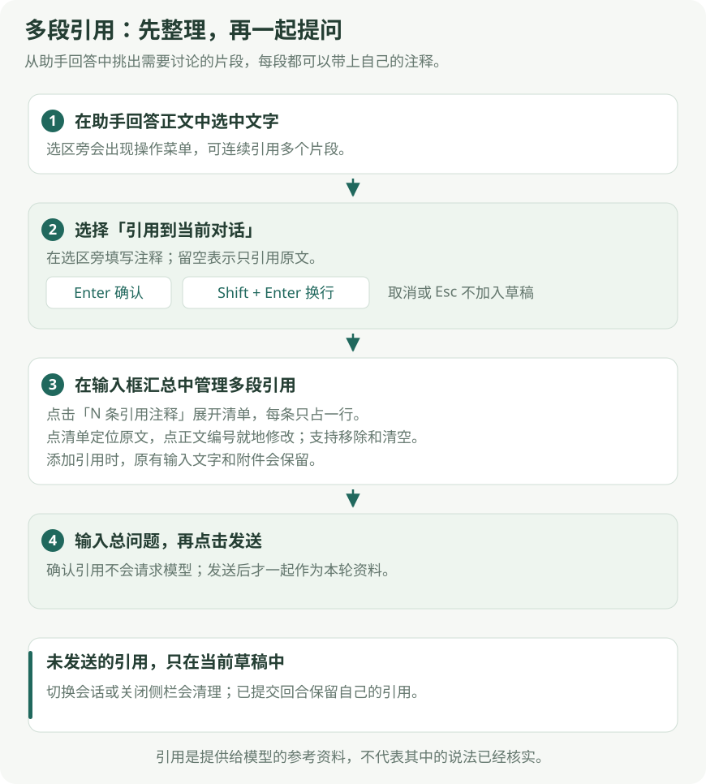

*图 14　每段引用先确认进入草稿，发送前统一检查；确认引用本身不请求模型。*

1. 选中回答里要讨论的一段话，点击“引用到当前对话”。
2. 在选区附近的“针对这段内容提问或添加说明…”输入框中写批注，例如“这个结论的依据是什么？”；也可以留空，只引用原文。
3. 点击“✓”或按 **Enter** 确认；**Shift + Enter** 换行。点击“×”或按 **Esc** 取消这次添加。
4. 确认后，原文出现淡青高亮和编号，主输入框默认只显示一行“N 条引用注释”。已有草稿文字和附件保留。
5. 点击原文编号，在该段文字附近查看、修改注释；点击“N 条引用注释”才展开清单。清单每条占一行，点击原文或注释可定位原文，“修改”在原文附近打开编辑框，“×”移除该条；也可“清空引用注释”。继续选择其他段落即可添加更多注释。
6. 在主输入框补充整体要求，检查引用清单后发送。

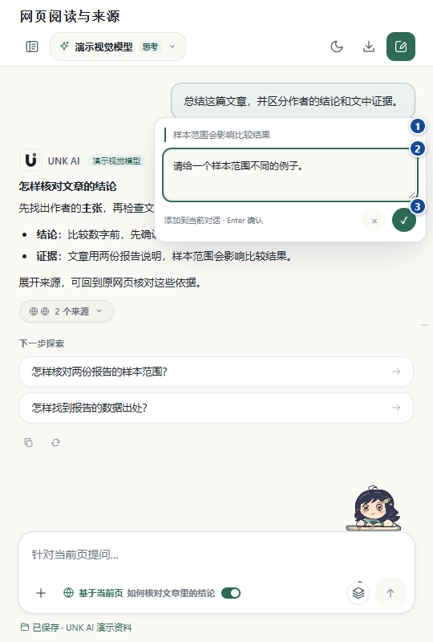

*图 15　① 核对选中的原文　② 写批注　③ 点击勾号加入草稿。*

较长的原文和注释在清单内省略显示，悬停可查看完整内容。编号随正文滚动，只在正文可见范围内显示，不遮挡输入框；原文已不在当前对话时会明确提示，引用和注释仍可保留、修改。

> 示例：先引用“采用方案 A”并注明“解释选它的原因”，再引用“预计成本下降”并注明“列出计算假设”；最后输入“请逐条回应这两处批注，并给出修改后的方案”。

每次最多 8 条引用注释；每条注释输入最多 2000 字符，注释合计最多 8000 字符，所选原文与相关上下文合计最多 16000 字符。条数或累计内容超限时，会提示精简并保留编辑框。较长选区及相邻语境可能先按范围截断，请查看截断提示并核对引用。

确认引用只是整理草稿，不发送模型请求，也不把未发送的注释写入历史。切换主对话或关闭侧栏会清理引用草稿，需要保留时先发送或另行复制。发送或加入队列时，引用立即从输入框上方移除，原文和注释随本轮提问保留。回答期间添加的引用用于下一问。重试沿用原回合的引用，回退编辑可恢复原引用。

#### 单独追问：在小窗口继续一个分支

1. 选中助手回答中的正文，点击“单独追问这段内容”。
2. 在小窗口核对引用原文和来源范围，输入具体问题并发送。例如“这段中的幂等和重试分别解决什么问题？请各举一个例子。”
3. 需要调整位置时拖动标题栏；需要扩大阅读区时拖动右下角。用键盘时可聚焦调整大小按钮，再按方向键；**Shift + 方向键** 以更大的幅度调整。
4. 点击标题栏的收起按钮，或向右拖到边缘。收起后可沿右缘上下拖动对话图标，单击图标重新展开。键盘聚焦图标后，也可用方向键移动，按 Enter 展开。
5. 想继续主聊天阅读时，保留小窗口或收起；想把这个分支作为主聊天时，在空闲状态使用“替换当前对话”。

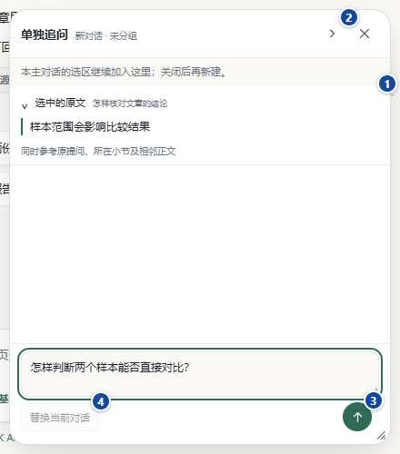

*图 16　① 核对选中的原文　② 收起窗口　③ 发送追问　④ 首次发送后，可在空闲时将追问移到主聊天区。*

同一主对话中再次选中其他内容并选择单独追问，会复用第一次打开且仍在跟踪的追问窗口，更新**下一次问题**的引用。选择原文不会自动发送；若窗口正在回答，新选区留给下一问，当前回答仍使用提交时的原文和上下文。

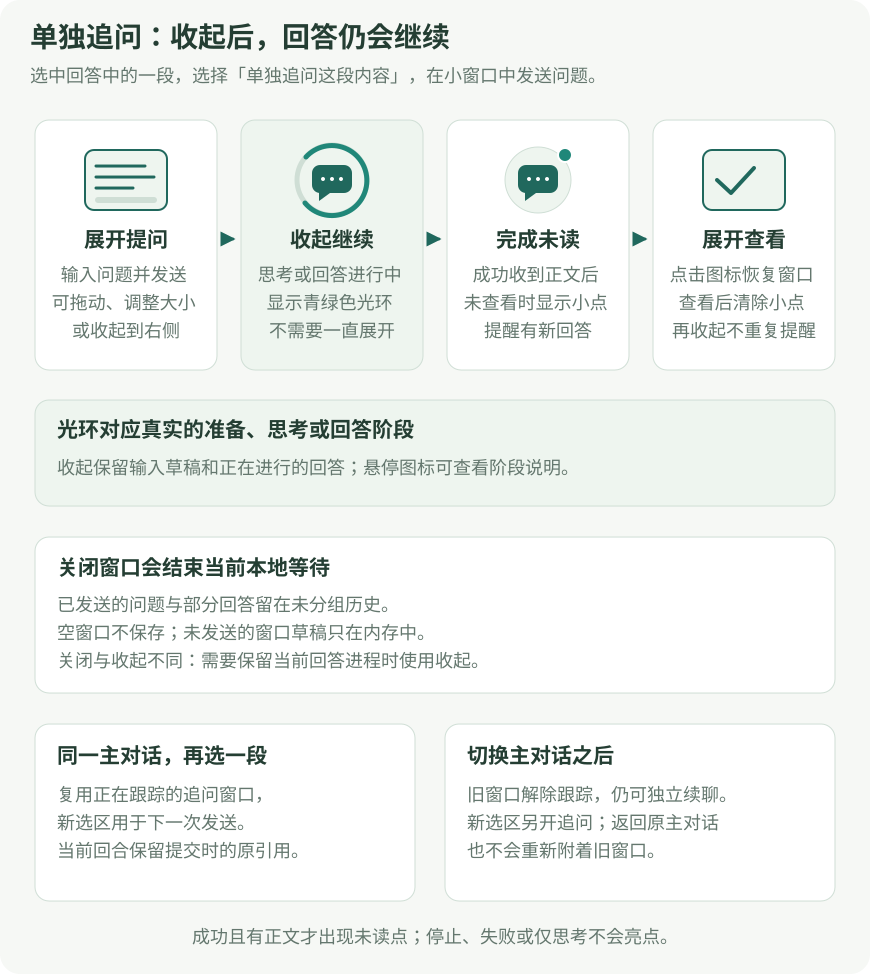

*图 17　收起保留同一追问；切换主对话后，旧窗口独立存在，新选区另开追问。*

| 你的操作或看到的状态 | 实际结果 |
| --- | --- |
| 第一次打开追问，尚未发送 | 只是空窗口，关闭后不保存，不出现在历史。 |
| 在窗口第一次发送问题 | 成为独立的未分组对话，随后可在历史中查找。 |
| 收起窗口 | 保留输入草稿、阅读位置和正在生成的任务；不停止任务，也不因此新增或保存空对话。 |
| 收起图标有青绿色光环 | 仍在准备、思考或回答；思考时轻微呼吸。 |
| 收起图标出现未读小点 | 有未查看的、成功完成且有正文的新回答。展开查看后清除，再收起不会重复提醒。 |
| 已停止或生成失败 | 保留对应状态，不显示成功完成的小点。 |
| 关闭窗口 | 结束该窗口及选区跟踪；正在生成时停止等待，已发送内容仍保留。下次单独追问会新建分支。 |
| 新建、切换或替换主对话 | 旧窗口脱离原主对话的选区跟踪，仍可独立续聊；新的选区另开追问。 |
| 回到原来的主对话 | 不会重新绑定已经脱离的旧窗口；旧窗口中的内容不受影响。 |
| 系统启用减少动态效果 | 收起、展开直接切换，运行光环改为静态，状态含义不变。 |

主对话变化后，旧窗口会持续提示“已切换主对话；新的选区将另开追问。”这不是保存失败。窗口与选区跟踪只存在于当前侧栏；重新打开侧栏后，可从历史继续已发送的追问。

#### 把追问移到主聊天区

窗口中的“替换当前对话”会把追问打开到主聊天区，原主对话仍保留在历史。从历史中打开同一个追问对话，也会将它从小窗口转到主聊天区，不会让两个位置同时接管该对话。操作前先完成或停止相关任务；小窗口正在回答时，历史接管会受到阻止。删除这段对话前，需要先关闭它的追问窗口。

小窗口根据引用原文和对话历史回答文字问题。需要使用网页阅读、联网、附件、生图或「下一步探索」时，点击「替换当前对话」，转入主聊天区。

## 5. 结合当前网页阅读

### 基本步骤

1. 打开需要分析的网页，等待主要内容加载出来。
2. 查看输入框底部的页面标题，确认是目标网页。
3. 开启“基于当前页”，页面阅读会按本轮需要自动补充资料。
4. 输入问题，或使用欢迎页的“总结当前页”。
5. 查看回答和来源说明；遇到缺口提示时，再选择补读方式或提供资料。

可直接使用这些提问：

> 总结这个页面的核心观点，并列出关键结论。
>
> 解释当前页面里的配置项。哪些已选状态能确认，哪些无法确认？
>
> 比较这页展示的套餐价格和限制，不要补造页面没写的条款。

开启页面模式后，每次普通页面提问都会重新读取基础正文。仅切换标签、看到页面标题变化，不代表正文已经读过。需要页面资料但读取失败时，插件会报告失败，不静默拿旧正文充当最新结果。

关闭页面开关后，本轮不再自动读取当前网页；它不会抹去历史消息中已经出现的页面内容。关闭状态下仍明确问“这个页面”时，可能出现“读取当前页并发送 / 按普通问题发送”，按本轮需要选择。

### B 站视频笔记

1. 打开 B 站普通视频。多集视频先选好要整理的分集。`P20` 表示同一条投稿的第 20 集。
2. 确认输入框底部显示这个页面，并选中“基于当前页”。
3. 点击 **＋ → 视频笔记**，立即读取字幕并使用当前模型生成简体中文笔记，无需再按发送。

最终成稿使用当前会话选定的思考档位。需要预读时，支持思考的模型使用可用的低档或服务默认档，先提取关键判断、条件和对应原句。

未选中“基于当前页”时，“视频笔记”和“页面操作”一起隐藏；选中后显示。浏览器内部页等不可读页面也不显示这两个入口。在其他网站、侧栏仍在准备或已有任务运行时，视频笔记按钮不可用，悬停可查看原因。正在整理时再次点击不会新增一份笔记；请先完成或停止当前任务。

笔记直接出现在当前对话中。正文从最值得理解的判断讲起，按内容组织教程、访谈或比较。补充解释与自拟例子会标清语境。展开「资料与范围」可查看合集、集数、原视频链接、字幕类型与时间范围。复制和导出时，这些信息随笔记附在末尾。每次读取当前分 P 的完整字幕轨。

时间码只标在关键要点上，每个段落或列表要点最多保留一个，避免连续堆叠；已有笔记重新打开、复制和导出时也会精简。点击正文中的 **[01:12]** 等时间码，只调整当前对应视频的播放进度，保持原来的播放 / 暂停状态，不刷新页面、不切换标签、不新开页面。当前不在对应视频或分集时，会提示先点击笔记标题返回；播放器尚未就绪或定位结果无法确认时会明确提示，不自动重复操作。

点击加粗的**分集标题**，会切回已经打开的同一视频、同一分集，保留播放进度；没有对应标签时才打开原视频页面。“原视频”链接也可用于返回。时间码仍支持右键复制链接；复制 Markdown 和导出后保留可独立打开的时间链接。

已经生成的笔记，只要这一轮保留了有效字幕记录，重新打开会话就能显示讲名和可点击的时间码，无需再次生成。旧记录没有分集总数时不会补猜，也不会为了显示总数额外读取网页。

视频笔记默认使用平台字幕；弹幕、评论和简介不会作为视频内容。中文字幕优先，同语言优先人工字幕；外语字幕也用中文整理。自动字幕可能识别有误，未口述的板书、图表和操作画面可开启下述截帧配图，或另行截图提问。

| 读取结果 | 接下来会发生什么 |
| --- | --- |
| 完整字幕轻松放入可用容量 | 完整字幕直接交给模型，一次成稿。 |
| 明确没有字幕，或字幕为空 / 仅含音乐音效标记 | 直接说明原因，不调用模型猜测视频内容。 |
| 需要登录或没有访问权限 | 显示访问原因；先在 B 站确认登录及视频权限，再重试。 |
| 网络失败、接口受限、原页面或分 P 变化 | 显示读取失败；待原视频稳定后重新整理。 |
| 完整字幕占用较多容量 | 按时间分批，每组最多同时预读两批。成稿优先使用大纲与完整字幕，容量紧张时优先保留要点、前提和纠正所对应的原句。 |
| 预读失败、达到本轮处理上限或模型容量不足 | 说明原因并保留原字幕，可重试或换用更大上下文的模型。 |

视频笔记以这一 P 的字幕为资料，输入框现有的文字、附件、Skill 和选区留给之后发送，不参与本次整理。笔记可沿现有流程保存、复制和导出。生成失败或停止后，重试会复用已经取得的原字幕；尚未读到字幕时，则仍需原视频页面可用。读取字幕期间关闭页面开关会取消读取；字幕已经接受后，停止生成请点击“停止”。

代码块只有与引用的字幕匹配才能保留「视频字幕原文」标签。口述内容足够时，笔记可以附上「根据讲解复原」的最小示例。自拟代码标为「补充示例」。手动确认的画面识别也会保留可读的按钮、参数、板书或其他屏幕文字，并注明来自屏幕。

每组预读完成后会更新已完成批数，成稿后可查看总耗时、预读和成稿用时。结构化预读最多用时 10 分钟，临时网络错误或部分服务错误可自动重试一次。预读失败会保留原字幕供重试。原回合的预读结果完整且仍在侧栏内存中时，20 分钟内以相同模型和容量重试可以复用。字幕读取的单次网络请求最多等待 30 秒、总计 90 秒。模型容量仍按设置预留输出空间。当前支持 B 站普通视频。

YouTube、直播实时字幕、语音转写和字幕文件导入尚未提供。

### 从视频画面识别字幕

1. 如「视频笔记」确认原视频没有平台字幕轨或字幕为空，先选择支持图片输入的视觉模型，再在提示下点击「从画面识别字幕」。旧的无字幕记录需重新运行「视频笔记」以取得入口。
2. 核对流量和模型用量提示后确认。插件独立读取 B 站视频分片，不暂停、跳转或改写当前播放器。同一文档内切换视频时，仍扫描确认时的原视频。
3. 若原页面关闭或重载，侧栏有已采集帧时可以「先用已扫描画面整理」，也可按「继续扫描」。续扫会使用可用 B 站标签页，必要时后台打开 B 站首页。检查点最多保留 20 分钟，关闭侧栏或主动停止扫描后不会自动接续。

画面扫描每秒采样一次，最多保留 240 张帧图发送到你配置的视觉模型。单 P 最长 2 小时，每次扫描最多下载 192 MiB 和等待 10 分钟，识别另有 8 分钟上限。笔记标记「画面识别」和缺口，可按时间码回看；短字幕、小字和未采到的画面可能遗漏，不会从音轨补全。付费、预览、互动或加密流不处理。会话保存识别文字和覆盖信息，不保存采样帧；已保存的识别资料可直接重试笔记。

扫帧、画面识别和笔记整理都计入该次回答的总耗时。「22:00 / 24:02」表示视频里的扫描位置，旁边的「本阶段」显示这一步的用时。点击「继续扫描」会从本次继续执行开始计时。

### 选择视频笔记配图

在“＋”菜单的“视频笔记”行尾点击配图按钮，默认关闭；选好方式后再点击“视频笔记”开始整理。当前源码在未选择默认生图模型时只在“关”和“截帧”之间切换；配置后才提供“生图”。带有“生图”选择的旧回合重试或回退重发时，若模型已移除，会提示先配置或重新选择配图方式，不会自动改成截帧。

- **截帧**独立解码原视频分片，观看可照常继续。模型查看候选画面和笔记节选。能提供上下文的相关界面、操作过程、结果、板书或场景都可以保留。保留的截图标注「模型已审阅」。
- **生图**用已配置的生图模型生成重点示意图，图注会标明 AI 生成。若规划结果格式无效，优先从带有效时间引用的笔记段落选一个要点，继续生成一张。一次视频笔记生图配图共享 20 分钟等待预算，完成的图片会逐张保存。

当前对话模型支持图片输入时优先用它审阅。当前模型为纯文本时，会选择同一服务中已配置的视觉模型。审核接受简短决定。结果含糊时跳过当前画面，继续检查其他候选。配图加载框在对应段落显示，完成后原位替换并保留实际图片比例。点击「取消配图」可结束剩余工作。

截帧按提交时的视频和分集取帧。同一页面换集时继续使用原分集。请保持原页面和侧栏打开，刷新或关闭会中断相关工作。

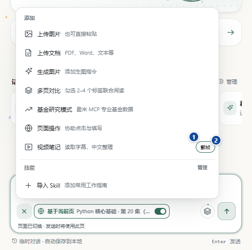

*图 18　① 视频笔记，点选即开始　② 切换配图方式。*

### 自动阅读与补充资料

开启“基于当前页”后，新提问默认先读正文，再按资料缺口决定是否补充页面结构、视觉或接口证据，不再提供自动/基础/深入选择器。模型思考强度仍在顶栏模型入口中调整。

结构补读最多一次，不会自动翻页、滚动、点击或刷新整个网站，也不能保证读取所有懒加载内容。需要核对时可以在问题中明确要求，例如“补读页面结构并核对这个配置是否选中”。旧回合的重试仍保留当时的读取范围。

自动模式会关注缺少字段、表格覆盖、配置状态和同页相关纠错；用户语气强硬、要求更简短或换一种说法，不会单独成为深入读取的理由。

### 页面选区、PDF 与代码仓库

网页选区包含图片时，输入框会显示图片数量。开启“基于当前页”并选择支持视觉的模型后，可以直接问“这个现在还适用吗”：插件会核对选区，读取其中的图片，与选中文字和本轮网页资料一起回答；开启联网仍可核实近期信息。只选图片也可以提问。

每轮最多读取选区前 3 张图片，长边缩放到最多 1600 像素，图片合计最多 8 MiB；超过选区数量限制会提示省略。已上传图片也占用本轮 3 张额度。选区或页面变化、读取超时、图片未加载完成或加载失败时会显示具体错误；请待图片正常显示后，回到原页面重新选择并发送。当前支持主页面中能被原生选区覆盖的图片、Canvas 和 SVG；受限页面和 iframe 中的图片不在当前支持范围内。

选区图片会随发送后的消息保存。成功读取后的重试和回退编辑复用原图片；后续保存准备失败或等待中停止，也会在当前回合保留已经读取的图片供重试，但不代表已保存成功。初次读取失败的重试会重新核对原选区。仍需回到原标签页和原文档，页面刷新后请重新选择并提问。较大的图片可能已缩放，保存的是此次读取的像素。

在网页上选择文字后，若侧栏出现“已选择 1 项”和来源提示，可针对这段内容提问；发送前检查选区，点“×”可清除。页面选区来自浏览器网页，与第 4 节中选中助手回答形成的引用注释属于不同来源，使用时先确认要讨论哪一处原文。

也可以在网页上选中文字后打开右键菜单，进入 **UNK AI** 子菜单选择 **解释选中内容**、**翻译选中内容（中英互译）** 或 **提炼核心要点**。插件会先固定原标签页、完整 URL 和文档身份，再打开（或复用）该标签页的侧栏，自动发送对应问题；原网页导航、关闭或文档替换时会拒绝这次自动发送，避免把选区解释到另一页。

### 对比多个标签页

1. 在同一个 Chrome 窗口打开要比较的网页。点击「＋ → 多页对比」，或在输入框输入 `/compare` 并确认。
2. 勾选 2–4 个标签页，点击「提取并加入对比」。资料会按页附入草稿，带上网页标题、来源链接和适用的截断提示。
3. 检查已加入的资料和读取失败提示，补写需要比较的维度，再按发送。例如「比较各文的事实依据、时间范围和有争议的结论」。

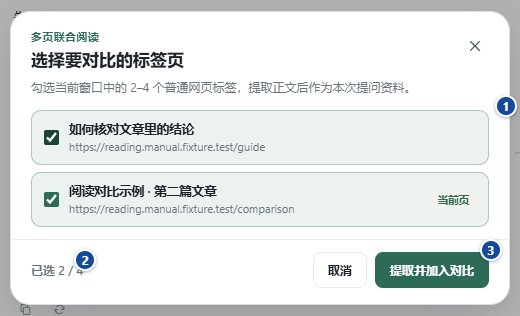

*图 19　① 勾选要对比的网页　② 检查已选页数　③ 点击「提取并加入对比」。*

部分页面读取失败时先检查成功加入的页数。打不开或正文受限的网页可改为复制关键段落或上传文档，再继续比较。

| 页面类型 | 推荐操作 | 阅读边界 |
| --- | --- | --- |
| 在线 PDF | 在 PDF 页面打开侧栏，开启页面开关，要求提炼观点并注明能核实的页码。 | 本地解析可读取的文字；扫描页、受限下载和特殊阅读器可能无法完整提取。 |
| 本地 PDF 或文件页 | 在扩展详情开启“允许访问文件网址”，重新打开文件；也可改用“＋ → 上传文档”上传。 | 文件需有可提取内容；扫描版 PDF 不提供 OCR。 |
| GitHub 仓库 | 打开目标仓库，提出明确问题，如“说明项目用途、入口和运行方式，区分实际读取的源码与推断”。 | 已实现 GitHub 源码读取；大仓库或受限内容不保证完整读取。 |
| 其他代码托管平台 | 可先按普通网页分析可见内容，再提供所需文件或片段。 | 能识别平台或仓库链接，不代表具有与 GitHub 相同的源码读取能力。 |
| 图表或依赖视觉的页面 | 使用支持视觉的模型，明确要分析的图表、趋势或控件状态；必要时上传关键截图。 | 自动视觉准备按本轮问题与目标页面决定；文字提取不等于完整看过图片。 |

> PDF 示例：提炼这份报告的研究问题、结论和限制；页码只填写实际能核实的部分，不能定位时明确说明。

### 阅读其他章节与查看来源

普通问题优先围绕本页。需要同站其他章节时，直接指出目标，例如：

> 找到这个站点的 MCP 章节，读取正文后总结，并给出实际读过的链接。

站内补读只支持能够访问的公开正文，最多补充三篇额外章节；登录限制或不支持的路由可能导致失败。找到目录标题不等于已经读到章节正文。

回答中的来源数量可以展开查看，各项标明“搜索摘要”“已读正文”或“读取状态未知”，内容有截断时也会说明。只有来源都明确取得正文时才显示“已读取 N 个来源”；数量不代表搜索次数，也不保证模型引用了其中每个字。历史只保留每轮来源小记录；插件不是可还原所有历史页面全文的网页存档工具。

## 6. 按需读取网页接口数据

这里的“接口”指**当前网站返回的数据**，例如页面请求到的 JSON；它不是模型服务的 API Key 设置，也不是全网搜索。

### 自动判断与明确请求

1. 在普通页面问答中开启“基于当前页”。
2. 直接提问；出现相关资料缺口时，由模型判断是否需要接口证据。
3. 也可明确要求：“读取本页接口返回的营收数据，列出实际采集到的字段和仍缺少的字段”。
4. 等待结果并检查实际来源；明确要求的接口资料未取得时会报告失败，不会假装已读取。

新提问使用绑定本轮原页面的短期读取许可，不保存永久站点授权。只有模型判断需要，或你明确请求接口资料时才短暂监听；判断失败不会自动采集。当前观察窗口约为 3 秒，只接收当前页主文档在监听期间新返回的同源 Fetch/XHR JSON，嵌入框架的请求不在范围内；最多保留 6 条响应，内容还会按大小和上下文预算裁剪。

它不会补抓已经结束的历史请求，不自动刷新网页，也不重放接口。如果页面在监听期间没有产生符合条件的新响应，就可能没有可用结果。不要为了“抓到数据”连续刷新正在读取的网页，文档变化会让本次读取失效。

停止、页面变化、关闭侧栏或许可到期会阻止后续读取。页面操作 Agent 当前不使用这套接口读取能力。旧回合重试仍核对当时记录的站点授权；旧回合未允许接口时，可回退并重新提问以使用新版自动策略。

### 追问是否每次重新抓取

基础页面正文仍每轮重新读；接口资料可以在以下条件满足时复用：

- 同一侧栏、同一会话、同一标签页、完整地址和网页文档。
- 新读到的正文、表格、配置等语义内容没有变化，追问与已有资料相关。
- 模型仍判断需要接口证据，资料未截断、没有已知字段缺口，且后台重新核对本轮许可成功。
- 距采集不超过 5 分钟；最多保留 4 项内存缓存，使用缓存不会延长到期时间。

复用时会显示“已复用接口资料”，展开可看到原采集时间和复用说明。关闭侧栏后不会从保存的聊天中恢复这份可复用缓存。

需要更新时，可以明确说：

> 请重新采集本页最新的接口数据，不使用缓存；没有新响应就明确说明。

这会跳过旧缓存，但仍受新响应窗口限制。网页外观没变，并不能证明服务器后台数据没变；有时效要求时应明确要求更新。

## 7. 基金研究工作台

### 首次接入盈米 MCP

1. 在盈米 AI 开放平台的「接入管理 → API 密钥」获取密钥。设置页列有控制台入口。基金研究使用盈米的只读数据工具。
2. 从左上角历史区进入「设置 → 基金研究」，在「盈米 MCP API Key」填写密钥。默认端点已填好。使用其他已确认的服务端点时，在「高级设置（服务端点）」修改。
3. 点击「测试连接」。成功时会显示发现的只读工具数量并保存配置。只想保存当前输入时可点「保存配置」。它和模型区的「保存设置」分别生效。
4. 返回侧栏，点击「＋ → 基金研究模式」，也可在输入框键入 `/`，选择 `/fund`。要让 AI 调用基金工具，还需在顶栏选择支持流式工具调用的对话模型。

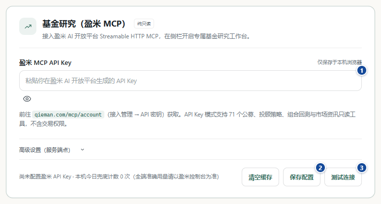

*图 20　① 填盈米 MCP API Key　② 单独保存配置　③ 测试连接，成功后自动保存。*

点击基金状态条的「退出」或再次选择 `/fund` 可回到普通聊天。退出后仍可在原对话查看已经生成的研报与数据调用。

### 看市场温度与热点

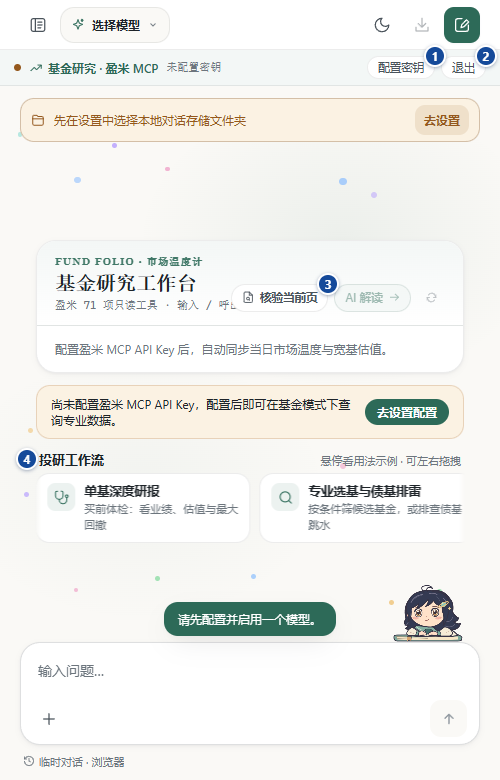

*图 21　① 前往基金设置　② 退出基金模式　③ 核验当前页　④ 浏览投研工作流。此图为首次接入前。*

- 空白对话会显示基金工作台。配置密钥后可查看当日市场温度和宽基估值。点击刷新图标可尝试更新。需要解释时，点「AI 解读」或选择 `/temp`，会直接发出市场复盘问题。
- 对话中可随时打开基金状态条上的「速览」，切换「财经热点」和「热门关注基金」，按提示加载。点击其中的话题或基金会直接提交对应的解读问题。
- 状态条可能显示服务端的今日用量，或「本机今日 N 次」。本机计数仅反映当前浏览器，全端用量以盈米控制台为准。

### 选择分析模板

可以直接提问，也可左右拖动工作台的「投研工作流」卡片，悬停看示例。内置模板也在基金模式的「＋」菜单和 `/` 指令面板中。选中后先检查输入框，补上标的、日期和口径，再发送。市场复盘与核验当前页会直接提交。

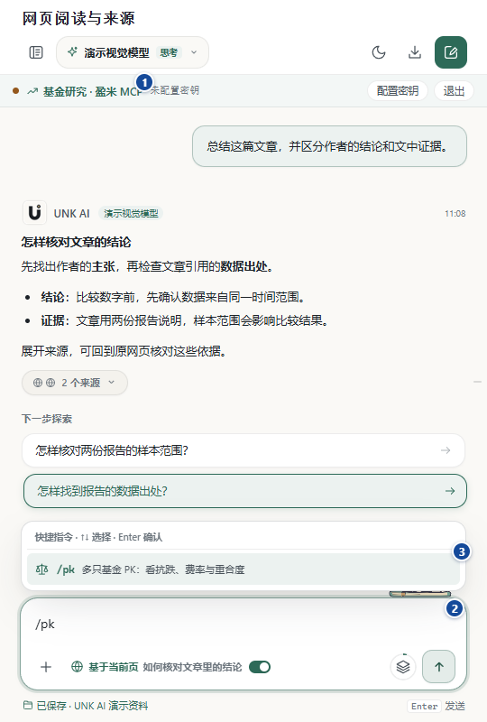

*图 22　① 确认已进入基金研究模式　② 输入 `/pk`　③ 选中「多只基金 PK」，确认后补充基金代码和比较区间。*

| 工作流 | 指令 | 发送前准备 |
| --- | --- | --- |
| 今日市场温度与复盘 | `/temp` | 点击即发送。想限制日期或指数时可自行写一个问题。 |
| 单基深度研报 | `/check` | 填基金名称或准确代码。名称相近时说明份额类别。 |
| 专业选基与债基排雷 | `/screen` | 写明基金类型、时段、筛选条件，或提供要排查的债基代码。 |
| 多基横向对比 | `/pk` | 填要比较的基金代码，注明共同区间、比较指标或份额类别。 |
| 持仓组合诊断回测 | `/portfolio` | 填基金代码与权重，可补回测区间和基准。示例数字可在发送前清掉。 |
| 投顾策略与调仓追踪 | `/strategy` | 填策略名称和要查询的时间范围。 |
| 家庭财务与配置规划 | `/plan` | 按模板描述期限和目标。可用范围或匿名示例表达金额。 |
| 费率规则与交易日历 | `/rules` | 填基金代码、份额类别或需要核对的日期。回答后以适用的公告与规则核实。 |
| 核验当前网页基金 | `/pagefund` | 先切到展示基金的网页。此指令会启用当前页读取并直接发送。 |

### 看懂结果与排查连接

1. 在回答里先核对基金代码、份额类别、日期和数据区间。拿到图表时，可点击「查看大图」。
2. 展开回答末尾的「盈米 MCP 数据调用」，查看本轮查询、耗时、「命中缓存」或「失败」。返回资料有限时，可围绕缺失字段再问，例如「只查这个份额的申购费率，并注明数据日期」。
3. 如显示未配置密钥，点「配置密钥」后测试连接。若连接测试成功但对话仍不能调用，检查当前模型是否支持流式工具调用，再重试。用量受限时，先检查盈米控制台的额度。
4. 若需排查缓存，在「设置 → 基金研究」点「清空缓存」，会清除本机工具目录和当日市场温度缓存。它不重置盈米服务端额度。

基金查询的参数会发往配置的盈米服务，查询结果可能交给当前对话模型整理。此模式使用只读工具。核对结果时以适用的原始资料与日期为准。

## 8. 让插件操作网页

页面操作会实际点击、输入、滚动或导航网页，与只读问答不同。

### 首次启用

1. 打开“设置 → 浏览器控制”，开启“允许浏览器控制”。
2. 在“操作确认方式”选择“标准确认”“逐次确认（严格模式）”或“自动批准操作”；首次可先用标准确认了解执行过程。
3. 回到目标网页，开启“基于当前页”，点击「＋ → 页面操作」。
4. 描述具体任务，发送后按提示核对并授权当前站点。
5. 查看任务面板的状态、步骤和待确认动作，必要时停止或接管。

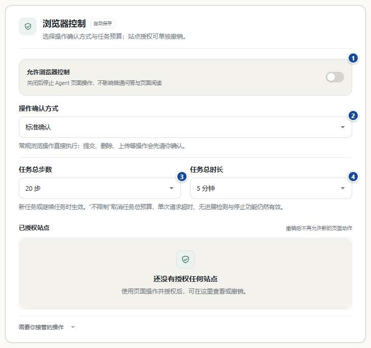

*图 23　① 启用浏览器控制　② 选择操作确认方式　③ 设置总步数　④ 设置总时长。*

适合从这类范围明确的任务开始：

> 打开当前网站的帮助中心，找到退款规则，读取后总结并给出页面链接。
>
> 在当前列表中筛选“已完成”项目，读取显示出来的结果，不提交其他操作。

### 选择操作确认方式

打开 **设置 → 浏览器控制 → 操作确认方式**，按任务需要选择：

| 模式 | 页面动作怎样执行 |
| --- | --- |
| 标准确认（默认） | 常规浏览动作直接执行；提交、发送、删除、上传等需要确认的操作，会先显示确认框。 |
| 逐次确认（严格模式） | 点击、输入、选择、导航等页面动作逐次确认；读取、等待和滚动不逐次确认。 |
| 自动批准操作 | 在已授权站点中，提交、删除、发布、上传等原本需要确认的操作直接执行，不再逐步弹出确认框。 |

自动批准需要你主动选择。启用后，新任务或点击“继续”的任务才使用它；已经等待确认的任务不会因为修改设置就立即执行。需要让当前任务采用新模式时，先接管暂停，核对页面后再继续。任务面板会显示自动批准状态，执行记录仍会保留。

三种模式都需要站点授权。跳到新站点时仍会询问是否允许；密码、支付、验证码等受限控件，以及无法可靠识别的操作仍需接管。自动批准会实际执行删除和提交，所以任务描述应写清对象及范围，例如具体列表、文件或记录名称。

从自动批准切回标准确认、切到严格模式，或撤销站点授权时，正在执行的任务会暂停。关闭浏览器控制也会撤销当前执行许可；已完成的网页动作不会回滚。之后继续时会重新核对权限。

### 调整任务总步数和总时长

同一设置区域提供两个独立选项，选择后自动保存：

| 设置 | 可选值 | 默认值 |
| --- | --- | --- |
| 任务总步数 | 20、40、100、200 步，或“不限制” | 20 步 |
| 任务总时长 | 5、15、30、60 分钟，或“不限制” | 5 分钟 |

步数包括规划、读取、核验与实际动作，并非仅计算点击次数。选择“不限制”会取消对应的任务总预算；两个选项都选“不限制”时，不会因为累计步数或总时长达到旧上限而结束任务。可只放宽其中一项，例如保留 30 分钟总时长、不限制总步数。

预算修改在新任务或明确点击“继续”时生效。继续任务会按当前设置重新计算可用时长，已完成的步数仍然保留；想继续较长任务时，应选择大于当前已执行步数的上限，或“不限制”。任务面板会显示已执行步数及总预算。

页面操作的「已用时」和「任务历时」从任务开始计算，包含暂停、等待确认和人工处理时间。任务预算可在「设置 → 浏览器控制」调整。

“不限制”仍保留单次模型请求、页面观察与动作的超时，以及连续无进展、重复失败和结果不明时的停止。你也可以随时停止或接管。它使用当前选中的模型；模型服务的上下文、输出长度、请求和费用限制仍由服务及模型配置决定。任务运行时需保持侧栏打开。

### 页面读取与页面操作的范围

| 开关 | 控制范围 |
| --- | --- |
| 基于当前页 | 本轮是否使用网页；页面操作也必须保持开启。 |
| 自动接口读取 | 普通页面问答按需读取本站新返回的接口 JSON，无独立开关。 |
| 允许浏览器控制 + 站点授权 | 是否允许 Agent 在授权范围内操作网页，接口读取不授予页面动作权限。 |

需要回到普通问答时，先结束当前任务，再从“＋”菜单关闭“页面操作”。

### 接管、继续与重新开始

| 任务状态 / 操作 | 应怎样处理 |
| --- | --- |
| 想自己操作网页 | 先点“接管”，再手动完成需要的步骤。 |
| 暂停后继续 | 点击“继续”，或在暂停提示中选择“继续任务”；插件会回到原任务页并重新观察。 |
| 已停止或失败 | 使用“重新开始任务”；原标签页仍在原完整地址时，返回该页并携带原提问图片启动新任务、重新观察。 |
| 动作超时、结果不明 | 先到网页核对是否已经生效，尤其不要重复执行提交类操作。 |

执行中切换标签页或手动操作，任务可能暂停。关闭“基于当前页”会停止当前操作并退出该模式；已经执行的动作不会被回滚。

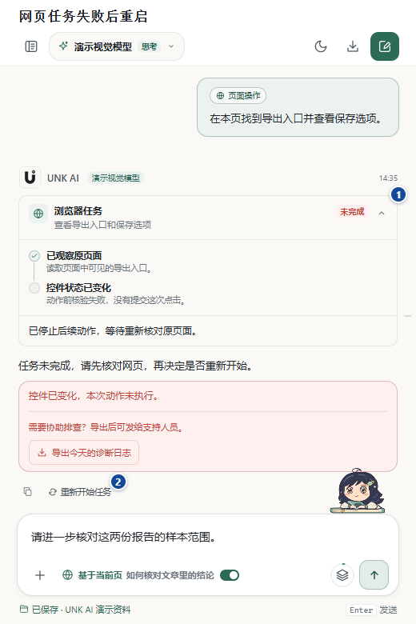

*图 24　① 展开原任务记录　② 核对网页状态后再重新开始任务。*

失败或停止后重新开始任务时，按图中任务卡片操作：

1. 先到网页核对之前的上传、生成或提交是否已经完成。
2. 开启“基于当前页”，在原任务卡片点击“重新开始任务”。
3. 插件会携带原提问和图片回到原任务标签页，重新观察并启动任务；按本次任务提示核对授权和待确认动作。

重新开始会重新执行任务流程，不能替你撤销之前已经完成的网页动作。

| 重新开始受阻的情况 | 处理方法 |
| --- | --- |
| 按钮变灰、提示任务正在运行 | 先停止或等待生成、提交、附件准备、历史整理及其他任务结束。 |
| 关闭了“基于当前页” | 先重新开启；空闲时按钮仍可点击查看具体原因。 |
| 原任务在另一个浏览器窗口 | 在原窗口打开侧栏，再重新开始。 |
| 原标签已关闭、完整地址变化，或旧记录缺少来源 | 回退原提问，保留附件，在目标页面重新发送；同名网页不能代替原标签页。 |
| 原图片缺失或不可读 | 恢复原数据目录中的图片及权限，或回退提问重新添加图片。 |

准备重新开始期间仍可以点击停止，原对话和图片会保留。重复点击不会提交两次。

密码、CVV、PIN、支付、下单和验证码等受限操作会被阻止，需要你接管处理。提交、删除和注销等动作按当前确认方式执行：标准或严格模式会要求确认，自动批准模式可直接执行。任务运行期间保持侧栏打开；关闭侧栏后无人值守持续执行不是当前能力。

### 多步骤任务与参考图上传

包含选择、勾选、填写等多项操作时，插件会先建立短计划，在任务状态中显示已核验的目标数量。已满足要求的选项和开关只核对状态；模型单方面说“完成”不会替代控件结果核验。

同类操作持续失败会触发一次调整方法；读取成功不会清掉操作错误。多步骤写任务连续 4 轮没有真实执行进展时，会进入一次恢复；恢复后再经过最多 3 轮仍未推进则停止。改计划、读到新正文或滚动不算写任务的执行进展；纯阅读保持原有规则。设置有限步数时，已核验的有效动作、对应目标状态或必要子目标进展，才可以在总上限内继续分配步数，不延长总时长。选择“不限制”会跳过总预算限制，但上述进展核验与停止规则仍然有效。已启用思考的当前模型可能在无进展时提高一次思考强度。

支持视觉的模型可以查看当前控件附近的局部画面，帮助识别模型菜单、上传入口或勾选框；恢复时也可自动尝试一次。插件先重新观察当前页面，再截取真实主页面控件及相邻标签，图片用于下一次现有动作决策。每任务最多 3 次，同一稳定控件只查看一次；局部 JPEG 最长边 960 像素、最大 512 KiB。后续点击仍使用当前页面的元素并经过权限与目标核验。无视觉模型需要接管，iframe 或未找到可见控件时不会盲点坐标。

自动截图超过模型上下文容量时，会省略这张自动图片，继续使用页面元素资料；你提供的参考图和明确请求的局部图片不足以装入预算时，会明确报错。截图期间关闭控制权限或页面目标失效，会立即暂停。

写任务每次动作决策只携带去重后的正文节选，合计最多 3000 字符，保留来源和截断说明；已经读到的完整资料仍留在本任务中。需要更新网页资料时，明确说明要核对的新字段或范围。诊断可查看输入字符、估算 Token、图片数量和大小，帮助区分重复读取与模型等待。局部观察和输入限制不保证所有站点或模型服务必然提速。

透明的原生开关可以通过正确关联的可见标签操作；透明上传区只有经过区域及命中校验的原生文件输入才支持，并按所选确认方式批准上传。局部视觉没找到目标或截图失败会在操作记录中说明，不能把截图当作已经完成任务。写任务的区域资料另限制为 3000 字符的带来源节选；停止日志区分无进展、结果不明、时间及步数原因。

需要把本条消息中的参考图交给网站时，插件只能选择本任务已经提交的图片。标准和严格模式会逐次询问确认；自动批准模式在已有站点授权范围内直接上传。支持原生文件输入框及具有可见原生关联标签的隐藏输入框；无法关联的自定义按钮、拖拽区或目录上传需你接管。文件进入网页不等于服务器处理完成，插件会继续核对页面结果；结果不明时不会自动重传。

网站接收参考图后清空文件选择框时，插件会核对本次新出现的局部图片预览；预览内容与原图匹配后，可以继续下一步。仅有图片计数或旧预览不能证明本次接收成功，仍会明确停止。

遇到“上传结果不明”或最后一步没有完成时，先展开任务记录，查看实际失败步骤，再到网页核对参考图预览、生成状态和提交结果。不要仅凭插件停止就再次点击“生成”或重传图片；必要时先接管处理，再决定继续或重新开始。

故障时可从当前对话顶部导出菜单，或错误卡片，导出今天的本对话诊断日志，并结合实际页面结果排查。不同网站和模型服务的支持情况可能不同。

## 9. 上传图片、截图和文档

“＋”菜单中的附件入口是**上传图片**和**上传文档**。之前的“当前页截图”“框选区域”入口已经移除；仍可以用系统截图工具截图，再粘贴到输入框，或上传截图文件。

1. 点击“＋”，选择类型和文件；图片也可以直接粘贴，文件可拖入输入区。
2. 等待附件卡片出现，检查文件名与是否标为“内容已截断”。
3. 输入任务，例如“解释这张图里的三个指标”或“总结文档中的实施步骤”。
4. 如果只分析附件，关闭“基于当前页”，避免同时携带无关网页。
5. 发送前可通过附件卡片上的“×”移除文件。

| 类型 | 格式与当前限制 |
| --- | --- |
| 图片 | PNG、JPG、WebP、GIF；单文件最大 8 MB，较大图片会压缩或缩放。需要支持视觉的模型。 |
| 普通文档 | TXT、Markdown、CSV、JSON、HTML、XML、YAML、日志、DOCX 等；单文件最大 5 MB，提取文字最多约 5 万字符。 |
| PDF | 单文件最大 20 MB；提取可读取文字，按预算截断。扫描版 PDF 的 OCR 尚未提供。 |
| 普通问答附件数 | 每条消息最多 6 个。 |
| 页面操作参考图片 | 最多 3 张、合计 8 MiB；页面操作不接收文档附件。 |

CSV 可以作为文本分析；当前没有直接读取 XLSX 表格文件的附件入口。复杂排版、图片化文字和被截断的部分不能当作已完整读取。

### 放大查看图片

1. 点击消息中的图片或输入框中的附件缩略图；也可按 Tab 聚焦图片，再按 Enter 或空格打开。
2. 预览直接显示图片，没有背景框、标题栏和工具栏。默认适应宽度：较矮的图片居中，长图从顶部显示。
3. 将鼠标放到要查看的细节处，向上滚动放大、向下滚动缩小。
4. 按住鼠标左键拖动图片，查看长图下方或放大后超出窗口的部分；触屏可用单指拖动。到达图片边缘后会停止继续平移，避免把图片拖出可见范围。
5. 打开后可直接用方向键移动视野，＋/－缩放，0 回到适应宽度，1 按当前附件像素以 100% 查看。滚轮用于缩放，长图下方用拖动或方向键查看。
6. 单击图片或空白处立即关闭；拖动结束不会误关闭。也可按 Enter、空格或 Esc 关闭。切换对话自动关闭，同一对话重绘保留缩放和位置。

*图 25　① 在图片上滚轮缩放，按住拖动查看其他位置。按 0 恢复适应宽度，按 Esc 关闭。*

最高可放大到 800%，通常最低可缩到 10%；当大图的适应宽度比例低于 10% 时，也能保留这个更小的比例。缩放只改变显示，不能增加原图细节。

图片预览用于查看附件和回答中的图片，不会修改图片或触发保存。上传时已经缩放的图片无法通过放大恢复原文件的细节；若关键小字已经模糊，可裁剪关键区域后重新上传，并在问题中指出需要识别的位置。

### 图片存在哪里，怎样备份

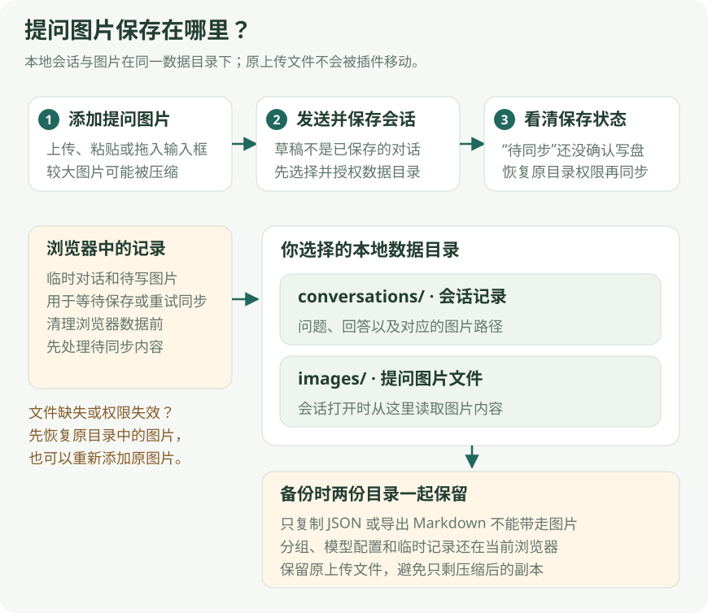

*图 26　图片从输入草稿进入会话，正式记录与图片文件需一起备份。*

图片保存在**设置 → 本地数据中所选的目录**，不是扩展安装目录，也不会自动保存到项目工作目录。查看设置中的当前文件夹名称，即可确认实际使用的数据目录。

| 所选数据目录内的位置 | 保存内容 |
| --- | --- |
| `conversations/<会话id>.json` | 正式会话记录及附件引用。 |
| `images/<内容摘要>.png`（或 JPG、WebP、GIF） | 提问图片文件；同一内容可以共用一个文件。 |
| `diagnostics/` | 最近 7 天的排障日志。 |

正式会话的 JSON 只记录图片相对路径和存储版本，不内嵌 Base64。打开会话时会从原目录读回图片；遇到文件缺失、损坏或权限失效，且无法从浏览器保留内容恢复图片时，会显示具体错误。需要该图的发送、任务重启和图片 / PDF 导出，会要求恢复文件或重新添加图片；Markdown 仍可导出已有文字。

按保存图解备份时：

1. 先停止当前任务，检查保存状态，确认会话已写入所选文件夹。
2. 一起复制 `conversations/` 和 `images/`，需要近期故障记录时一并复制 `diagnostics/`。
3. 保留原浏览器的配置、分组和待同步记录；仅复制文件夹不等于迁移整个插件。

**整段 Markdown 导出不打包图片和文档附件，不能代替数据目录备份。**

旧版内嵌图片记录仍可打开，在下一次正常保存时转为图片文件。删除会话保留共享图片，供其它会话和删除撤销使用；目前不自动清理未引用的图片。写盘前或同步失败时，浏览器 IndexedDB 保留完整待写图片以便恢复；临时会话仍存于扩展的 `temporaryConversation` 本地存储。模型请求按服务接口要求传图片数据，不把电脑上的相对路径发送给远端模型。较大图片可能已被压缩或缩放，保存内容不一定是原文件的逐字节副本；原上传文件不会被插件移动或删除。

## 10. 会话整理与容量提示

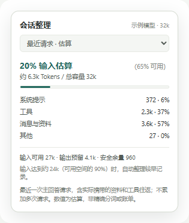

*图 27　① 切换估算范围　② 输入估算与模型总容量。*

点击发送按钮左侧的叠层图标，先选择统计范围，再核对输入分类、输出预留和已整理摘要。准备发送时查看“下一次提问”，核对刚才生成使用了哪些资料时查看“最近请求”。

- **下一次提问 · 预估**：按普通问答的草稿、选区、附件、Skill、当前页面开关和已知正文估算，包含已开启的联网工具定义。尚未读取的页面、截图等会提示未计入；发送时可能补读、整理或裁剪。
- **最近请求 · 估算**：按最近一次主回答实际交给模型传输层的消息和工具统计，包含 Skill、视频字幕及该次请求携带的工具往返。联网多次请求取最后一次，不相加；压缩、建议问题等辅助请求不覆盖它。视频笔记按自身隔离历史的请求计数。此快照仅在当前侧栏内存中保存，重开侧栏后需发送新请求。
- **分类**：系统提示包含以系统消息携带的压缩摘要；工具包含定义、调用参数和返回结果；消息与资料包含提问、历史回答、页面、文档、Skill 和字幕；其他包含消息格式、图片估算和已知元数据。百分比以估算输入总量为分母，加总为 100%。悬停数字可看未缩写的估算值。
- **预留**：最大输出与 3% 安全余量单列，不算作已经使用的输入。未设置最大输出时，服务默认输出上限未知。模型总容量仍以设置值为准。
- **预警与整理**：输入占可用输入空间的 75% 时预警、90% 时明显提醒；普通生成前会尝试整理较早记录。可用空间先扣除输出与安全余量，必需资料和工具也参与预算。

分类行的百分比表示该类占本次估算输入的比例；顶部百分比表示输入占模型总容量。预警则按扣除输出预留与安全余量后的可用输入空间计算，所以顶部比例不到 90% 时，也可能需要整理。例如总容量 32,000、最大输出 4,096 时，还要预留 960 的安全余量，输入可用空间约为 26,944 Tokens。

整理会用摘要压缩后续请求中携带的旧消息，帮助保留目标、关键事实和约束，不是删除历史聊天文件。它可能产生额外模型请求；摘要不保证保留每个细节。

**当前只在生成前自动整理，没有手动整理入口。** 没有足够的较早记录，或只是单条页面/文档过长时，整理也不能解决全部容量问题，可减少输入、拆分材料或新建对话。页面操作沿自身的决策预算运行，面板的下一次提问预估针对普通问答。

容量仍是字符与固定图片开销的估算，尚未接入模型 tokenizer 或接口返回的 `usage`，不能据此计算精确用量或费用。图片随模型、尺寸和细节策略存在偏差；旧文件附件的服务端提取用量未知，会单独提示，不能当成零。显示“输入超过可用空间”时，发送前会按预算整理或裁剪；必需 Skill 不能完整放入时明确报错。视频笔记会分段整理全部长字幕，问题和来源说明本身超出容量时仍会报错。重要资料应尽量明确指出，不要假定超长材料会完整进入单次模型请求。

## 11. 历史对话、分组和本地保存

### 拉宽或收窄侧栏

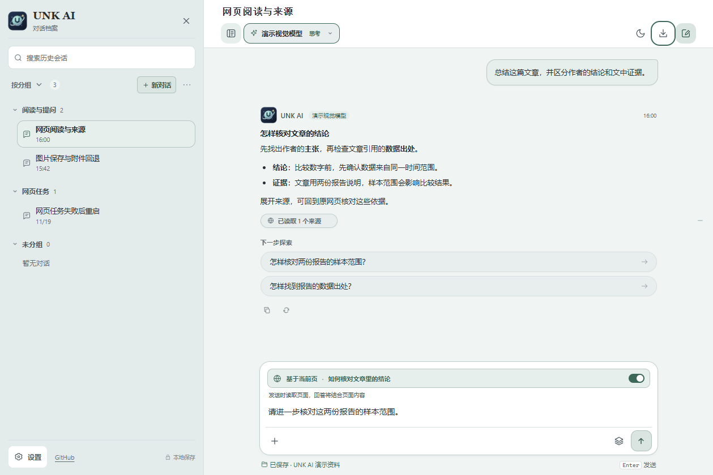

*图 28　① 左侧历史列表　② 右侧当前对话。*

1. 将侧栏边缘向外拖宽；可用宽度达到 960 像素时，历史区自动显示在左侧，占 360 像素，右侧保留至少 600 像素对话空间。
2. 在左侧查找或选择会话，右侧继续阅读；并排模式没有背景遮罩，两边可以分别滚动。
3. 需要更多对话空间时，点击历史区右上角“×”收起，再点顶部历史图标展开。

宽屏切换或新建对话会保留已展开的历史区，自动展开不会把输入焦点移走。在同一宽屏状态下，手动收起的历史区不会因切换对话而重新展开。

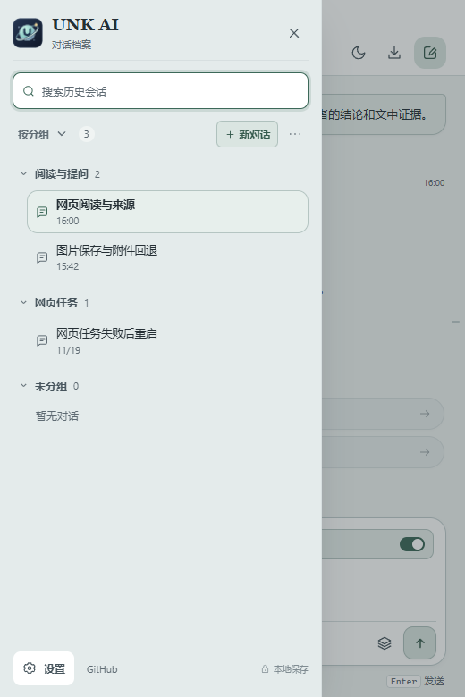

*图 29　① 搜索对话　② 分组与多选管理　③ 设置。*

1. 收窄到 960 像素以下时，历史区自动关闭，恢复抽屉方式；需要查看时再点击顶部历史图标。
2. 查找并打开会话后，抽屉会关闭，回到对话。
3. 只想关闭抽屉时，点击“×”或外侧遮罩；没有正在编辑名称、批量选择或打开子菜单时，也可按 Esc 关闭。

再次拉宽到足够空间时，历史区会自动并排展开，搜索和分组状态会保留。

### 查找与整理历史

1. 历史区未展开时，点击左上角历史图标。
2. 输入对话名称中的关键词查找，点击结果打开；当前不提供聊天正文的全文搜索，也不保证按网页标题或网址找到会话。
3. 使用“按分组 / 全部对话”切换显示方式。
4. 点击顶部“⋯”可新建分组或进入“选择多个”。
5. 对话和分组可通过右键或“⋯”菜单重命名、移动等；对话也可以长按拖入目标分组，Esc 取消拖动。
6. 在未搜索的「按分组」视图中，长按分组标题并拖到目标位置，松手后保存顺序。按 Esc 取消本次拖动。「未分组」固定在末尾。

点击顶部“新对话”或分组旁的“＋”，都会先打开临时对话。未发送问题时，切换到其他对话或再次新建不会把空对话加入历史；只输入草稿也不算发送。组内新建会保留所选分组，实际保存后出现在该组。

| 你做了什么 | 是否会因此新增历史对话 |
| --- | --- |
| 点击新对话，然后直接切换回来 | 不会，未发送的空对话不保存。 |
| 在分组内点“＋”，只输入草稿或添加未发送的附件 | 不会；草稿不算正式提问，切换前自行保留需要的内容。 |
| 选中回答，确认几条引用注释但尚未发送 | 不会；它们属于当前草稿。 |
| 打开或收起一个尚未发送的追问窗口 | 不会；空窗口不保存。 |
| 在主对话或追问窗口真正发送问题 | 进入对应对话的正常保存流程；仍需查看文件夹同步状态。 |

未发送草稿与已发送记录不同。不要把切换对话、收起窗口或显示输入文字当作保存确认；需要长期保留的内容应发送、复制或导出。

批量操作时先进入“选择多个”，勾选会话后再移动或删除。搜索、折叠可能隐藏已选项目，提交前留意选中数量。正在生成、准备提交、整理或操作网页时，部分历史操作会禁用。

### 删除与恢复

删除对话会涉及原目录中的真实会话文件。操作前确认选中的范围，特别是批量删除时。

- 删除后可通过提示中的“撤销”恢复。
- 提示消失后，可到顶部“⋯ → 撤销上次删除”。
- “文件删除待核验”表示文件操作结果尚未确认，不等于已完成删除。
- 删除分组只解除分组关系，不删除分组里的会话正文。

恢复依赖当前浏览器保留的恢复记录；它不是跨设备的云端回收站。清理扩展数据或卸载前，应先处理待同步内容并备份需要的文件。

### 看懂保存状态

| 状态 | 含义与处理 |
| --- | --- |
| 临时对话 · 浏览器 | 新建时先创建临时会话。有有效文件夹授权时，首次发送会转为正式会话；也可使用可见的“保存到本地”入口。 |
| 已保存 · 文件夹名称 | 会话文件已写入授权文件夹中的 `conversations/`。 |
| 已保存在浏览器 · 文件夹待同步 | 浏览器保留了待写记录，但文件夹同步尚未完成；恢复原文件夹权限后再同步。 |
| 权限失效 / 恢复权限 | 按界面提示重新授权原目录；仍失败时到“设置 → 本地数据”检查。 |

设置中的文件夹选择不是“搬家”操作。切换目录不会自动迁移旧文件或把原目录的待同步记录重定向到新目录。分组、自定义名称和部分恢复记录保存在浏览器，仅复制会话文件夹不等于复制全部插件状态。

恢复原目录权限后或重新打开侧栏时，插件会重试待同步记录；当前没有独立的“立即同步”按钮。重新打开侧栏通常恢复已有临时会话或最近会话，要开始新主题请主动点击新对话。

## 12. 复制、导出与分享

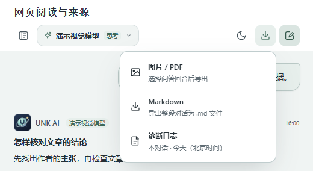

*图 30　① 图片 / PDF　② 整段 Markdown　③ 当前对话今天的诊断日志。*

分享与整段会话导出入口集中在**顶栏下载图标**，不再放在消息区的标题旁。先打开当前对话，再按用途选择图中入口：

| 选择 | 适合用途 | 导出范围 |
| --- | --- | --- |
| 图片 / PDF | 分享排版后的回答或部分问答 | 先选回合，再预览；可选择是否包含自己的提问。 |
| Markdown | 保存可编辑的整段对话文字 | 当前会话文字，可能包含模型名称、状态和 Agent 步骤；不打包附件文件。 |
| 诊断日志 | 排查等待、失败或页面操作问题 | 当前对话今天（北京时间）的运行记录，不包含对话正文、图片或密钥。 |

### 复制一条回答

点击回答下方的复制图标，选择“复制 Markdown”或“复制纯文本”。需要保留代码与排版结构时选 Markdown；粘贴到普通输入框时可选纯文本。

复制自己的提问时，先将鼠标放到提问气泡上，再移到气泡右下方的复制图标并点击。气泡到下方操作区之间可以连续移动，按钮不会因跨过间隙消失；右侧轮次刻度也不会挡住复制按钮。键盘聚焦可显示并激活复制按钮，触屏设备直接显示入口。

悬停或键盘聚焦右侧轮次刻度，可以预览该轮提问和回答。预览保留 Markdown 的标题、段落、加粗、列表、引用和代码排版；链接只显示文字，卡片保持最多三行的短预览，省略号表示还有内容。点击刻度可回到完整原文，Esc 关闭预览。

### 导出整段 Markdown

点击顶栏下载图标 → Markdown，在浏览器保存窗口选择位置，保存整段当前会话。它保留原来的会话 Markdown 格式，可能包含模型名称、消息状态和 Agent 步骤；不会改成 PNG / PDF 的回合选择格式，也不包含思考过程、附件文件或隐藏的页面全文。

尚未发送问题的新对话不能导出 Markdown 或图片 / PDF，但仍可查看可用的诊断记录。生成、页面任务、提交、压缩或任务重启期间，Markdown 选项暂不可用；等待保存窗口时禁止重复导出。若等待保存超时，先检查浏览器下载列表和保存窗口，再决定是否重试。切换会话会结束本地等待，已经交给浏览器的下载仍需在下载界面检查或取消。

### 导出 PNG / PDF

1. 点击顶栏下载图标，选择“图片 / PDF”。
2. 选择需要的问答回合；可全选、清空，或关闭“包含我的提问”。
3. 打开预览，检查内容和来源。
4. 选择保存 PNG 或 PDF，在浏览器下载界面确认保存结果。

一次最多 50 轮、12 万字符，本地图片合计最多 8 MiB。长图过长时减少回合或改为 PDF；PDF 最多 40 页。

PNG / PDF 导出使用固定浅色版式，不包含思考过程、推荐问题、Agent 内部步骤或隐藏的页面全文。PDF 采用图片分页，文字不能直接选取；需要可编辑文字时使用复制 Markdown，或选择顶栏下载菜单中的“Markdown”。整段会话的 Markdown 导出格式不同，可能包含模型名称和 Agent 步骤，分享前请检查内容。

所选提问含有无法恢复的图片时，需先恢复图片，或移除对应回合；也可关闭“包含我的提问”后只导出回答。未选中的缺图回合不会阻止其它回合导出。

## 13. 联网搜索、数据范围与常见问题

### 联网搜索与页面读取的区别

| 能力 | 入口 | 主要资料来源 |
| --- | --- | --- |
| 当前页阅读 | 输入框底部“基于当前页” | 本轮固定的网页，以及明确需要的同站补充章节。 |
| 本站接口读取 | 开启“基于当前页”后按需判断 | 经本轮许可，在短暂监听窗口中新返回的同源 JSON。 |
| 全网搜索与来源读取 | 设置 → 联网检索 | 模型按问题查询的公开搜索结果，以及需要进一步读取的来源正文。 |
| 页面操作 | “页面操作”及浏览器控制授权 | 真实页面上的观察与动作，可点击、输入、滚动和导航。 |

关闭“基于当前页”不等于关闭全网搜索；自动接口读取也不等于开启联网搜索或授权页面动作。

### 配置并完成一次联网核实

1. 打开“设置 → 联网检索”，开启“启用搜索与抓取”。
2. 点击“检测接口”，或按服务商说明填写搜索与抓取接口名称；搜索与抓取沿用当前模型服务地址和密钥。
3. 保存设置。先使用能够支持流式工具调用的模型服务，再提出带明确主题、日期范围和核实要求的问题。
4. 观察“正在搜索并读取公开网页”等阶段提示；回答后展开来源，查看哪些是摘要、哪些确实读到了正文。
5. 对没有核实的部分，缩小范围继续追问，或自行打开原链接核对。

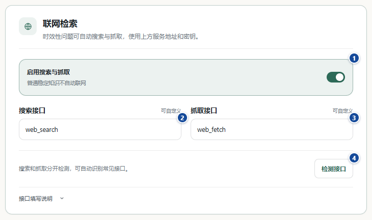

*图 31　① 启用搜索与抓取　② 搜索接口　③ 抓取接口　④ 检测接口。*

> 示例：核对最近 7 天的 AI 模型发布，区分已官宣与传闻，列出发布日期、官方原链接和仍未核实的信息。
>
> 示例：比较这两个方案目前公开的价格与配额，只引用可打开的官方资料；没有找到的数据明确留空。

联网问答需要模型服务支持流式工具调用（`tool_calls`）。测试连接成功只验证简短模型请求，不代表搜索和工具协议可用；服务拒绝工具时会显示错误，不会自动移除工具后假装完成核实。

### 模型怎样决定搜索与读取

开启联网后，普通问答的第一次主模型请求就提供搜索工具。模型按问题和已有资料决定直接回答、查询什么，以及是否进一步读取来源，整个过程继续同一条回答。

例如，上传错误截图问“这里正常吗”，模型可以直接使用图片解释；询问最新情况或明确要求核实时，则可搜索并依据结果继续分析。已有完整正文会复用，缺少资料时才请求来源读取，不会自动把每一条搜索结果都抓取一遍。页面开关开启时，必要的本页读取、补读和视觉准备仍会先按本轮要求执行。

对“今天”“最近一周”等问题，插件提供北京时间供模型核对。来源的采集时间不等于文章发布时间；核对新消息时，应要求区分发布、更新和采集日期。

### 看懂来源证据

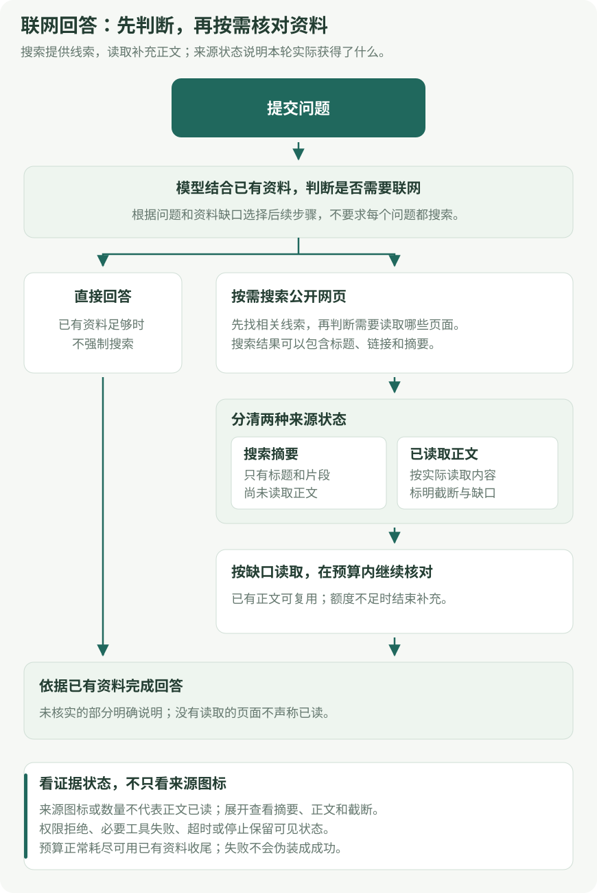

*图 32　搜到链接、取得摘要和读到正文是不同状态；核实结论时先检查来源证据。*

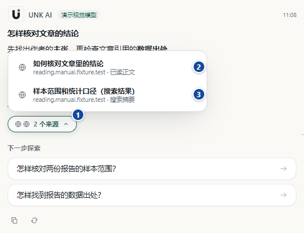

*图 33　① 点击来源数量展开列表　② 已读正文示例　③ 搜索摘要示例。*

| 来源标记 | 能说明什么 | 不能据此认定什么 |
| --- | --- | --- |
| 搜索摘要 | 本轮拿到了搜索结果中的标题、链接或摘要。 | 不能当作已经通读原网页，摘要可能缺少条件和上下文。 |
| 已读正文 | 本轮取得了来源正文，并在预算内提供给模型。 | 不保证每个段落都被保留或引用；有截断时需按提示理解范围。 |
| 正文读取暂不可用 | 本次读取遇到临时服务错误，仍保留原搜索摘要或已有正文，并标明原来的读取范围。 | 不表示取得了新的完整正文，也不表示来源不存在。 |
| 读取状态未知 | 旧记录或资料不足，无法确认读取深度。 | 不能直接认定已读，也不能仅据此判断网站不存在。 |

只有全部来源都明确取得正文且没有待解决的读取错误时，汇总才显示“已读取 N 个来源”；混合、读取暂不可用或未知状态显示中性的来源数量。来源数不是搜索次数，也不是完整通读的文章数。网站图标失败时显示默认地球图标，正文读取状态仍以文字标记为准。

需要更强证据时，可以追问“请读取第 2 个来源的正文，核对这个结论及其适用条件；读取失败时说明原因”。资料缺失、截断或只有摘要时，回答应保留这些限制，不能将其写成已核实事实。

### 搜索额度、复用与收尾

每次回答最多 4 轮工具交互、6 次不同工具操作、3 个不同搜索查询；同批最多并行 2 项，结果还有时间和大小限制。重复查询或读取同一来源会复用本轮结果，不再扣同一操作或查询的次数，但新的工具交互仍计入轮数。

模型申请超过剩余额度时，插件先执行额度内允许的请求，告知其余请求未执行，再依据已有资料完成同一条回答，并说明尚未核实的部分。这表示本轮检索范围到达上限，可以在下一问缩小主题继续核实。模型选取的某个公开来源读取遇到临时服务错误（HTTP 500、502、503、504）时，插件会明确告知该来源未取得新正文，让模型继续核对其他资料或说明证据不足；失败来源在本轮不自动重读，已有回答和图片继续保留。

搜索失败、认证或权限拒绝、限流、取消、超时，以及用户明确要求的当前页或选区资料读取失败，仍保留对应错误或停止状态。来源地址变化、正文为空等异常也不会按临时服务错误处理。

只有服务的搜索或抓取端点返回 HTTP `404`、`405`、`501`，表明缺少该接口时，插件才尝试有界的公开网页检索或读取。认证失败、权限拒绝、限流、网络错误、取消或超时不会触发这种回退。上述来源临时服务错误也不会改用其他服务。公开读取不带登录凭据、不跟随重定向，部分网站可能无法使用。工具失败会保留可见说明，不能把没有来源的回答当作已经核验的最新消息。

### 数据发送到哪里

模型请求会把本轮使用的问题、历史、页面资料、附件或所选 Skill 内容发送给你配置的模型服务；视频笔记会发送本轮取得的字幕。选择本地保存不等于离线推理。PDF 文字提取在浏览器本地执行，网页搜索、字幕读取与资料下载仍会访问相应网站。

API Key 保存在当前浏览器，不使用操作系统级密钥库加密，也不会随对话导出。接口响应会按规则裁剪并过滤常见凭据与敏感字段，但不能保证识别全部业务敏感数据。按实际资料和所用服务决定是否开启相关能力。

### 等待或报错时怎样排查

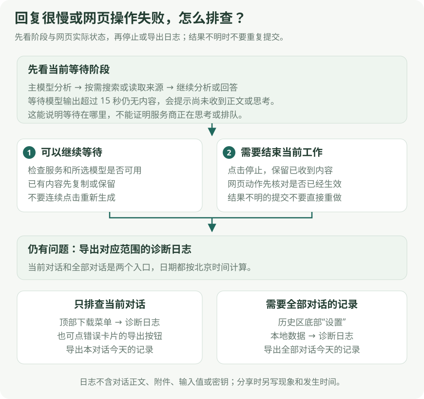

*图 34　先确认等待或失败步骤，再核对网页结果与诊断范围。*

1. 先辨认界面停在页面读取、公开搜索、模型思考，还是模型输出等待。
2. 页面操作失败时，展开任务记录，再到原页面核对实际结果；“结果不明”不能直接当成未执行。
3. 需要结束本轮时点击停止；保留要继续使用的草稿、附件和已有回复。
4. 按下表选择当前对话或全部对话的诊断范围，保存文件并记下大致时间、任务和预期结果。

### 导出诊断日志

**无需等到报错：点击顶栏下载图标 → 诊断日志**，即可导出当前对话今天（北京时间）的记录；正在生成时也能使用。菜单内已标注导出范围。

1. 先展开“浏览器任务”或错误详情查看失败步骤；完成、失败和停止的任务也能展开。
2. 点击错误消息下的“导出今天的诊断日志”，下载 **本对话今天（北京时间）** 的排障记录；需要全部对话时，进入“设置 → 本地数据 → 诊断日志”，点击“导出今天全部诊断日志”。
3. 将下载的 JSON 文件发给支持人员，并说明大致发生时间、操作和预期结果。插件不会自动发送。

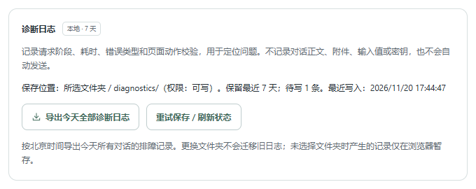

*图 35　① 导出当天所有对话的诊断日志　② 重试保存或刷新状态。*

| 导出入口 | 记录范围 |
| --- | --- |
| 当前对话顶栏下载 → 诊断日志 | 当前对话今天（北京时间）的记录，生成中也可使用。 |
| 错误消息 → 导出今天的诊断日志 | 该消息所属对话今天（北京时间）的记录。 |
| 设置 → 本地数据 → 导出今天全部诊断日志 | 今天所有对话的记录，用于跨对话或运行环境排查。 |

设置图中还可查看目录权限、待写和缺失数量。日志保存有问题时，点击“重试保存 / 刷新状态”，再检查反馈；它不会阻止主回复展示。

诊断日志不包含对话正文、思考、页面全文、附件、输入值或密钥；主要包含请求耗时、HTTP 状态、阶段、动作校验、错误类型和匿名关联编号。文件会说明记录覆盖范围及缺失，旧日期或功能启用前的故障不能用今天的记录还原。界面只提供今天的导出范围，遇到问题时请及时保留当天日志。导出没有记录，也不能证明网页动作从未执行；动作结果仍需到原页面核对。

日志在所选文件夹的 `diagnostics/` 下保存今天及前 6 天。浏览器关闭时不执行清理，重新运行后再维护。设置页可查看文件夹权限、待写和缺失数量，点击“重试保存 / 刷新状态”；日志故障不会阻塞回答。更换目录不迁移旧日志，未选择目录时产生的记录只在当前浏览器暂存。文件夹导出仅读取当前所选目录，同时合并可用的浏览器暂存记录。

### 常见问题速查表

| 遇到的情况 | 建议处理 |
| --- | --- |
| 安装时提示找不到清单 | 选择直接包含 `manifest.json` 的解压目录，不要选择 ZIP 或多套一层的父目录。 |
| 重新打包后界面没变 | 核对 Chrome 加载的扩展路径，替换该路径下的文件，点击重新加载并重开侧栏。 |
| 长对话里看不到标题 | 当前版本的标题固定在顶栏；核对版本和加载路径。新对话没有额外标题行，Chrome 原生栏显示默认插件名。 |
| 刚打开页面看不到滚动条 | 内容足够短时不需要滚动条；长内容区域在鼠标移入后显示。移出隐藏时仍可用滚轮，颜色随主题统一变化。 |
| 历史区盖住对话 | 窄屏采用抽屉，可点“×”或遮罩关闭；拉宽到 960 像素时会自动并排显示。 |
| 顶部历史按钮不能收起历史区 | 这个按钮用于展开；收起请点击历史区右上角“×”。 |
| Markdown 导出选项变灰 | 新对话尚无问题，或正在生成、提交、压缩、页面任务、重启及等待保存；结束相关工作后重开菜单。 |
| 无法获取模型 / 测试连接失败 | 检查服务地址、密钥、服务是否运行及模型是否可用。获取列表成功也不等于生成请求一定成功。 |
| 测试连接成功，但设置仍未生效 | 检查是否已授权文件夹并点击“保存设置”。 |
| 测试盈米连接后仍无法生成基金研报 | 确认顶栏模型支持流式工具调用。查看回答错误和「盈米 MCP 数据调用」，核对密钥、网络或服务端额度。 |
| 普通聊天正常，联网却失败 | 核对是否启用搜索与抓取，以及服务是否支持流式工具调用；连接测试不覆盖工具协议。查看具体 HTTP 状态和诊断阶段。 |
| 来源显示“搜索摘要”，却没有正文 | 本轮仅取得摘要，不能理解为已通读。缩小问题范围，明确要求读取相应来源；受限网页仍可能无法读取。 |
| 来源的网站图标变成地球 | 这是图标缺失或失败的后备显示，不代表正文读取失败；查看来源文字标记。 |
| 联网回答说部分内容未核实 | 查看是否达到本轮额度或资料被截断；把未核实事项单独提出，优先指定官方来源。 |
| 看不到页面开关 | 浏览器内部页、扩展商店等页面受限制；自动阅读和接口读取已没有独立按钮。 |
| 本地文件读取失败 | 在扩展详情启用“允许访问文件网址”，重新打开文件后再试。具体文件仍需有可读内容。 |
| 页面里有内容，但读取失败或不完整 | 等待加载，核对原页面后重试，或明确要求“补读页面结构并核对缺失字段”；跨域框架、懒加载、自绘内容和登录限制仍可能无法读取。 |
| 找不到“视频笔记”或按钮不可用 | 开启“基于当前页”，打开 B 站普通视频并选好分 P；等待页面加载及当前任务结束，悬停按钮查看原因。 |
| 视频没有可读取的字幕 | 先核对平台字幕和访问权限。无字幕或空字幕提示中可手动确认从画面识别；弹幕和评论不会当作字幕。 |
| 读取 B 站字幕超时 | 字幕读取尚未完成，模型还未开始整理。确认原视频页面已加载、登录及网络正常后重试；单次请求最多等待 30 秒。 |
| 视频笔记时间码没有定位 | 回到原视频、原分 P 并等待播放器就绪；可先点击笔记标题返回，再点击时间码。结果不明时先核对播放进度。 |
| 视频笔记整理失败 | 长字幕会自动分段；检查模型上下文、最大输出及服务状态。摘要失败可直接重试，已取得的原字幕会保留。 |
| 接口读取没有数据 | 本轮短暂窗口内必须出现符合范围的 JSON。历史请求、跨站接口、WebSocket 和非 JSON 不在当前范围。 |
| 追问显示复用，但我需要最新数据 | 明确要求“最新、重新采集、不用缓存”；没有新响应仍可能采集不到。 |
| 读不到图片 / 上传按钮不可用 | 选择支持视觉的模型，检查文件格式与大小；任务运行中部分附件操作禁用。扫描版 PDF 可改为提供关键页图片。 |
| 图片放大后仍看不清小字 | 原始尺寸显示的是当前附件像素，无法恢复上传缩放丢失的细节；裁剪关键区域后重新上传。 |
| 滚轮变成缩放，怎样看长图下方 | 按住左键向上拖动图片，或聚焦预览区后按方向键；触屏可单指拖动。 |
| 图片缩放或位置不合适 | 打开预览后按 0 回到适应宽度，按 1 显示原始尺寸；单击图片会关闭预览。 |
| 选中文字后没有引用菜单 | 确认选中的是同一条助手回答正文，不是思考、输入框、按钮或跨多条消息的文字。 |
| 刚选的引用没有进入输入框 | 在选区旁的注释框点击“✓”或按 Enter 后才加入；取消或 Esc 不会添加。 |
| 引用太多或注释太长 | 展开“N 条引用注释”精简内容；每次最多 8 条，单条注释 2000 字符，注释总计 8000 字符。 |
| 又选一段原文，为什么还是同一个追问窗口 | 同一主对话会复用仍在跟踪的首次追问；新选区用于下一问。关闭窗口后再次单独追问才新建分支。 |
| 收起追问后还在生成 | 收起只隐藏窗口，光环提示仍在运行；要结束请求请展开并停止，或关闭窗口。 |
| 未读小点展开后不再出现 | 展开已清除本次完成提醒，再次收起不会重复提示；只有新的未查看成功回答会再显示。 |
| 旧追问显示“已切换主对话” | 旧窗口已脱离选区跟踪，仍可独立续聊；新选区另开追问，回到旧主对话也不重新绑定。 |
| 不能从历史打开或删除某个追问 | 正在运行时先停止；打开会把对话从浮窗移到主区，删除前需先关闭浮窗。 |
| 没看到“下一步探索” | 在「设置 → 界面外观」检查开关。完成的主对话回答有可用建议时才会显示。 |
| 新对话或历史操作变灰 | 先等待生成、准备、整理或页面任务结束；有队列时先处理队列。 |
| 新建后切走，在历史找不到刚才的空对话 | 未发送的对话不保存；只输入草稿、添加引用或打开空追问都不等于发送。 |
| 点停止后又开始回答另一问 | 停止不会清空队列；检查并撤回剩余排队问题，避免下一项继续执行。 |
| Agent 暂停了 | 查看任务提示；切页、手动操作、导航和授权变化都可能暂停任务，确认状态后继续。 |
| 页面操作确认框太多 | 在“设置 → 浏览器控制 → 操作确认方式”选择“自动批准操作”，对新任务或明确继续的任务生效；新站点仍需授权。 |
| 任务达到时间或步数上限 | 在浏览器控制设置中增大对应总预算，或选择“不限制”；新任务或继续任务时应用。结果不明、连续失败或无进展仍会停止。 |
| 重新开始任务不可用 | 先结束当前工作，开启页面开关；再根据提示核对原标签页、完整地址、浏览器窗口和图片文件。 |
| 图片卡片显示文件缺失 | 恢复原数据目录中的 `images/` 文件和权限，或回退原提问重新添加；不要只修改图片路径假装内容已经恢复。 |
| 网页有上传预览，但任务仍然失败 | 展开任务记录查看实际失败步骤，到网页核对生成或提交结果；预览出现不等于服务器处理完成。 |
| 等待模型超过 15 秒仍没有内容 | 可继续等待或停止，检查模型服务；顶栏诊断日志在等待期间仍可导出。计时不代表服务商已经开始思考。 |
| 找不到手动整理按钮 | 当前在生成前按输入预算自动整理，没有手动入口；单条材料过长时请拆分内容或新建对话。 |
| “最近请求”不可选或重开后消失 | 先发送问题并等待主回答请求开始。该估算只保存在当前侧栏中，重新打开后需要新请求；切换模型并不会改写旧请求的数字。 |
| Token 分类加起来是 100%，是否已经用满 | 分类占比以输入总量为分母；查看顶部容量比例和输出预留判断剩余空间，数值不代表服务商计费。 |
| 回答只有思考、被截断或中途报错 | 这不算完整成功。检查服务和输出上限后重试；需要保留的已有内容先复制。 |
| 显示待同步，不确定有没有保存 | 浏览器记录与文件夹同步是两步，恢复原目录权限并检查同步结果，不要把“待同步”当作已经写盘。 |

当前 Skill 仅支持单文件文字指南，尚未提供完整技能包资源加载、脚本执行、通用 MCP 工具接入、长期记忆或关闭侧栏后的无人值守 Agent。不同网站、模型服务和 Chrome 生命周期下的行为可能不同，遇到不支持或资料缺口提示时以本轮实际结果为准。

## 14. 常用任务速查

| 我要做什么 | 推荐入口 / 设置 |
| --- | --- |
| 解释一个普通概念 | 关闭“基于当前页”，直接提问。 |
| 围绕回答中的几句话逐条提问 | 选中正文 → 引用到当前对话 → 添加并确认注释，检查汇总后发送。 |
| 单独研究回答中的一个分支 | 选中正文 → 单独追问这段内容，在独立窗口发送；可拖动、调整大小或收起。 |
| 把独立追问作为主要对话 | 结束相关任务后，在追问窗口“替换当前对话”，或从历史打开它。 |
| 继续回答给出的推荐方向 | 点击“下一步探索”会直接发送；需要修改时先自行写入输入框。 |
| 总结当前文章 | 开启页面开关，明确要总结的观点、证据或限制，资料按需要自动补读。 |
| 对比多篇网页资料 | 「＋ → 多页对比」，选 2–4 页，提取并检查资料后再发。 |
| 查看基金资料或持仓回测 | 「＋ → 基金研究模式」，选工作流，补基金代码、日期或权重后发送。 |
| 整理 B 站课程 | 先选好当前分 P，开启页面开关，点击“＋ → 视频笔记”；关键要点的时间码用于回看。 |
| 按固定指南总结或写作 | “＋ → 技能 → 管理”导入 SKILL.md，检查兼容性并选用于本次提问。 |
| 阅读在线 PDF | 开启页面开关，要求提炼观点和可核实页码；也可下载后从文档入口上传。 |
| 了解 GitHub 项目 | 打开目标仓库，明确要求说明项目用途、入口和运行方式，核对实际读取范围。 |
| 核实最新消息或价格 | 设置中开启搜索与抓取，明确时间与官方来源要求，回答后检查摘要 / 正文标记。 |
| 核对复杂配置和表格 | 开启页面开关，明确需要的字段；遗漏时指出缺口并要求补读页面结构。 |
| 查看网站新返回的数据 | 开启页面开关并提问，由模型判断是否需要；明确要求时直接说明接口资料范围，并检查实际结果。 |
| 找本站其他章节 | 明确写出章节名称或关键词，要求给出实际读取的来源。 |
| 点击、筛选或导航网页 | 开启浏览器控制和页面开关，进入“页面操作”，按提示授权。 |
| 分析系统截图 | 使用视觉模型，在“＋”上传图片或直接粘贴截图。 |
| 看清图片里的细节 | 点击缩略图，滚轮缩放、拖动定位；“原始尺寸”查看 100%，“适应宽度”复位。必要时重新上传关键区域裁剪图。 |
| 分析独立文档 | 关闭页面开关，上传文档并描述任务。 |
| 看会话占用多少容量 | 点击发送按钮左侧的叠层图标，切换“下一次提问 / 最近请求”，核对分类与输出预留。 |
| 快速找回某轮问答 | 悬停右侧轮次刻度预览，点击刻度跳到完整原文。 |
| 分享回答 | 单条内容用复制；多轮用顶栏导出 PNG / PDF 或 Markdown。 |
| 让历史和对话同时可见 | 把侧栏拉宽到至少 960 像素；需要更多对话空间时用历史区“×”收起。 |
| 修改原问题及其图片 | 停止当前工作后，悬停原提问，点击“回退并重新编辑”，检查恢复的附件后发送。 |
| 重新开始失败的网页任务 | 开启页面开关，在原任务卡片点击“重新开始任务”；先核对网页有没有已经完成的动作。 |
| 找到或备份提问图片 | 查看“设置 → 本地数据”当前目录，一起备份 `conversations/` 和 `images/`。 |
| 排查当前对话报错或等待 | 顶栏下载 → 诊断日志；所有对话的今天记录在设置 → 本地数据导出。 |

### 常用快捷键与手势

| 所在位置 | 快捷键 / 手势 | 作用 |
| --- | --- | --- |
| Chrome | Alt + U | 打开或切换 UNK AI 侧栏；可在扩展快捷键页修改。 |
| 主聊天输入框 | Enter / Shift + Enter | 发送 / 换行；输入法选字时 Enter 先确认文字。 |
| 主聊天输入框 | /，再用方向键 / Enter / Esc | 打开、选择或关闭快捷指令面板。 |
| “＋”添加菜单 | 方向键 / Enter / Esc | 切换选项 / 选择 / 关闭菜单。 |
| 右侧轮次刻度 | 悬停或键盘聚焦 / Esc | 预览该轮问答 / 关闭预览；点击刻度返回原文。 |
| 引用注释输入框 | Enter / Shift + Enter / Esc | 确认引用 / 换行 / 取消本次添加。 |
| 图片缩略图 | Tab 聚焦后 Enter 或空格 | 打开放大预览。 |
| 图片预览区 | 滚轮 / 左键拖动 / 单指拖动 | 缩放 / 移动查看超出窗口的内容。 |
| 图片预览区 | 单击图片或空白处 | 关闭预览；拖动松手不会误关闭。 |
| 图片预览区获得焦点后 | 方向键 / Shift + 方向键 | 小幅 / 较大幅度移动视野。 |
| 图片预览区获得焦点后 | ＋ / － / 0 / 1 | 放大 / 缩小 / 回到适应宽度 / 原始尺寸。 |
| 图片预览 | Enter / 空格 / Esc | 关闭预览。 |
| 追问窗口 | 拖动标题栏 / 右下角 | 移动 / 调整大小。 |
| 追问调整大小按钮 | 方向键 / Shift + 方向键 | 小幅 / 较大幅度调整窗口。 |
| 追问窗口 | 拖至右边缘或点击收起 | 收起到对话图标，保留任务与草稿。 |
| 来源列表 | Esc | 优先关闭来源弹层；已关闭后留意 Esc 对当前窗口的作用。 |
| 窄屏历史抽屉 | Esc | 无编辑、批量选择和子菜单时关闭抽屉。 |
| 历史对话 | 长按后拖动 / Esc | 移入目标分组 / 取消拖动。 |
| 历史分组标题 | 长按后拖动 / Esc | 调整分组顺序 / 取消拖动。 |

### 一次完整的使用示例

1. 打开一篇技术文章，开启“基于当前页”，发送“总结核心方案、适用条件和局限”。
2. 查看来源，确认实际读取范围；表格或配置遗漏时，明确指出缺失字段并要求补读页面结构。
3. 引用回答中的两处结论，分别添加“补充证据”和“解释风险”，在同一问题中逐条核对。
4. 对其中一个值得展开的主题使用“单独追问这段内容”，发送后收起窗口，继续阅读主对话。
5. 收起图标出现未读小点后展开查看。若该分支需要持续研究，结束任务后将其替换到主聊天区。
6. 核对保存状态，按需要分组；选取最终问答导出 PDF，或导出 Markdown 继续编辑。完整备份时同时保留会话和图片目录。

本手册按当前源码、界面和行为测试核对。配图只用于说明布局，不代表已在所有网站与模型服务中完成实测。项目简介与安装方式见 [README](../README.md)。
