# UNK AI 操作手册

**适用版本：0.18.2｜更新日期：2026 年 11 月 11 日**

UNK AI 是一个 Chrome 侧栏插件。你可以直接聊天、结合当前网页提问、上传图片和文档，也可以在授权后让它操作网页。回答使用你在设置中配置的模型服务。

本手册按 0.18.2 的实际入口编写，涵盖安装配置、聊天与引用、独立追问、网页阅读、联网核实、网页操作、附件、保存和导出。截图和流程图使用演示数据，按文字说明核对当前入口。

### 五分钟开始第一次对话

1. 按第 1 节安装扩展，点击工具栏图标或按 **Alt + U** 打开侧栏。
2. 从左上角历史区进入底部“设置”，选择本地数据文件夹，填写模型服务地址、密钥并添加模型。
3. 点击“测试连接”，确认可用后点击“保存设置”；回到侧栏查看顶栏模型名称。
4. 先关闭“基于当前页”，发送“用三个步骤解释你可以怎样帮我整理一篇文章”，确认普通对话可用。
5. 打开一篇文章，开启“基于当前页”，保持“自动”，发送“总结这篇文章，并区分作者结论和文中证据”。
6. 选中回答中的一句话，点击“引用到当前对话”，补充说明并确认；在输入框发送后继续讨论。需要另开一个主题时，选择“单独追问这段内容”。
7. 查看保存状态；需要分享时，用顶栏下载图标导出图片 / PDF 或 Markdown。

不确定模式时，先用普通聊天。需要阅读眼前网页再开启页面开关；需要实际点击、输入和导航时，再进入“页面操作”并授权。

### 按场景查找

| 你现在想做什么 | 阅读位置 |
| --- | --- |
| 安装、更新、换模型或配置联网 | 第 1–2 节；联网单独见第 12 节。 |
| 停止、排队、重试，或改回先前的问题 | 第 4 节“停止与排队”“重新生成与回退编辑”。 |
| 围绕某一句话追问，保留主聊天进度 | 第 4 节“引用注释”“单独追问”。 |
| 总结网页、PDF、代码仓库，核对表格或接口数据 | 第 5–6 节。 |
| 让插件帮忙筛选、填写或上传参考图 | 第 7 节，先了解授权和结果不明的处理。 |
| 上传截图、放大图片、分析文档或备份附件 | 第 8 节。 |
| 管理长对话、历史、分组和待同步记录 | 第 9–10 节。 |
| 分享回答、导出文字、定位失败原因 | 第 11–12 节；常用入口与快捷键见第 13 节。 |

### 本版可以直接感受到的变化

- 回答选区可添加多条引用注释，在原文高亮编号，发送前可修改、移除和清空。
- 独立追问可拖动、调整大小或收起；同一主对话后续选区可继续追问，运行状态和未读完成提示显示在收起图标上。
- 图片缩略图可打开预览，再用滚轮缩放、拖动查看细节；联网来源区分摘要与正文，“下一步探索”围绕本轮具体结论提供追问。
- 页面操作可选择“自动批准操作”，减少已授权站点的逐次确认；任务总步数和总时长可分别设为“不限制”。
- 内容超出区域时，鼠标移入才显示滚动条；聊天、历史、追问窗口和设置使用一致的颜色。
- 新建空对话和未发送的追问窗口不会因切换而进入历史；输入草稿也不等于已经保存。

## 1. 安装与更新

### 首次安装

1. 将 `unk-ai-v0.18.2.zip` 解压到一个固定文件夹。
2. 在 Chrome 地址栏输入 `chrome://extensions`。
3. 打开右上角的“开发者模式”。
4. 点击“加载已解压的扩展程序”，选择**直接包含 `manifest.json` 的文件夹**。
5. 在浏览器扩展菜单中找到 UNK AI，建议固定到工具栏。
6. 打开一个普通网页，点击插件图标打开侧栏。

安装压缩包时，解压后的根目录就是扩展目录；从项目源码构建时，加载的是 `dist` 文件夹。不要把 ZIP 文件本身当作扩展目录。

默认快捷键为 **Alt + U**。如果与其他程序冲突，可到 `chrome://extensions/shortcuts` 查看或修改。

### 更新现有插件

1. 先停止正在生成的回答或网页操作，确认需要保留的会话已经保存。
2. 将新包解压到原来的扩展目录，替换旧程序文件。
3. 回到 `chrome://extensions`，点击 UNK AI 卡片上的重新加载按钮。
4. 在扩展卡片或详情中核对版本为 **0.18.2**，再重新打开侧栏；已经打开的目标网页必要时也刷新一次。

使用项目源码时，先完成构建，再重新加载 Chrome 正在使用的 `dist` 目录。界面仍没变化时，到扩展详情核对实际加载路径；只更新另一个同名文件夹不会更新正在运行的插件。

保留原扩展安装和对话数据文件夹。为了更新而卸载插件可能清除浏览器内的配置、临时记录、分组和待同步内容。

## 2. 首次配置：连接模型并保存设置

设置入口在**左上角历史侧栏 → 底部“设置”**。

1. 进入“本地数据”，点击“选择文件夹”，选择专门保存对话的目录并授权。
2. 进入“连接服务”，填写服务地址和 API Key。服务地址通常填到 `/v1`，也支持完整的 `/chat/completions` 地址；不需要密钥的本地服务可以留空。
3. 点击“获取模型”。在“模型库”的下拉框中选中需要的模型，再点击“添加模型”。
4. 点击已经添加的模型，检查它的“生成参数”。不确定的数值先留空，沿用模型或服务默认值。
5. 点击“测试连接”，根据反馈修正服务地址、密钥或模型。
6. 点击“保存设置”，看到保存成功后回到侧栏。

**测试连接不等于保存设置。** 测试只发送一条简短模型请求，不读取网页；修改模型配置后仍需点击“保存设置”。文件夹授权、浏览器控制开关和站点授权则即时生效。

| 设置项 | 如何使用 |
| --- | --- |
| 上下文长度 | 模型一次请求能承载的总内容量。按服务商提供的真实规格设置，不要为了消除提示随意填大。 |
| 最大输出 | 模型单次生成的输出预算；部分服务会把思考也计入。普通回答、页面操作决策和推荐问题都跟随本轮模型配置，设置过小可能导致正文或动作没有生成。 |
| 回答随机性 | 越低通常越稳定，越高通常越有变化；不确定时沿用默认值。 |
| 思考模式 / 思考强度 | 仅在模型及服务实际支持时启用。它控制模型推理，与页面“深入”读取是两件事。 |
| 视觉输入 | 需要读图片时使用支持视觉的模型。手动开启此项不会让纯文本模型获得识图能力。 |

页面操作决策和“下一步探索”不再额外固定为 1200 和 420 tokens。模型未配置最大输出时，请求省略该参数，交给服务默认策略；这不代表模型支持无限输出。思考强度是另一项设置，停止、请求超时和上下文容量检查仍然生效。

模型库的“从服务添加模型”下拉框用于**添加**模型；编辑现有模型参数时，点击模型库中已经添加的模型。普通问答和页面操作共用侧栏顶栏的模型选择入口。

### 日常切换与修改模型

1. 只切换本次使用的模型时，在侧栏顶栏选择已经添加的模型。
2. 需要调整上下文长度、最大输出、视觉或思考参数时，回到设置，点击模型库中对应的模型卡片修改。
3. 测试修改后的连接并保存，再回到侧栏发一条简短问题验证实际输出。
4. 使用图片或联网时，再分别验证图片理解和带来源的问题；普通文本测试不会覆盖这些能力。

服务地址、密钥与模型名称必须相互匹配。能获取模型列表只说明列表接口可用，不能证明回答、视觉和联网工具调用都可用。先用服务商明确支持的配置跑通，再调整生成参数，便于定位失败原因。

## 3. 认识当前界面

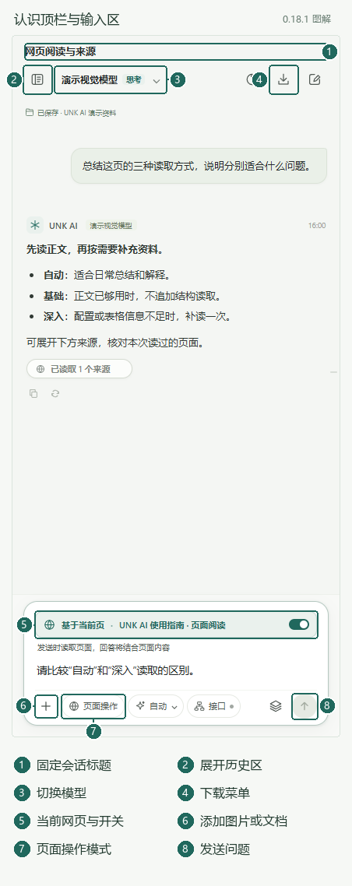

*图 1：当前对话标题、顶栏操作与输入区。*

| 位置 / 入口 | 作用 |
| --- | --- |
| 顶栏左侧历史图标 | 展开历史区，访问历史对话、分组和底部设置；收起使用历史区右上角“×”。 |
| 顶栏会话标题 | 滚动长对话时保持可见；过长时悬停查看全文，新对话不显示额外标题行。 |
| 顶栏模型名称 | 切换已配置的模型；支持思考的模型还会显示思考强度选项。 |
| 顶栏主题图标 | 切换明暗主题。 |
| 顶栏下载图标 | 选择图片 / PDF、整段 Markdown，或本对话今天的诊断日志。 |
| 顶栏新对话图标 | 新建一段对话。 |
| 输入框上方页面条 | 显示本轮准备使用的网页，提供“基于当前页”开关。 |
| 输入框底部“＋” | 上传图片或文档。 |
| “页面操作” | 进入网页操作模式，需要单独授权。 |
| “自动”下拉菜单 | 选择自动、基础或深入读取。 |
| “接口” | 允许或关闭当前站点的接口资料读取。单击切换，悬停查看说明。 |
| 叠层图标 | 查看会话容量、整理摘要与页面资料。 |
| 右下角箭头 / 停止图标 | 发送问题，或停止正在进行的任务。 |

当前对话标题固定在工具栏上方，滚动长对话时仍可见；标题过长时单行省略，悬停查看全文。Chrome 原生侧栏头由浏览器绘制，不能随会话动态改名，当前标题显示在它正下方。新对话不增加标题行，保留默认的“UNK AI - 阅读与对话”。

窄侧栏会将底部控件分成两行。浏览器内部页等不可读页面不显示页面能力区；开启“页面操作”后，普通阅读强度和接口开关会隐藏。

滚动条只在内容超出区域时出现。鼠标移入聊天、历史、思考、表格、浮窗或设置页的可滚动区域后显示滑块，移出后隐藏；滚轮始终可用。键盘聚焦可滚动区域或使用触屏时保留提示。各处颜色统一并随明暗主题调整，显隐不会挤动正文。

| 浏览长内容的场景 | 操作与显示 |
| --- | --- |
| 刚打开页面，鼠标不在长内容区域 | 默认保持清爽；没有溢出内容时无需滚动条。 |
| 鼠标移入聊天、历史或设置中的长列表 | 显示该区域的滚动条，可滚轮滚动或拖动滑块。 |
| 宽表格、长代码 | 在对应区域内横向或纵向滚动，其他区域保持当前位置。 |
| 放大预览中的图片 | 滚轮缩放，按住左键或单指拖动查看；图片区域使用平移，不显示原生滚动条。 |
| 用键盘或触屏浏览 | 保留必要的滚动提示；不同区域的滚动条粗细可以不同，颜色规则一致。 |

### 阅读一条长回答

正文支持 Markdown、代码块、公式和表格。模型返回实际思考内容时，可展开或收起思考区；收起只改变显示，不停止回答。向上滚动阅读旧内容后，可以使用回到最新内容的入口继续查看输出；右侧轮次导航用于定位已有问答。

标题、来源列表、思考区和正文各有自己的显示状态。来源图标显示为地球时，通常只是网站图标缺失；是否读到正文要看来源中的文字状态。

## 4. 普通聊天、停止、重试和编辑

### 大段粘贴与长提问

在主聊天或独立追问的输入框粘贴较长的纯文本时，会出现一张“粘贴的文本”卡片，显示首行摘要和字符数。达到 1000 字符或 15 行即使用卡片；短文本仍直接进入输入框，图片粘贴仍按图片附件处理。

1. 点击卡片查看完整原文；关闭弹窗后可以继续输入问题。
2. 点击卡片的“编辑”将该段文字放回输入框并选中，再修改内容。点击“×”只移除这一段。
3. 多次粘贴可形成多张卡片，最多 6 段，粘贴文本合计最多 20 万字符。超过限制会提示拆分，不会只保留一部分。
4. 发送时，卡片文字按原粘贴位置合并为完整提问，保留代码、空格和段落；卡片不是额外的文档附件。需要分隔两段内容时，照常用 Shift + Enter 输入换行。

发送后，超过五行显示高度的长提问会折叠并显示“查看全文”。点击预览或用 Tab 聚焦后按 Enter / 空格，在“完整消息”弹窗阅读、滚动或选择复制原文。点击关闭按钮、遮罩或按 Esc 退出；选取气泡中的文字不会误开弹窗，原有复制和回退编辑按钮仍可使用。

折叠只改变显示，保存、排队及模型请求仍使用完整提问；模型实际可使用的上下文仍受所选模型容量和既有预算约束。未发送的卡片属于当前输入草稿，不会因为点开预览而保存；关闭侧栏前请先发送或另行保留。回退或撤回排队会把全文恢复到输入框，便于重新编辑。

### 先选这次要做的任务

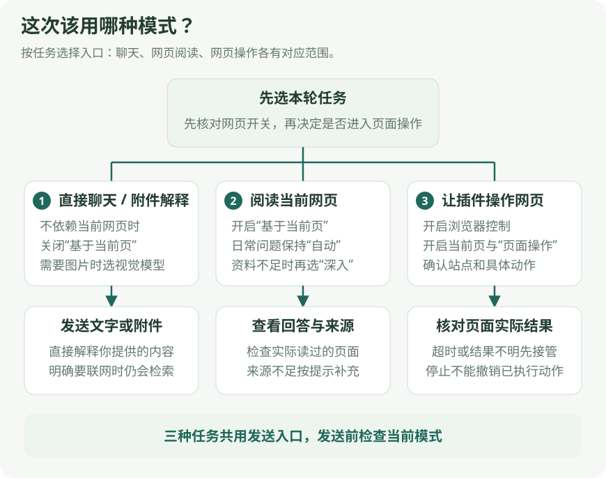

*图 2：按任务选择普通聊天、页面问答或页面操作。*

1. 与眼前网页无关的知识、写作或附件问题，关闭“基于当前页”直接提问。
2. 需要读当前页面时，开启“基于当前页”，保留“自动”读取后提问。
3. 需要实际点击、输入或导航时，在页面开关开启的基础上进入“页面操作”，再按提示授权。

“接口”用于普通页面问答中的本站数据读取，不能替代页面操作授权。

### 直接提问

如果问题与眼前网页无关，先关闭“基于当前页”，再输入问题并发送。

> 示例：用一个生活中的例子解释向量检索，最后列出三个常见误解。

**Enter 发送，Shift + Enter 换行。** 中文输入法正在选字时，Enter 优先用于确认输入。

欢迎页的新闻、AI、科技、商业等话题卡片会先填入草稿，确认内容后再发送。这些独立话题不会自动带上当前网页；需要结合网页时，再主动开启页面开关或选择页面问题。

完成必要的页面和附件准备后，主模型先分析问题，可以直接回答，也可以调用搜索或来源读取工具后继续回答，不再单独请求模型判断是否联网。没有可显示内容时，界面会按实际阶段显示“正在搜索并读取公开网页”或“正在等待模型输出”，并分别计时。等待模型输出达到 15 秒时，会补充“尚未收到正文或思考内容”；只有服务返回实际思考内容才显示思考。主回答仍使用你选定的模型及思考配置。

| 当前提示 | 可以怎样处理 |
| --- | --- |
| 深度思考 | 服务已返回实际思考内容，模型可以继续回答或按需请求工具；需要结束时点击停止。 |
| 正在搜索并读取公开网页 | 本轮在搜索和读取资料，可等待来源出现，或点击停止结束本轮。 |
| 正在等待模型输出 | 请求尚未返回可显示的正文或思考；计时不能证明服务商正在思考或排队。持续无输出时可停止，检查服务后重试。 |

单纯解释本轮截图、日志、选区或已经读到的页面内容时，模型可以直接回答；需要近期事实或核实时，由模型决定查询和必要的来源读取。工具结果回到同一轮分析，不另建第二条主回复。回复仍很慢或报错时，可在等待期间从顶栏导出诊断日志，记录大致时间和卡住的提示。

### 使用“下一步探索”继续讨论

回答完成后的“下一步探索”会结合本轮问题、具体结论和来源核实状态给出 1–3 个具体追问。例如，消息尚未官宣时，推荐可以围绕官方来源核对，而不会把传闻作为已确认事实；解释了某个技术取舍后，可以继续比较它在本场景中的适用条件。

**点击推荐问题会直接发起追问。** 如果想先改写，先把问题复制或手动写入输入框，修改后自行发送。欢迎页话题卡片则先填入草稿，两种入口的行为不同。

推荐会过滤整段陈述、泛指短语和回答摘录；没有合适问题或生成失败时可以不显示，不影响已经完成的主回答。历史中此前保存的无效推荐只隐藏，正文和会话数据保留。

### 停止与排队

- 生成中点击停止按钮，可结束本轮等待并阻止本轮后续请求。已经收到的内容会保留，状态标为停止。
- 普通回答进行中，可以继续输入下一问并加入队列；以界面的“加入队列”状态为准。
- 页面相关队列项保留入队时的原会话和原网页。切换会话或关闭页面开关后，可能显示等待原因；可返回原会话继续，或撤回后修改。
- 停止当前回答不会清空队列，收尾后仍可能自动发送下一项。若不希望后续问题继续执行，还需撤回队列中的问题。
- 停止不能撤销已经执行的网页动作，也不能让服务商已经接收的请求变成从未发生。

### 重新生成与回退编辑

回答下方的“重新生成回答”图标或错误状态下的“重试”，用于重新生成对应回合。**对较早回合重新生成，会替换该回合回答并舍弃其后的对话分支**；需要保留的内容先复制或导出。

当前重新生成还会清空待发送队列，且发生在页面重试校验之前。请先撤回并保存需要保留的排队草稿，再点击重试。

页面提问重试时，需要开启页面开关并回到原页面。插件会重新读取当前正文，因此结果可能与第一次提问时不同；它不会自动改读你后来切换到的另一个网页。读取强度和接口选项沿用原回合设置，接口授权仍需重新核验。

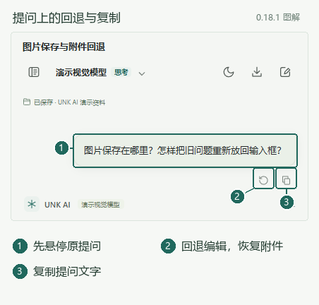

*图 3：悬停原提问，使用右下方的回退或复制按钮。*

需要改提问及其附件时，使用“回退并重新编辑”：

1. 先停止或等待当前生成、提交、附件准备、网页任务及历史整理结束。
2. 悬停原提问气泡，移到右下方的回退图标并点击；旁边的复制图标用于复制提问文字。
3. 检查输入框中的原文字、图片、文档和选区；可继续修改，或通过附件“×”移除文件。
4. 核对页面开关、页面操作模式和目标页面，再重新发送。

回退会移除该提问及后续消息分支，原附件以独立副本恢复。截图仍保留原页面身份，旧网页正文不会作为整份旧页面快照自动恢复。

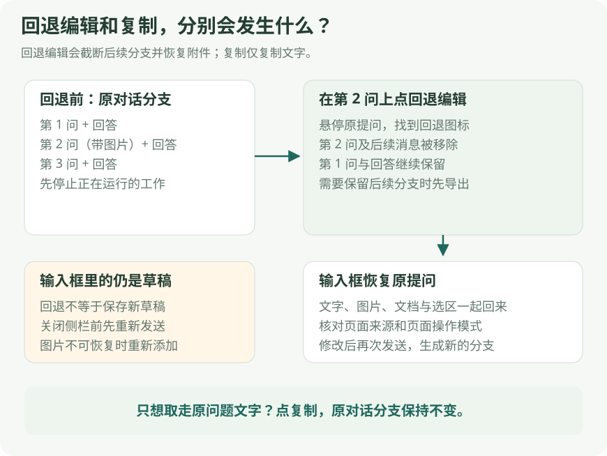

*图 4：回退把原提问和附件放回草稿，复制只复制文字并保留对话分支。*

回退后的文字和附件仍是当前侧栏中的草稿，恢复到输入框不等于草稿已经保存。关闭侧栏前请重新发送或另行保留需要的内容。回退保存超时或失败时保留草稿，并显示具体错误；它不会因迟到保存把图片写进另一段新对话。

### 选中回答引用与单独追问

选中**同一条助手回答中的正文**后，会出现“引用到当前对话”和“单独追问这段内容”。不要跨多条消息选择，也不要选择思考区、按钮或输入框文字。引用带上原提问、所在小节和相邻正文，帮助模型理解这段内容；不会携带整段原对话、内部思考或自动读取当前浏览器网页。

| 入口 | 适合用途 | 对话会去哪里 |
| --- | --- | --- |
| 引用到当前对话 | 对同一回答逐条批注，集中追问或纠正 | 先成为当前输入框的引用草稿，随问题发送。 |
| 单独追问这段内容 | 深入研究一个分支，同时保留主聊天阅读位置 | 打开独立窗口，首次发送后成为单独的历史对话。 |

#### 引用注释：选中、确认，再发送

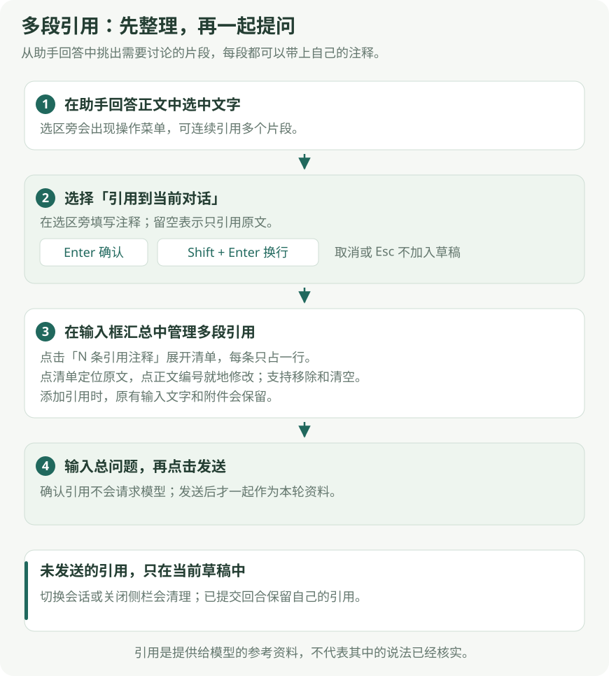

*图 14：每段引用先确认进入草稿，发送前统一检查；确认引用本身不请求模型。*

1. 选中回答里要讨论的一段话，点击“引用到当前对话”。
2. 在选区附近的“针对这段内容提问或添加说明…”输入框中写批注，例如“这个结论的依据是什么？”；也可以留空，只引用原文。
3. 点击“✓”或按 **Enter** 确认；**Shift + Enter** 换行。点击“×”或按 **Esc** 取消这次添加。
4. 确认后，原文出现淡青高亮和编号，主输入框默认只显示一行“N 条引用注释”。已有草稿文字和附件保留。
5. 点击原文编号，在该段文字附近查看、修改注释；点击“N 条引用注释”才展开清单。清单每条占一行，点击原文或注释可定位原文，“修改”在原文附近打开编辑框，“×”移除该条；也可“清空引用注释”。继续选择其他段落即可添加更多注释。
6. 在主输入框补充整体要求，检查引用清单后发送。

较长的原文和注释在清单内省略显示，悬停可查看完整内容。编号随正文滚动，只在正文可见范围内显示，不遮挡输入框；原文已不在当前对话时会明确提示，引用和注释仍可保留、修改。

> 示例：先引用“采用方案 A”并注明“解释选它的原因”，再引用“预计成本下降”并注明“列出计算假设”；最后输入“请逐条回应这两处批注，并给出修改后的方案”。

每次最多 8 条引用注释；每条注释输入最多 2000 字符，注释合计最多 8000 字符，所选原文与相关上下文合计最多 16000 字符。条数或累计内容超限时，会提示精简并保留编辑框。较长选区及相邻语境可能先按范围截断，请查看截断提示并核对引用。

确认引用只是整理草稿，不发送模型请求，也不把未发送的注释写入历史。切换主对话或关闭侧栏会清理引用草稿，需要保留时先发送或另行复制。问题发送后，本轮使用的引用固定；之后再修改草稿或选择新内容，不会改变正在回答的问题，也不会改写已排队、重试或回退所对应的原引用。

#### 单独追问：在小窗口继续一个分支

1. 选中助手回答中的正文，点击“单独追问这段内容”。
2. 在小窗口核对引用原文和来源范围，输入具体问题并发送。例如“这段中的幂等和重试分别解决什么问题？请各举一个例子。”
3. 需要调整位置时拖动标题栏；需要扩大阅读区时拖动右下角。用键盘时可聚焦调整大小按钮，再按方向键；**Shift + 方向键** 以更大的幅度调整。
4. 暂时收起时，点击标题栏收起按钮，或把窗口向右拖到边缘；点击右侧对话图标重新展开。
5. 想继续主聊天阅读时，保留小窗口或收起；想把这个分支作为主聊天时，在空闲状态使用“替换当前对话”。

同一主对话中再次选中其他内容并选择单独追问，会复用第一次打开且仍在跟踪的追问窗口，更新**下一次问题**的引用。选择原文不会自动发送；若窗口正在回答，新选区留给下一问，当前回答仍使用提交时的原文和上下文。

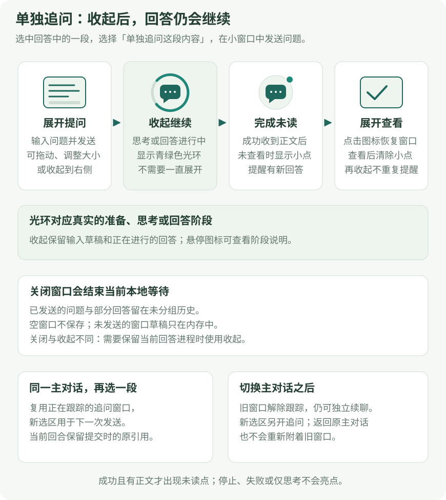

*图 15：收起保留同一追问；切换主对话后，旧窗口独立存在，新选区另开追问。*

| 你的操作或看到的状态 | 实际结果 |
| --- | --- |
| 第一次打开追问，尚未发送 | 只是空窗口，关闭后不保存，不出现在历史。 |
| 在窗口第一次发送问题 | 成为独立的未分组对话，随后可在历史中查找。 |
| 收起窗口 | 保留输入草稿、阅读位置和正在生成的任务；不停止任务，也不因此新增或保存空对话。 |
| 收起图标有青绿色光环 | 仍在准备、思考或回答；思考时轻微呼吸。 |
| 收起图标出现未读小点 | 有未查看的、成功完成且有正文的新回答。展开查看后清除，再收起不会重复提醒。 |
| 已停止或生成失败 | 保留对应状态，不显示成功完成的小点。 |
| 关闭窗口 | 结束该窗口及选区跟踪；正在生成时停止等待，已发送内容仍保留。下次单独追问会新建分支。 |
| 新建、切换或替换主对话 | 旧窗口脱离原主对话的选区跟踪，仍可独立续聊；新的选区另开追问。 |
| 回到原来的主对话 | 不会重新绑定已经脱离的旧窗口；旧窗口中的内容不受影响。 |
| 系统启用减少动态效果 | 收起、展开直接切换，运行光环改为静态，状态含义不变。 |

主对话变化后，旧窗口会持续提示“已切换主对话；新的选区将另开追问。”这不是保存失败。窗口与选区跟踪只存在于当前侧栏；重新打开侧栏后，可从历史继续已发送的追问。

#### 把追问移到主聊天区

窗口中的“替换当前对话”会把追问打开到主聊天区，原主对话仍保留在历史。从历史中打开同一个追问对话，也会将它从小窗口转到主聊天区，不会让两个位置同时接管该对话。操作前先完成或停止相关任务；小窗口正在回答时，历史接管会受到阻止。删除这段对话前，需要先关闭它的追问窗口。

小窗口的来源列表可点击外部或按 Esc 关闭；第一次 Esc 优先只关闭来源列表。滚动回答正文、调整浏览器窗口大小或窗口失去焦点时也会关闭列表，来源列表内部仍可滚动，链接仍可正常打开。来源列表已经关闭后，再按 Esc 可能关闭追问窗口，查看资料时留意当前焦点与弹层。

## 5. 结合当前网页阅读

### 基本步骤

1. 打开需要分析的网页，等待主要内容加载出来。
2. 查看输入框上方的页面标题，确认是目标网页。
3. 开启“基于当前页”，通常保持“自动”读取。
4. 输入问题，或使用欢迎页的“总结当前页”。
5. 查看回答和来源说明；遇到缺口提示时，再选择补读方式或提供资料。

可直接使用这些提问：

> 总结这个页面的核心观点，并列出关键结论。
>
> 解释当前页面里的配置项。哪些已选状态能确认，哪些无法确认？
>
> 比较这页展示的套餐价格和限制，不要补造页面没写的条款。

开启页面模式后，每次普通页面提问都会重新读取基础正文。仅切换标签、看到页面标题变化，不代表正文已经读过。需要页面资料但读取失败时，插件会报告失败，不静默拿旧正文充当最新结果。

关闭页面开关后，本轮不再自动读取当前网页；它不会抹去历史消息中已经出现的页面内容。关闭状态下仍明确问“这个页面”时，可能出现“读取当前页并发送 / 按普通问题发送”，按本轮需要选择。

### 自动、基础、深入怎么选

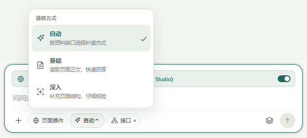

*图 5：在输入框底部选择自动、基础或深入读取。*

点击输入框底部的读取方式名称展开图中菜单，再选择自动、基础或深入。这个菜单控制页面读取范围；模型思考强度在顶栏模型入口中调整。

| 方式 | 适合的问题 | 实际行为 |
| --- | --- | --- |
| 自动 | 日常网页解释、总结、配置分析 | 先读正文，再按资料缺口决定是否补充页面结构。建议作为默认选项。 |
| 基础 | 正文已经清楚，想直接总结或解释 | 不自动追加深度结构读取。 |
| 深入 | 配置状态、表格结构或正文覆盖不足，需要核验 | 最多追加一次结构读取；耗时可能增加，仍可能存在缺失内容。 |

“深入”不是模型的思考强度，也不意味着自动翻页、滚动、点击或刷新整个网站。它不能保证读取所有懒加载内容。若明确要求补读，即使当前选了基础，也可能按本轮明确要求执行。

自动模式会关注缺少字段、表格覆盖、配置状态和同页相关纠错；用户语气强硬、要求更简短或换一种说法，不会单独成为深入读取的理由。

### 页面选区、PDF 与代码仓库

网页选区包含图片时，输入框会显示图片数量。开启“基于当前页”并选择支持视觉的模型后，可以直接问“这个现在还适用吗”：插件会核对选区，读取其中的图片，与选中文字和本轮网页资料一起回答；开启联网仍可核实近期信息。只选图片也可以提问。

每轮最多读取选区前 3 张图片，长边缩放到最多 1600 像素，图片合计最多 8 MiB；超过选区数量限制会提示省略。已上传图片也占用本轮 3 张额度。选区或页面变化、读取超时、图片未加载完成或加载失败时会显示具体错误；请待图片正常显示后，回到原页面重新选择并发送。当前支持主页面中能被原生选区覆盖的图片、Canvas 和 SVG；受限页面和 iframe 中的图片不在当前支持范围内。

选区图片会随发送后的消息保存。成功读取后的重试和回退编辑复用原图片；后续保存准备失败或等待中停止，也会在当前回合保留已经读取的图片供重试，但不代表已保存成功。初次读取失败的重试会重新核对原选区。仍需回到原标签页和原文档，页面刷新后请重新选择并提问。较大的图片可能已缩放，保存的是此次读取的像素。

在网页上选择文字后，若侧栏出现“已选择 1 项”和来源提示，可针对这段内容提问；发送前检查选区，点“×”可清除。页面选区来自浏览器网页，与第 4 节中选中助手回答形成的引用注释属于不同来源，使用时先确认要讨论哪一处原文。

| 页面类型 | 推荐操作 | 阅读边界 |
| --- | --- | --- |
| 在线 PDF | 在 PDF 页面打开侧栏，开启页面开关，要求提炼观点并注明能核实的页码。 | 本地解析可读取的文字；扫描页、受限下载和特殊阅读器可能无法完整提取。 |
| 本地 PDF 或文件页 | 在扩展详情开启“允许访问文件网址”，重新打开文件；也可改用“＋ → 文档”上传。 | 文件需有可提取内容；扫描版 PDF 不提供 OCR。 |
| GitHub 仓库 | 打开目标仓库，提出明确问题，如“说明项目用途、入口和运行方式，区分实际读取的源码与推断”。 | 已实现 GitHub 源码读取；大仓库或受限内容不保证完整读取。 |
| 其他代码托管平台 | 可先按普通网页分析可见内容，再提供所需文件或片段。 | 能识别平台或仓库链接，不代表具有与 GitHub 相同的源码读取能力。 |
| 图表或依赖视觉的页面 | 使用支持视觉的模型，明确要分析的图表、趋势或控件状态；必要时上传关键截图。 | 自动视觉准备按本轮问题与目标页面决定；文字提取不等于完整看过图片。 |

> PDF 示例：提炼这份报告的研究问题、结论和限制；页码只填写实际能核实的部分，不能定位时明确说明。

### 阅读其他章节与查看来源

普通问题优先围绕本页。需要同站其他章节时，直接指出目标，例如：

> 找到这个站点的 MCP 章节，读取正文后总结，并给出实际读过的链接。

站内补读只支持能够访问的公开正文，最多补充三篇额外章节；登录限制或不支持的路由可能导致失败。找到目录标题不等于已经读到章节正文。

回答中的来源数量可以展开查看，各项标明“搜索摘要”“已读正文”或“读取状态未知”，内容有截断时也会说明。只有来源都明确取得正文时才显示“已读取 N 个来源”；数量不代表搜索次数，也不保证模型引用了其中每个字。历史只保留每轮来源小记录；插件不是可还原所有历史页面全文的网页存档工具。

## 6. 使用“接口”读取网页返回的数据

这里的“接口”指**当前网站返回的数据**，例如页面请求到的 JSON；它不是模型服务的 API Key 设置，也不是全网搜索。

### 开启与使用

1. 在普通页面问答中开启“基于当前页”。
2. 点击“接口”。选中状态表示允许当前站点读取，再点一次即可关闭。
3. 悬停可确认状态和范围；设置按站点保存在当前浏览器。
4. 提出需要接口证据的问题，例如“读取本页接口返回的营收数据，列出实际采集到的字段和仍缺少的字段”。
5. 等待结果，查看本轮读取说明，不把“已允许”理解为“已经抓到数据”。

**开启按钮只保存许可，不会立刻开始持续抓包。** 只有本轮确实需要接口资料时，插件才短暂监听。当前观察窗口约为 3 秒，只接收当前页主文档在监听期间新返回的同源 Fetch/XHR JSON，嵌入框架的请求不在范围内；最多保留 6 条响应，内容还会按大小和上下文预算裁剪。

它不会补抓已经结束的历史请求，不自动刷新网页，也不重放接口。如果页面在监听期间没有产生符合条件的新响应，就可能没有可用结果。不要为了“抓到数据”连续刷新正在读取的网页，文档变化会让本次读取失效。

接口按钮显示“未确认”时，点击会先核对真实设置，不会盲目反转许可。页面操作 Agent 当前不使用这套接口读取能力。

### 追问是否每次重新抓取

基础页面正文仍每轮重新读；接口资料可以在以下条件满足时复用：

- 同一侧栏、同一会话、同一标签页、完整地址和网页文档。
- 新读到的正文、表格、配置等语义内容没有变化，追问与已有资料相关。
- 资料未截断、没有已知字段缺口，且后台重新核对授权成功。
- 距采集不超过 5 分钟；最多保留 4 项内存缓存，使用缓存不会延长到期时间。

复用时会显示“已复用接口资料”，展开可看到原采集时间和复用说明。关闭侧栏后不会从保存的聊天中恢复这份可复用缓存。

需要更新时，可以明确说：

> 请重新采集本页最新的接口数据，不使用缓存；没有新响应就明确说明。

这会跳过旧缓存，但仍受新响应窗口限制。网页外观没变，并不能证明服务器后台数据没变；有时效要求时应明确要求更新。

## 7. 让插件操作网页

页面操作会实际点击、输入、滚动或导航网页，与只读问答不同。

### 首次启用

1. 打开“设置 → 浏览器控制”，开启“允许浏览器控制”。
2. 在“操作确认方式”选择“标准确认”“逐次确认（严格模式）”或“自动批准操作”；首次可先用标准确认了解执行过程。
3. 回到目标网页，开启“基于当前页”，点击“页面操作”。
4. 描述具体任务，发送后按提示核对并授权当前站点。
5. 查看任务面板的状态、步骤和待确认动作，必要时停止或接管。

适合从这类范围明确的任务开始：

> 打开当前网站的帮助中心，找到退款规则，读取后总结并给出页面链接。
>
> 在当前列表中筛选“已完成”项目，读取显示出来的结果，不提交其他操作。

### 选择操作确认方式

打开 **设置 → 浏览器控制 → 操作确认方式**，按任务需要选择：

| 模式 | 页面动作怎样执行 |
| --- | --- |
| 标准确认（默认） | 常规浏览动作直接执行；提交、发送、删除、上传等需要确认的操作，会先显示确认框。 |
| 逐次确认（严格模式） | 点击、输入、选择、导航等页面动作逐次确认；读取、等待和滚动不逐次确认。 |
| 自动批准操作 | 在已授权站点中，提交、删除、发布、上传等原本需要确认的操作直接执行，不再逐步弹出确认框。 |

自动批准需要你主动选择。启用后，新任务或点击“继续”的任务才使用它；已经等待确认的任务不会因为修改设置就立即执行。需要让当前任务采用新模式时，先接管暂停，核对页面后再继续。任务面板会显示自动批准状态，执行记录仍会保留。

三种模式都需要站点授权。跳到新站点时仍会询问是否允许；密码、支付、验证码等受限控件，以及无法可靠识别的操作仍需接管。自动批准会实际执行删除和提交，所以任务描述应写清对象及范围，例如具体列表、文件或记录名称。

从自动批准切回标准确认、切到严格模式，或撤销站点授权时，正在执行的任务会暂停。关闭浏览器控制也会撤销当前执行许可；已完成的网页动作不会回滚。之后继续时会重新核对权限。

### 调整任务总步数和总时长

同一设置区域提供两个独立选项，选择后自动保存：

| 设置 | 可选值 | 默认值 |
| --- | --- | --- |
| 任务总步数 | 20、40、100、200 步，或“不限制” | 20 步 |
| 任务总时长 | 5、15、30、60 分钟，或“不限制” | 5 分钟 |

步数包括规划、读取、核验与实际动作，并非仅计算点击次数。选择“不限制”会取消对应的任务总预算；两个选项都选“不限制”时，不会因为累计步数或总时长达到旧上限而结束任务。可只放宽其中一项，例如保留 30 分钟总时长、不限制总步数。

预算修改在新任务或明确点击“继续”时生效。继续任务会按当前设置重新计算可用时长，已完成的步数仍然保留；想继续较长任务时，应选择大于当前已执行步数的上限，或“不限制”。任务面板会显示已执行步数及总预算。

“不限制”仍保留单次模型请求、页面观察与动作的超时，以及连续无进展、重复失败和结果不明时的停止。你也可以随时停止或接管。它使用当前选中的模型；模型服务的上下文、输出长度、请求和费用限制仍由服务及模型配置决定。任务运行时需保持侧栏打开。

### 三个开关分别管什么

| 开关 | 控制范围 |
| --- | --- |
| 基于当前页 | 本轮是否使用网页；页面操作也必须保持开启。 |
| 接口 | 普通页面问答是否允许按需读取本站新返回的接口 JSON。 |
| 允许浏览器控制 + 站点授权 | 是否允许 Agent 在授权范围内操作网页。开启接口不等于授权页面动作。 |

进入页面操作模式后，“自动”和“接口”入口隐藏。需要回到只读问答时，先结束当前任务，再取消“页面操作”。

### 接管、继续与重新开始

| 任务状态 / 操作 | 应怎样处理 |
| --- | --- |
| 想自己操作网页 | 先点“接管”，再手动完成需要的步骤。 |
| 暂停后继续 | 点击“继续”，或在暂停提示中选择“继续任务”；插件会回到原任务页并重新观察。 |
| 已停止或失败 | 使用“重新开始任务”；原标签页仍在原完整地址时，返回该页并携带原提问图片启动新任务、重新观察。 |
| 动作超时、结果不明 | 先到网页核对是否已经生效，尤其不要重复执行提交类操作。 |

执行中切换标签页或手动操作，任务可能暂停。关闭“基于当前页”会停止当前操作并退出该模式；已经执行的动作不会被回滚。

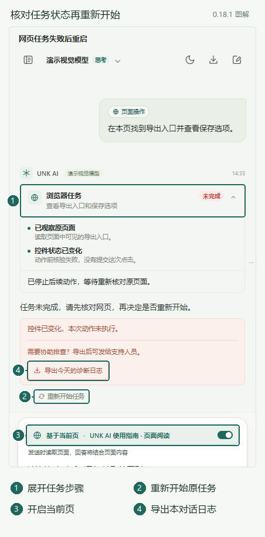

*图 6：展开原任务记录，核对状态后重新开始。*

失败或停止后重新开始任务时，按图中任务卡片操作：

1. 先到网页核对之前的上传、生成或提交是否已经完成。
2. 开启“基于当前页”，在原任务卡片点击“重新开始任务”。
3. 插件会携带原提问和图片回到原任务标签页，重新观察并启动任务；按本次任务提示核对授权和待确认动作。

重新开始会重新执行任务流程，不能替你撤销之前已经完成的网页动作。

| 重新开始受阻的情况 | 处理方法 |
| --- | --- |
| 按钮变灰、提示任务正在运行 | 先停止或等待生成、提交、附件准备、历史整理及其他任务结束。 |
| 关闭了“基于当前页” | 先重新开启；空闲时按钮仍可点击查看具体原因。 |
| 原任务在另一个浏览器窗口 | 在原窗口打开侧栏，再重新开始。 |
| 原标签已关闭、完整地址变化，或旧记录缺少来源 | 回退原提问，保留附件，在目标页面重新发送；同名网页不能代替原标签页。 |
| 原图片缺失或不可读 | 恢复原数据目录中的图片及权限，或回退提问重新添加图片。 |

准备重新开始期间仍可以点击停止，原对话和图片会保留。重复点击不会提交两次。

密码、CVV、PIN、支付、下单和验证码等受限操作会被阻止，需要你接管处理。提交、删除和注销等动作按当前确认方式执行：标准或严格模式会要求确认，自动批准模式可直接执行。任务运行期间保持侧栏打开；关闭侧栏后无人值守持续执行不是当前能力。

### 多步骤任务与参考图上传

包含选择、勾选、填写等多项操作时，插件会先建立短计划，在任务状态中显示已核验的目标数量。已满足要求的选项和开关只核对状态；模型单方面说“完成”不会替代控件结果核验。

同类操作持续失败会触发一次调整方法；读取成功不会清掉操作错误。多步骤写任务连续 4 轮没有真实执行进展时，会进入一次恢复；恢复后再经过最多 3 轮仍未推进则停止。改计划、读到新正文或滚动不算写任务的执行进展；纯阅读保持原有规则。设置有限步数时，已核验的有效动作、对应目标状态或必要子目标进展，才可以在总上限内继续分配步数，不延长总时长。选择“不限制”会跳过总预算限制，但上述进展核验与停止规则仍然有效。已启用思考的当前模型可能在无进展时提高一次思考强度。

支持视觉的模型可以查看当前控件附近的局部画面，帮助识别模型菜单、上传入口或勾选框；恢复时也可自动尝试一次。插件先重新观察当前页面，再截取真实主页面控件及相邻标签，图片用于下一次现有动作决策。每任务最多 3 次，同一稳定控件只查看一次；局部 JPEG 最长边 960 像素、最大 512 KiB。后续点击仍使用当前页面的元素并经过权限与目标核验。无视觉模型需要接管，iframe 或未找到可见控件时不会盲点坐标。

自动截图超过模型上下文容量时，会省略这张自动图片，继续使用页面元素资料；你提供的参考图和明确请求的局部图片不足以装入预算时，会明确报错。截图期间关闭控制权限或页面目标失效，会立即暂停。

写任务每次动作决策只携带去重后的正文节选，合计最多 3000 字符，保留来源和截断说明；已经读到的完整资料仍留在本任务中。仅改提问关键词不代表网页正文更新。诊断可查看输入字符、估算 Token、图片数量和大小，帮助区分重复读取与模型等待。局部观察和输入限制不保证所有站点或模型服务必然提速。

透明的原生开关可以通过正确关联的可见标签操作；透明上传区只有经过区域及命中校验的原生文件输入才支持，并按所选确认方式批准上传。局部视觉没找到目标或截图失败会在操作记录中说明，不能把截图当作已经完成任务。写任务的区域资料另限制为 3000 字符的带来源节选；停止日志区分无进展、结果不明、时间及步数原因。

需要把本条消息中的参考图交给网站时，插件只能选择本任务已经提交的图片。标准和严格模式会逐次询问确认；自动批准模式在已有站点授权范围内直接上传。支持原生文件输入框及具有可见原生关联标签的隐藏输入框；无法关联的自定义按钮、拖拽区或目录上传需你接管。文件进入网页不等于服务器处理完成，插件会继续核对页面结果；结果不明时不会自动重传。

网站接收参考图后清空文件选择框时，插件会核对本次新出现的局部图片预览；预览内容与原图匹配后，可以继续下一步。仅有图片计数或旧预览不能证明本次接收成功，仍会明确停止。

遇到“上传结果不明”或最后一步没有完成时，先展开任务记录，查看实际失败步骤，再到网页核对参考图预览、生成状态和提交结果。不要仅凭插件停止就再次点击“生成”或重传图片；必要时先接管处理，再决定继续或重新开始。

故障时可从当前对话顶部导出菜单，或错误卡片，导出今天的本对话诊断日志，并结合实际页面结果排查。不同网站和模型服务的支持情况可能不同。

## 8. 上传图片、截图和文档

“＋”菜单当前只有**上传图片**和**文档**。之前的“当前页截图”“框选区域”入口已经移除；仍可以用系统截图工具截图，再粘贴到输入框，或上传截图文件。

1. 点击“＋”，选择类型和文件；图片也可以直接粘贴，文件可拖入输入区。
2. 等待附件卡片出现，检查文件名与是否标为“内容已截断”。
3. 输入任务，例如“解释这张图里的三个指标”或“总结文档中的实施步骤”。
4. 如果只分析附件，关闭“基于当前页”，避免同时携带无关网页。
5. 发送前可通过附件卡片上的“×”移除文件。

| 类型 | 格式与当前限制 |
| --- | --- |
| 图片 | PNG、JPG、WebP、GIF；单文件最大 8 MB，较大图片会压缩或缩放。需要支持视觉的模型。 |
| 普通文档 | TXT、Markdown、CSV、JSON、HTML、XML、YAML、日志、DOCX 等；单文件最大 5 MB，提取文字最多约 5 万字符。 |
| PDF | 单文件最大 20 MB；提取可读取文字，按预算截断。扫描版 PDF 的 OCR 尚未提供。 |
| 普通问答附件数 | 每条消息最多 6 个。 |
| 页面操作参考图片 | 最多 3 张、合计 8 MiB；页面操作不接收文档附件。 |

CSV 可以作为文本分析；当前没有直接读取 XLSX 表格文件的附件入口。复杂排版、图片化文字和被截断的部分不能当作已完整读取。

### 放大查看图片

1. 点击消息中的图片或输入框中的附件缩略图；也可按 Tab 聚焦图片，再按 Enter 或空格打开。
2. 预览默认“适应宽度”：较矮的图片居中，长图保留可读宽度并从顶部显示。
3. 将鼠标放到要查看的细节处，向上滚动放大、向下滚动缩小；也可点击工具栏的“＋”“－”，旁边显示当前缩放百分比。
4. 按住鼠标左键拖动图片，查看长图下方或放大后超出窗口的部分；触屏可用单指拖动。到达图片边缘后会停止继续平移，避免把图片拖出可见范围。
5. 点击“原始尺寸”按当前附件像素以 100% 查看，再点“适应宽度”复位。双击图片区域也可切换这两种状态；手动缩放后可直接点击“适应宽度”重新居中。
6. 点击预览区或按 Tab 将焦点移入后，方向键可移动视野，＋/－缩放，0 回到适应宽度。浏览长图时使用拖动或方向键；图片区的滚轮用于缩放。
7. 点击右上角“×”、窗口外的遮罩，或按 Esc 关闭；切换对话时预览也会自动关闭。同一对话重绘时保留当前缩放和位置。

最高可放大到 800%，通常最低可缩到 10%；当大图的适应宽度比例低于 10% 时，也能保留这个更小的比例。缩放只改变显示，不能增加原图细节。

图片预览用于检查上传内容，不会修改图片或触发保存。上传时已经缩放的图片无法通过放大恢复原文件的细节；若关键小字已经模糊，可裁剪关键区域后重新上传，并在问题中指出需要识别的位置。

### 图片存在哪里，怎样备份

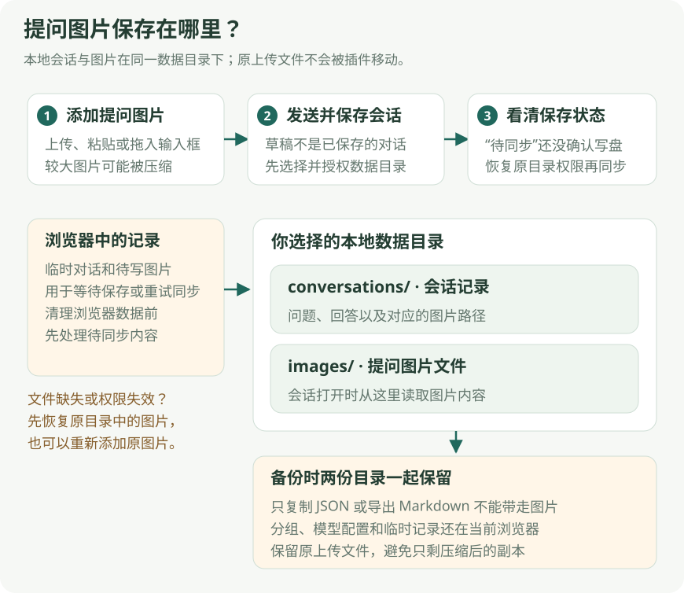

*图 7：图片从输入草稿进入会话，正式记录与图片文件需一起备份。*

图片保存在**设置 → 本地数据中所选的目录**，不是扩展安装目录，也不会自动保存到项目工作目录。查看设置中的当前文件夹名称，即可确认实际使用的数据目录。

| 所选数据目录内的位置 | 保存内容 |
| --- | --- |
| `conversations/<会话id>.json` | 正式会话记录及附件引用。 |
| `images/<内容摘要>.png`（或 JPG、WebP、GIF） | 提问图片文件；同一内容可以共用一个文件。 |
| `diagnostics/` | 最近 7 天的排障日志。 |

正式会话的 JSON 只记录图片相对路径和存储版本，不内嵌 Base64。打开会话时会从原目录读回图片；遇到文件缺失、损坏或权限失效，且无法从浏览器保留内容恢复图片时，会显示具体错误。需要该图的发送、任务重启和图片 / PDF 导出，会要求恢复文件或重新添加图片；Markdown 仍可导出已有文字。

按保存图解备份时：

1. 先停止当前任务，检查保存状态，确认会话已写入所选文件夹。
2. 一起复制 `conversations/` 和 `images/`，需要近期故障记录时一并复制 `diagnostics/`。
3. 保留原浏览器的配置、分组和待同步记录；仅复制文件夹不等于迁移整个插件。

**整段 Markdown 导出不打包图片和文档附件，不能代替数据目录备份。**

旧版内嵌图片记录仍可打开，在下一次正常保存时转为图片文件。删除会话保留共享图片，供其它会话和删除撤销使用；目前不自动清理未引用的图片。写盘前或同步失败时，浏览器 IndexedDB 保留完整待写图片以便恢复；临时会话仍存于扩展的 `temporaryConversation` 本地存储。模型请求按服务接口要求传图片数据，不把电脑上的相对路径发送给远端模型。较大图片可能已被压缩或缩放，保存内容不一定是原文件的逐字节副本；原上传文件不会被插件移动或删除。

## 9. 会话整理与容量提示

*图 8：查看估算容量、已整理摘要与当前页面资料。*

点击发送按钮左侧的叠层图标打开图中面板，可以核对容量、摘要和当前页面资料。面板的“立即整理”目前尚不可用，处理容量不足时请按下方限制说明操作。

输入框右下方、发送按钮左侧的叠层图标用于查看会话容量。

- 悬停：查看当前估算容量。
- 点击：查看已用与剩余比例、Token 估算、已整理摘要和已读页面信息。
- 达到 75%：显示预警提示。
- 达到 90%：显示更明显的提醒；满足条件时，后续普通生成流程会尝试自动整理较早记录。

整理会用摘要压缩后续请求中携带的旧消息，帮助保留目标、关键事实和约束，不是删除历史聊天文件。它可能产生额外模型请求；摘要不保证保留每个细节。

**当前限制：面板中的“立即整理”按钮尚未接入点击处理，不能作为可用的手动操作。** 目前请以生成过程中的自动整理为准。没有足够的较早记录，或只是单条页面/文档过长时，整理也不能解决全部容量问题，可减少输入、拆分材料或新建对话。

容量是估算值，不是模型精确计数，也不是服务商账单。显示“资料超过模型容量”时，发送前会按预算裁剪；重要资料应尽量明确指出，不要假定超长材料会完整进入模型。

## 10. 历史对话、分组和本地保存

### 拉宽或收窄侧栏

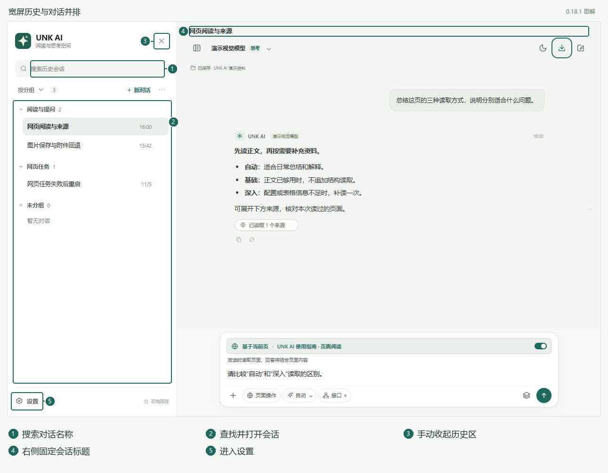

*图 9：宽度足够时，左侧历史与右侧对话并排显示。*

1. 将侧栏边缘向外拖宽；可用宽度达到 960 像素时，历史区自动显示在左侧，占 360 像素，右侧保留至少 600 像素对话空间。
2. 在左侧查找或选择会话，右侧继续阅读；并排模式没有背景遮罩，两边可以分别滚动。
3. 需要更多对话空间时，点击历史区右上角“×”收起，再点顶部历史图标展开。

宽屏切换或新建对话会保留已展开的历史区，自动展开不会把输入焦点移走。在同一宽屏状态下，手动收起的历史区不会因切换对话而重新展开。

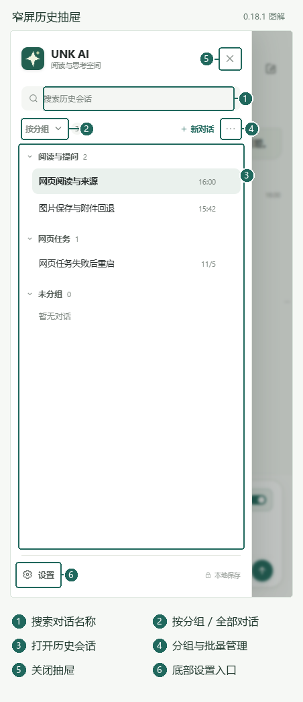

*图 10：窄屏历史使用抽屉，关闭后回到对话。*

1. 收窄到 960 像素以下时，历史区自动关闭，恢复抽屉方式；需要查看时再点击顶部历史图标。
2. 查找并打开会话后，抽屉会关闭，回到对话。
3. 只想关闭抽屉时，点击“×”或外侧遮罩；没有正在编辑名称、批量选择或打开子菜单时，也可按 Esc 关闭。

再次拉宽到足够空间时，历史区会自动并排展开，搜索和分组状态会保留。

### 查找与整理历史

1. 历史区未展开时，点击左上角历史图标。
2. 输入对话名称中的关键词查找，点击结果打开；当前不提供聊天正文的全文搜索，也不保证按网页标题或网址找到会话。
3. 使用“按分组 / 全部对话”切换显示方式。
4. 点击顶部“⋯”可新建分组或进入“选择多个”。
5. 对话和分组可通过右键或“⋯”菜单重命名、移动等；对话也可以长按拖入目标分组，Esc 取消拖动。

点击顶部“新对话”或分组旁的“＋”，都会先打开临时对话。未发送问题时，切换到其他对话或再次新建不会把空对话加入历史；只输入草稿也不算发送。组内新建会保留所选分组，实际保存后出现在该组。

| 你做了什么 | 是否会因此新增历史对话 |
| --- | --- |
| 点击新对话，然后直接切换回来 | 不会，未发送的空对话不保存。 |
| 在分组内点“＋”，只输入草稿或添加未发送的附件 | 不会；草稿不算正式提问，切换前自行保留需要的内容。 |
| 选中回答，确认几条引用注释但尚未发送 | 不会；它们属于当前草稿。 |
| 打开或收起一个尚未发送的追问窗口 | 不会；空窗口不保存。 |
| 在主对话或追问窗口真正发送问题 | 进入对应对话的正常保存流程；仍需查看文件夹同步状态。 |

未发送草稿与已发送记录不同。不要把切换对话、收起窗口或显示输入文字当作保存确认；需要长期保留的内容应发送、复制或导出。

批量操作时先进入“选择多个”，勾选会话后再移动或删除。搜索、折叠可能隐藏已选项目，提交前留意选中数量。正在生成、准备提交、整理或操作网页时，部分历史操作会禁用。

### 删除与恢复

删除对话会涉及原目录中的真实会话文件。操作前确认选中的范围，特别是批量删除时。

- 删除后可通过提示中的“撤销”恢复。
- 提示消失后，可到顶部“⋯ → 撤销上次删除”。
- “文件删除待核验”表示文件操作结果尚未确认，不等于已完成删除。
- 删除分组只解除分组关系，不删除分组里的会话正文。

恢复依赖当前浏览器保留的恢复记录；它不是跨设备的云端回收站。清理扩展数据或卸载前，应先处理待同步内容并备份需要的文件。

### 看懂保存状态

| 状态 | 含义与处理 |
| --- | --- |
| 临时对话 · 浏览器 | 新建时先创建临时会话。有有效文件夹授权时，首次发送会转为正式会话；也可使用可见的“保存到本地”入口。 |
| 已保存 · 文件夹名称 | 会话文件已写入授权文件夹中的 `conversations/`。 |
| 已保存在浏览器 · 文件夹待同步 | 浏览器保留了待写记录，但文件夹同步尚未完成；恢复原文件夹权限后再同步。 |
| 权限失效 / 恢复权限 | 按界面提示重新授权原目录；仍失败时到“设置 → 本地数据”检查。 |

设置中的文件夹选择不是“搬家”操作。切换目录不会自动迁移旧文件或把原目录的待同步记录重定向到新目录。分组、自定义名称和部分恢复记录保存在浏览器，仅复制会话文件夹不等于复制全部插件状态。

恢复原目录权限后或重新打开侧栏时，插件会重试待同步记录；当前没有独立的“立即同步”按钮。重新打开侧栏通常恢复已有临时会话或最近会话，要开始新主题请主动点击新对话。

## 11. 复制、导出与分享

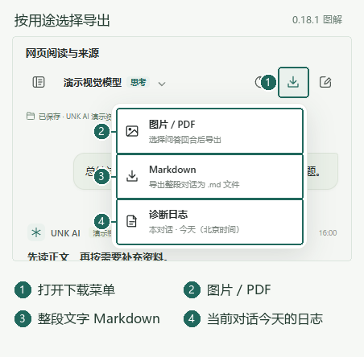

*图 11：按分享、文字留存或排障用途选择导出类型。*

分享与整段会话导出入口集中在**顶栏下载图标**，不再放在消息区的标题旁。先打开当前对话，再按用途选择图中入口：

| 选择 | 适合用途 | 导出范围 |
| --- | --- | --- |
| 图片 / PDF | 分享排版后的回答或部分问答 | 先选回合，再预览；可选择是否包含自己的提问。 |
| Markdown | 保存可编辑的整段对话文字 | 当前会话文字，可能包含模型名称、状态和 Agent 步骤；不打包附件文件。 |
| 诊断日志 | 排查等待、失败或页面操作问题 | 当前对话今天（北京时间）的运行记录，不包含对话正文、图片或密钥。 |

### 复制一条回答

点击回答下方的复制图标，选择“复制 Markdown”或“复制纯文本”。需要保留代码与排版结构时选 Markdown；粘贴到普通输入框时可选纯文本。

复制自己的提问时，先将鼠标放到提问气泡上，再移到气泡右下方的复制图标并点击。气泡到下方操作区之间可以连续移动，按钮不会因跨过间隙消失；右侧轮次刻度也不会挡住复制按钮。键盘聚焦可显示并激活复制按钮，触屏设备直接显示入口。

### 导出整段 Markdown

点击顶栏下载图标 → Markdown，在浏览器保存窗口选择位置，保存整段当前会话。它保留原来的会话 Markdown 格式，可能包含模型名称、消息状态和 Agent 步骤；不会改成 PNG / PDF 的回合选择格式，也不包含思考过程、附件文件或隐藏的页面全文。

尚未发送问题的新对话不能导出 Markdown 或图片 / PDF，但仍可查看可用的诊断记录。生成、页面任务、提交、压缩或任务重启期间，Markdown 选项暂不可用；等待保存窗口时禁止重复导出。若等待保存超时，先检查浏览器下载列表和保存窗口，再决定是否重试。切换会话会结束本地等待，已经交给浏览器的下载仍需在下载界面检查或取消。

### 导出 PNG / PDF

1. 点击顶栏下载图标，选择“图片 / PDF”。
2. 选择需要的问答回合；可全选、清空，或关闭“包含我的提问”。
3. 打开预览，检查内容和来源。
4. 选择保存 PNG 或 PDF，在浏览器下载界面确认保存结果。

一次最多 50 轮、12 万字符，本地图片合计最多 8 MiB。长图过长时减少回合或改为 PDF；PDF 最多 40 页。

PNG / PDF 导出使用固定浅色版式，不包含思考过程、推荐问题、Agent 内部步骤或隐藏的页面全文。PDF 采用图片分页，文字不能直接选取；需要可编辑文字时使用复制 Markdown，或选择顶栏下载菜单中的“Markdown”。整段会话的 Markdown 导出格式不同，可能包含模型名称和 Agent 步骤，分享前请检查内容。

所选提问含有无法恢复的图片时，需先恢复图片，或移除对应回合；也可关闭“包含我的提问”后只导出回答。未选中的缺图回合不会阻止其它回合导出。

## 12. 联网搜索、数据范围与常见问题

### 联网搜索与页面读取的区别

| 能力 | 入口 | 主要资料来源 |
| --- | --- | --- |
| 当前页阅读 | 输入框上方“基于当前页” | 本轮固定的网页，以及明确需要的同站补充章节。 |
| 本站接口读取 | 输入框底部“接口” | 经本站许可后，在本轮短暂监听窗口中新返回的同源 JSON。 |
| 全网搜索与来源读取 | 设置 → 联网检索 | 模型按问题查询的公开搜索结果，以及需要进一步读取的来源正文。 |
| 页面操作 | “页面操作”及浏览器控制授权 | 真实页面上的观察与动作，可点击、输入、滚动和导航。 |

关闭“基于当前页”不等于关闭全网搜索；开启“接口”也不等于开启联网搜索或授权页面动作。

### 配置并完成一次联网核实

1. 打开“设置 → 联网检索”，开启“启用搜索与抓取”。
2. 点击“检测接口”，或按服务商说明填写搜索与抓取接口名称；搜索与抓取沿用当前模型服务地址和密钥。
3. 保存设置。先使用能够支持流式工具调用的模型服务，再提出带明确主题、日期范围和核实要求的问题。
4. 观察“正在搜索并读取公开网页”等阶段提示；回答后展开来源，查看哪些是摘要、哪些确实读到了正文。
5. 对没有核实的部分，缩小范围继续追问，或自行打开原链接核对。

> 示例：核对最近 7 天的 AI 模型发布，区分已官宣与传闻，列出发布日期、官方原链接和仍未核实的信息。
>
> 示例：比较这两个方案目前公开的价格与配额，只引用可打开的官方资料；没有找到的数据明确留空。

联网问答需要模型服务支持流式工具调用（`tool_calls`）。测试连接成功只验证简短模型请求，不代表搜索和工具协议可用；服务拒绝工具时会显示错误，不会自动移除工具后假装完成核实。

### 模型怎样决定搜索与读取

开启联网后，普通问答的第一次主模型请求就提供搜索工具。模型按问题和已有资料决定直接回答、查询什么，以及是否进一步读取来源，整个过程继续同一条回答。

例如，上传错误截图问“这里正常吗”，模型可以直接使用图片解释；询问最新情况或明确要求核实时，则可搜索并依据结果继续分析。已有完整正文会复用，缺少资料时才请求来源读取，不会自动把每一条搜索结果都抓取一遍。页面开关开启时，必要的本页读取、补读和视觉准备仍会先按本轮要求执行。

对“今天”“最近一周”等问题，插件提供北京时间供模型核对。来源的采集时间不等于文章发布时间；核对新消息时，应要求区分发布、更新和采集日期。

### 看懂来源证据

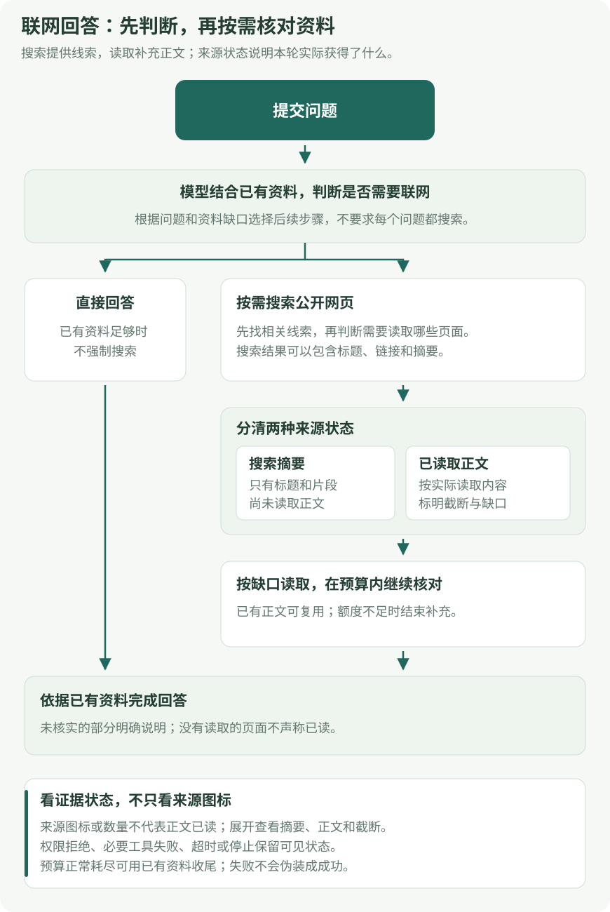

*图 16：搜到链接、取得摘要和读到正文是不同状态；核实结论时先检查来源证据。*

| 来源标记 | 能说明什么 | 不能据此认定什么 |
| --- | --- | --- |
| 搜索摘要 | 本轮拿到了搜索结果中的标题、链接或摘要。 | 不能当作已经通读原网页，摘要可能缺少条件和上下文。 |
| 已读正文 | 本轮取得了来源正文，并在预算内提供给模型。 | 不保证每个段落都被保留或引用；有截断时需按提示理解范围。 |
| 正文读取暂不可用 | 本次读取遇到临时服务错误，仍保留原搜索摘要或已有正文，并标明原来的读取范围。 | 不表示取得了新的完整正文，也不表示来源不存在。 |
| 读取状态未知 | 旧记录或资料不足，无法确认读取深度。 | 不能直接认定已读，也不能仅据此判断网站不存在。 |

只有全部来源都明确取得正文且没有待解决的读取错误时，汇总才显示“已读取 N 个来源”；混合、读取暂不可用或未知状态显示中性的来源数量。来源数不是搜索次数，也不是完整通读的文章数。网站图标失败时显示默认地球图标，正文读取状态仍以文字标记为准。

需要更强证据时，可以追问“请读取第 2 个来源的正文，核对这个结论及其适用条件；读取失败时说明原因”。资料缺失、截断或只有摘要时，回答应保留这些限制，不能将其写成已核实事实。

### 搜索额度、复用与收尾

每次回答最多 4 轮工具交互、6 次不同工具操作、3 个不同搜索查询；同批最多并行 2 项，结果还有时间和大小限制。重复查询或读取同一来源会复用本轮结果，不再扣同一操作或查询的次数，但新的工具交互仍计入轮数。

模型申请超过剩余额度时，插件先执行额度内允许的请求，告知其余请求未执行，再依据已有资料完成同一条回答，并说明尚未核实的部分。这表示本轮检索范围到达上限，可以在下一问缩小主题继续核实。模型选取的某个公开来源读取遇到临时服务错误（HTTP 500、502、503、504）时，插件会明确告知该来源未取得新正文，让模型继续核对其他资料或说明证据不足；失败来源在本轮不自动重读，已有回答和图片继续保留。

搜索失败、认证或权限拒绝、限流、取消、超时，以及用户明确要求的当前页或选区资料读取失败，仍保留对应错误或停止状态。来源地址变化、正文为空等异常也不会按临时服务错误处理。

只有服务的搜索或抓取端点返回 HTTP `404`、`405`、`501`，表明缺少该接口时，插件才尝试有界的公开网页检索或读取。认证失败、权限拒绝、限流、网络错误、取消或超时不会触发这种回退。上述来源临时服务错误也不会改用其他服务。公开读取不带登录凭据、不跟随重定向，部分网站可能无法使用。工具失败会保留可见说明，不能把没有来源的回答当作已经核验的最新消息。

### 数据发送到哪里

模型请求会把本轮使用的问题、历史、页面资料和附件内容发送给你配置的模型服务。选择本地保存不等于离线推理。PDF 文字提取在浏览器本地执行，网页搜索与资料下载仍会访问相应网站。

API Key 保存在当前浏览器，不使用操作系统级密钥库加密，也不会随对话导出。接口响应会按规则裁剪并过滤常见凭据与敏感字段，但不能保证识别全部业务敏感数据。按实际资料和所用服务决定是否开启相关能力。

### 等待或报错时怎样排查

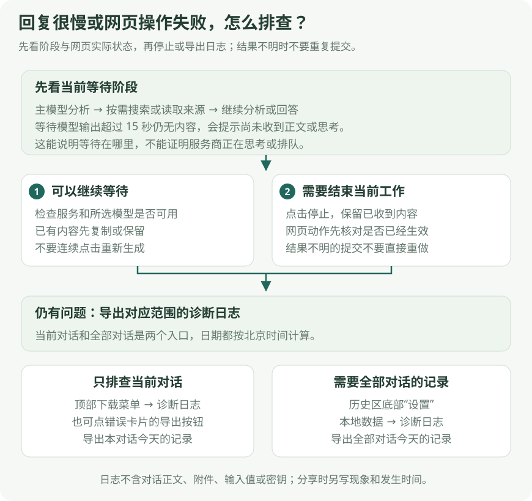

*图 12：先确认等待或失败步骤，再核对网页结果与诊断范围。*

1. 先辨认界面停在页面读取、公开搜索、模型思考，还是模型输出等待。
2. 页面操作失败时，展开任务记录，再到原页面核对实际结果；“结果不明”不能直接当成未执行。
3. 需要结束本轮时点击停止；保留要继续使用的草稿、附件和已有回复。
4. 按下表选择当前对话或全部对话的诊断范围，保存文件并记下大致时间、任务和预期结果。

### 导出诊断日志

**无需等到报错：点击顶栏下载图标 → 诊断日志**，即可导出当前对话今天（北京时间）的记录；正在生成时也能使用。菜单内已标注导出范围。

1. 先展开“浏览器任务”或错误详情查看失败步骤；完成、失败和停止的任务也能展开。
2. 点击错误消息下的“导出今天的诊断日志”，下载 **本对话今天（北京时间）** 的排障记录；需要全部对话时，进入“设置 → 本地数据 → 诊断日志”，点击“导出今天全部诊断日志”。
3. 将下载的 JSON 文件发给支持人员，并说明大致发生时间、操作和预期结果。插件不会自动发送。

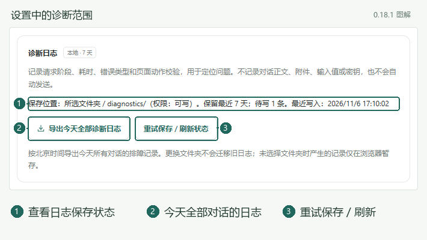

*图 13：在设置中导出今天全部诊断日志，并查看保存状态。*

| 导出入口 | 记录范围 |
| --- | --- |
| 当前对话顶栏下载 → 诊断日志 | 当前对话今天（北京时间）的记录，生成中也可使用。 |
| 错误消息 → 导出今天的诊断日志 | 该消息所属对话今天（北京时间）的记录。 |
| 设置 → 本地数据 → 导出今天全部诊断日志 | 今天所有对话的记录，用于跨对话或运行环境排查。 |

设置图中还可查看目录权限、待写和缺失数量。日志保存有问题时，点击“重试保存 / 刷新状态”，再检查反馈；它不会阻止主回复展示。

诊断日志不包含对话正文、思考、页面全文、附件、输入值或密钥；主要包含请求耗时、HTTP 状态、阶段、动作校验、错误类型和匿名关联编号。文件会说明记录覆盖范围及缺失，旧日期或功能启用前的故障不能用今天的记录还原。界面只提供今天的导出范围，遇到问题时请及时保留当天日志。导出没有记录，也不能证明网页动作从未执行；动作结果仍需到原页面核对。

日志在所选文件夹的 `diagnostics/` 下保存今天及前 6 天。浏览器关闭时不执行清理，重新运行后再维护。设置页可查看文件夹权限、待写和缺失数量，点击“重试保存 / 刷新状态”；日志故障不会阻塞回答。更换目录不迁移旧日志，未选择目录时产生的记录只在当前浏览器暂存。文件夹导出仅读取当前所选目录，同时合并可用的浏览器暂存记录。

### 常见问题速查表

| 遇到的情况 | 建议处理 |
| --- | --- |
| 安装时提示找不到清单 | 选择直接包含 `manifest.json` 的解压目录，不要选择 ZIP 或多套一层的父目录。 |
| 重新打包后界面没变 | 核对 Chrome 加载的扩展路径，替换该路径下的文件，点击重新加载并重开侧栏。 |
| 长对话里看不到标题 | 当前版本的标题固定在顶栏；核对版本和加载路径。新对话没有额外标题行，Chrome 原生栏显示默认插件名。 |
| 刚打开页面看不到滚动条 | 内容足够短时不需要滚动条；长内容区域在鼠标移入后显示。移出隐藏时仍可用滚轮，颜色随主题统一变化。 |
| 历史区盖住对话 | 窄屏采用抽屉，可点“×”或遮罩关闭；拉宽到 960 像素时会自动并排显示。 |
| 顶部历史按钮不能收起历史区 | 这个按钮用于展开；收起请点击历史区右上角“×”。 |
| Markdown 导出选项变灰 | 新对话尚无问题，或正在生成、提交、压缩、页面任务、重启及等待保存；结束相关工作后重开菜单。 |
| 无法获取模型 / 测试连接失败 | 检查服务地址、密钥、服务是否运行及模型是否可用。获取列表成功也不等于生成请求一定成功。 |
| 测试连接成功，但设置仍未生效 | 检查是否已授权文件夹并点击“保存设置”。 |
| 普通聊天正常，联网却失败 | 核对是否启用搜索与抓取，以及服务是否支持流式工具调用；连接测试不覆盖工具协议。查看具体 HTTP 状态和诊断阶段。 |
| 来源显示“搜索摘要”，却没有正文 | 本轮仅取得摘要，不能理解为已通读。缩小问题范围，明确要求读取相应来源；受限网页仍可能无法读取。 |
| 来源的网站图标变成地球 | 这是图标缺失或失败的后备显示，不代表正文读取失败；查看来源文字标记。 |
| 联网回答说部分内容未核实 | 查看是否达到本轮额度或资料被截断；把未核实事项单独提出，优先指定官方来源。 |
| 看不到页面开关或“接口” | 浏览器内部页、扩展商店等页面受限制；本地文件没有本站接口开关；Agent 模式下读取强度和接口会隐藏。 |
| 本地文件读取失败 | 在扩展详情启用“允许访问文件网址”，重新打开文件后再试。具体文件仍需有可读内容。 |
| 页面里有内容，但读取失败或不完整 | 等待加载，核对原页面，重试或选择“深入”；跨域框架、懒加载、自绘内容和登录限制仍可能无法读取。 |
| 开了接口却没有数据 | 按钮只授权；新请求窗口内必须出现符合范围的 JSON。历史请求、跨站接口、WebSocket 和非 JSON 不在当前范围。 |
| 追问显示复用，但我需要最新数据 | 明确要求“最新、重新采集、不用缓存”；没有新响应仍可能采集不到。 |
| 读不到图片 / 上传按钮不可用 | 选择支持视觉的模型，检查文件格式与大小；任务运行中部分附件操作禁用。扫描版 PDF 可改为提供关键页图片。 |
| 图片放大后仍看不清小字 | 原始尺寸显示的是当前附件像素，无法恢复上传缩放丢失的细节；裁剪关键区域后重新上传。 |
| 滚轮变成缩放，怎样看长图下方 | 按住左键向上拖动图片，或聚焦预览区后按方向键；触屏可单指拖动。 |
| 图片缩放或位置不合适 | 点击“适应宽度”或聚焦预览区后按 0 复位；双击图片区域可在适应宽度和 100% 之间切换。 |
| 选中文字后没有引用菜单 | 确认选中的是同一条助手回答正文，不是思考、输入框、按钮或跨多条消息的文字。 |
| 刚选的引用没有进入输入框 | 在选区旁的注释框点击“✓”或按 Enter 后才加入；取消或 Esc 不会添加。 |
| 引用太多或注释太长 | 展开“N 条引用注释”精简内容；每次最多 8 条，单条注释 2000 字符，注释总计 8000 字符。 |
| 又选一段原文，为什么还是同一个追问窗口 | 同一主对话会复用仍在跟踪的首次追问；新选区用于下一问。关闭窗口后再次单独追问才新建分支。 |
| 收起追问后还在生成 | 收起只隐藏窗口，光环提示仍在运行；要结束请求请展开并停止，或关闭窗口。 |
| 未读小点展开后不再出现 | 展开已清除本次完成提醒，再次收起不会重复提示；只有新的未查看成功回答会再显示。 |
| 旧追问显示“已切换主对话” | 旧窗口已脱离选区跟踪，仍可独立续聊；新选区另开追问，回到旧主对话也不重新绑定。 |
| 不能从历史打开或删除某个追问 | 正在运行时先停止；打开会把对话从浮窗移到主区，删除前需先关闭浮窗。 |
| 没看到“下一步探索” | 无合适问题或辅助推荐失败时可不显示；主回答已经完成即可正常使用。推荐不是每轮必须出现。 |
| 新对话或历史操作变灰 | 先等待生成、准备、整理或页面任务结束；有队列时先处理队列。 |
| 新建后切走，在历史找不到刚才的空对话 | 未发送的对话不保存；只输入草稿、添加引用或打开空追问都不等于发送。 |
| 点停止后又开始回答另一问 | 停止不会清空队列；检查并撤回剩余排队问题，避免下一项继续执行。 |
| Agent 暂停了 | 查看任务提示；切页、手动操作、导航和授权变化都可能暂停任务，确认状态后继续。 |
| 页面操作确认框太多 | 在“设置 → 浏览器控制 → 操作确认方式”选择“自动批准操作”，对新任务或明确继续的任务生效；新站点仍需授权。 |
| 任务达到时间或步数上限 | 在浏览器控制设置中增大对应总预算，或选择“不限制”；新任务或继续任务时应用。结果不明、连续失败或无进展仍会停止。 |
| 重新开始任务不可用 | 先结束当前工作，开启页面开关；再根据提示核对原标签页、完整地址、浏览器窗口和图片文件。 |
| 图片卡片显示文件缺失 | 恢复原数据目录中的 `images/` 文件和权限，或回退原提问重新添加；不要只修改图片路径假装内容已经恢复。 |
| 网页有上传预览，但任务仍然失败 | 展开任务记录查看实际失败步骤，到网页核对生成或提交结果；预览出现不等于服务器处理完成。 |
| 等待模型超过 15 秒仍没有内容 | 可继续等待或停止，检查模型服务；顶栏诊断日志在等待期间仍可导出。计时不代表服务商已经开始思考。 |
| “立即整理”点击没有反应 | 当前手动按钮未接入执行。自动整理流程保留；必要时减少材料或新建对话。 |
| 回答只有思考、被截断或中途报错 | 这不算完整成功。检查服务和输出上限后重试；需要保留的已有内容先复制。 |
| 显示待同步，不确定有没有保存 | 浏览器记录与文件夹同步是两步，恢复原目录权限并检查同步结果，不要把“待同步”当作已经写盘。 |

当前未提供通用 MCP 工具接入、自定义 Skill 执行、长期记忆或关闭侧栏后的无人值守 Agent。不同网站、模型服务和 Chrome 生命周期下的行为可能不同，遇到不支持或资料缺口提示时以本轮实际结果为准。

## 13. 常用任务速查

| 我要做什么 | 推荐入口 / 设置 |
| --- | --- |
| 解释一个普通概念 | 关闭“基于当前页”，直接提问。 |
| 围绕回答中的几句话逐条提问 | 选中正文 → 引用到当前对话 → 添加并确认注释，检查汇总后发送。 |
| 单独研究回答中的一个分支 | 选中正文 → 单独追问这段内容，在独立窗口发送；可拖动、调整大小或收起。 |
| 把独立追问作为主要对话 | 结束相关任务后，在追问窗口“替换当前对话”，或从历史打开它。 |
| 继续回答给出的推荐方向 | 点击“下一步探索”会直接发送；需要修改时先自行写入输入框。 |
| 总结当前文章 | 开启页面开关，保留“自动”，使用“总结当前页”或自行提问。 |
| 阅读在线 PDF | 开启页面开关，要求提炼观点和可核实页码；也可下载后从文档入口上传。 |
| 了解 GitHub 项目 | 打开目标仓库，明确要求说明项目用途、入口和运行方式，核对实际读取范围。 |
| 核实最新消息或价格 | 设置中开启搜索与抓取，明确时间与官方来源要求，回答后检查摘要 / 正文标记。 |
| 核对复杂配置和表格 | 先用“自动”；资料不足时选择“深入”，明确要核对的字段。 |
| 查看网站新返回的数据 | 普通页面问答中允许“接口”，明确问题，并检查是否实际采集成功。 |
| 找本站其他章节 | 明确写出章节名称或关键词，要求给出实际读取的来源。 |
| 点击、筛选或导航网页 | 开启浏览器控制和页面开关，进入“页面操作”，按提示授权。 |
| 分析系统截图 | 使用视觉模型，在“＋”上传图片或直接粘贴截图。 |
| 看清图片里的细节 | 点击缩略图，滚轮缩放、拖动定位；“原始尺寸”查看 100%，“适应宽度”复位。必要时重新上传关键区域裁剪图。 |
| 分析独立文档 | 关闭页面开关，上传文档并描述任务。 |
| 看会话占用多少容量 | 悬停或点击发送按钮左侧的叠层图标。 |
| 分享回答 | 单条内容用复制；多轮用顶栏导出 PNG / PDF 或 Markdown。 |
| 让历史和对话同时可见 | 把侧栏拉宽到至少 960 像素；需要更多对话空间时用历史区“×”收起。 |
| 修改原问题及其图片 | 停止当前工作后，悬停原提问，点击“回退并重新编辑”，检查恢复的附件后发送。 |
| 重新开始失败的网页任务 | 开启页面开关，在原任务卡片点击“重新开始任务”；先核对网页有没有已经完成的动作。 |
| 找到或备份提问图片 | 查看“设置 → 本地数据”当前目录，一起备份 `conversations/` 和 `images/`。 |
| 排查当前对话报错或等待 | 顶栏下载 → 诊断日志；所有对话的今天记录在设置 → 本地数据导出。 |

### 常用快捷键与手势

| 所在位置 | 快捷键 / 手势 | 作用 |
| --- | --- | --- |
| Chrome | Alt + U | 打开或切换 UNK AI 侧栏；可在扩展快捷键页修改。 |
| 主聊天输入框 | Enter / Shift + Enter | 发送 / 换行；输入法选字时 Enter 先确认文字。 |
| 引用注释输入框 | Enter / Shift + Enter / Esc | 确认引用 / 换行 / 取消本次添加。 |
| 图片缩略图 | Tab 聚焦后 Enter 或空格 | 打开放大预览。 |
| 图片预览区 | 滚轮 / 左键拖动 / 单指拖动 | 缩放 / 移动查看超出窗口的内容。 |
| 图片预览区 | 双击 | 切换适应宽度与原始尺寸 100%。 |
| 图片预览区获得焦点后 | 方向键 / Shift + 方向键 | 小幅 / 较大幅度移动视野。 |
| 图片预览区获得焦点后 | ＋ / － / 0 | 放大 / 缩小 / 回到适应宽度。 |
| 图片预览 | Esc 或点击遮罩 | 关闭预览。 |
| 追问窗口 | 拖动标题栏 / 右下角 | 移动 / 调整大小。 |
| 追问调整大小按钮 | 方向键 / Shift + 方向键 | 小幅 / 较大幅度调整窗口。 |
| 追问窗口 | 拖至右边缘或点击收起 | 收起到对话图标，保留任务与草稿。 |
| 来源列表 | Esc | 优先关闭来源弹层；已关闭后留意 Esc 对当前窗口的作用。 |
| 窄屏历史抽屉 | Esc | 无编辑、批量选择和子菜单时关闭抽屉。 |
| 历史对话 | 长按后拖动 / Esc | 移入目标分组 / 取消拖动。 |

### 一次完整的使用示例

1. 打开一篇技术文章，开启“基于当前页”，发送“总结核心方案、适用条件和局限”。
2. 查看来源，确认实际读取范围；表格或配置遗漏时，明确指出缺失字段，再用“深入”补读。
3. 引用回答中的两处结论，分别添加“补充证据”和“解释风险”，在同一问题中逐条核对。
4. 对其中一个值得展开的主题使用“单独追问这段内容”，发送后收起窗口，继续阅读主对话。
5. 收起图标出现未读小点后展开查看。若该分支需要持续研究，结束任务后将其替换到主聊天区。
6. 核对保存状态，按需要分组；选取最终问答导出 PDF，或导出 Markdown 继续编辑。完整备份时同时保留会话和图片目录。

本手册按当前源码、界面和行为测试核对。配图只用于说明布局，不代表已在所有网站与模型服务中完成实测。项目简介与安装方式见 [README](../README.md)。
